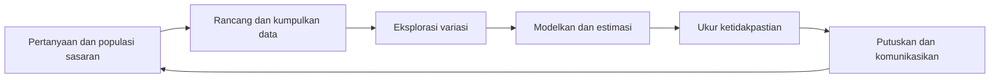
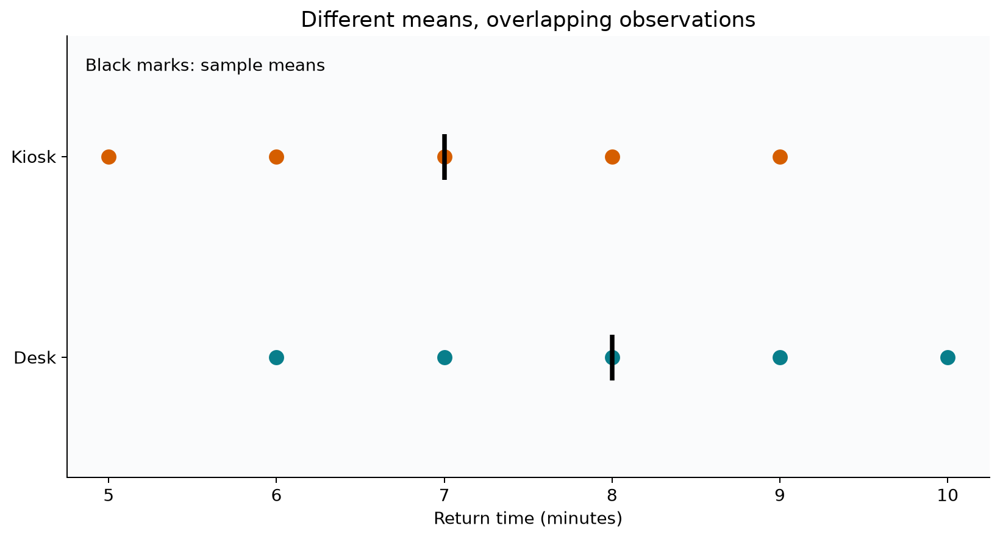
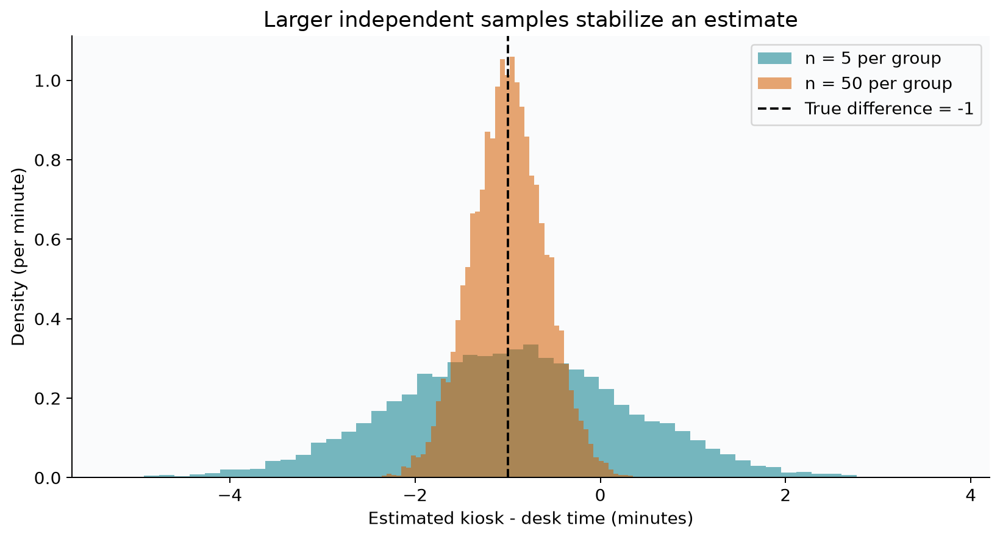

# 00 · Belajar bernalar dengan data

Statistika menghubungkan pertanyaan tentang dunia dengan kesimpulan yang mengakui adanya ketidakpastian. Suatu perhitungan baru menjadi berguna setelah kita mengetahui apa yang diukur, bagaimana pengamatan diperoleh, dan klaim mana yang ingin kita nilai.

**Alur pembelajaran:** pertanyaan → rancangan → deskripsi → inferensi → keputusan. Baca [prasyarat](../AA_Prerequisite/AA_Prerequisite.md) setiap kali notasi atau Python menjadi kendala. Bab ini hanya memerlukan aritmetika.

## 1. Mulailah dengan pertanyaan yang dapat diukur

Misalkan sebuah perpustakaan sedang mempertimbangkan dua cara untuk mengembalikan peralatan yang dipinjam. Apakah meja layanan dengan petugas atau kios layanan mandiri lebih cepat? “Lebih baik” belum merupakan pertanyaan statistik. Lebih baik bisa berarti waktu rata-rata yang lebih singkat, lebih sedikit waktu tunggu yang sangat lama, lebih sedikit kesalahan, atau biaya yang lebih rendah. Masing-masing memerlukan ukuran hasil yang berbeda.

Kita memilih **durasi pengembalian dalam menit** dan menanyakan pengembalian yang memenuhi kriteria pada hari kerja di perpustakaan ini selama periode akademik berikutnya. Satu baris mewakili satu pengembalian, dengan metode, tanggal, dan durasinya. Tentukan kapan pencatatan waktu dimulai dan dihentikan sebelum mengumpulkan data. Menghitung waktu hanya setelah pengguna mencapai meja layanan akan menjawab pertanyaan yang berbeda dari menghitung waktu sejak pengguna mulai mengantre.

**Populasi** adalah kumpulan unit atau hasil yang menjadi sasaran pertanyaan kita. **Sampel** adalah bagian dari populasi yang diamati. **Parameter** adalah karakteristik numerik dari populasi atau model probabilitas. **Statistik** adalah fungsi dari sampel yang diamati. Sasaran kita, atau **estimand**, adalah

$$\Delta=\mu_{\mathrm{kiosk}}-\mu_{\mathrm{desk}}.$$

Nilai negatif berarti kios lebih cepat secara rata-rata. Menuliskan konvensi tanda ini sejak awal mencegah kita membalik kesimpulan nantinya. Hal ini juga membedakan perbandingan pada tingkat populasi dari selisih yang diamati antara dua rata-rata sampel.

## 2. Empat tugas yang terdengar serupa tetapi berbeda

| Tugas | Contoh pertanyaan | Yang diperlukan |
|---|---|---|
| Deskripsi | Berapa waktu pengembalian yang diamati? | Ringkasan dan grafik yang jelas |
| Estimasi | Berapa selisih rata-rata pada populasi sasaran? | Rancangan yang sesuai dan estimasi ketidakpastian |
| Prediksi | Berapa lama pengembalian berikutnya akan berlangsung? | Model yang bekerja dengan baik untuk pengembalian mendatang |
| Inferensi kausal | Apa yang akan berubah jika kita menempatkan pengguna yang sama dan memenuhi kriteria ke metode yang lain? | Rancangan atau asumsi yang dapat dipertanggungjawabkan untuk mengidentifikasi dampak intervensi tersebut |

Garis yang dicocokkan dengan data dapat memprediksi dengan baik tanpa mengidentifikasi penyebab. Pengguna yang memilih kios mungkin sudah terbiasa dengan peralatan tersebut. Perbandingan antarrelawan akan mencampurkan perbedaan metode dengan perbedaan pengguna. Penempatan secara acak membantu membuat kelompok perlakuan sebanding secara rata-rata dalam pengacakan berulang. Pengambilan sampel secara acak memiliki tujuan yang berbeda: mendukung generalisasi ke populasi sasaran. Keduanya tidak menjamin keseimbangan sempurna atau pengukuran sempurna dalam suatu studi tertentu.

## 3. Contoh lengkap pertama

Perhatikan waktu pengembalian **rekaan** berikut. Jumlah datanya cukup sedikit untuk dihitung secara manual dan bukan merupakan bukti tentang perpustakaan yang sebenarnya.

| Metode | Waktu, dalam menit | Rata-rata |
|---|---|---:|
| Meja layanan | 6, 8, 7, 9, 10 | 8 |
| Kios | 5, 7, 6, 8, 9 | 7 |

Estimasi selisihnya adalah $7-8=-1$ menit. Ini merupakan fakta deskriptif tentang sepuluh pengamatan tersebut. Hasil ini tidak memberi tahu kita apakah sampel lain akan menunjukkan selisih yang sama, ataupun apakah proses pengambilan sampelnya mewakili pengguna pada periode akademik berikutnya.

Titik-titik memperlihatkan data yang tersembunyi di balik rata-rata: kedua kelompok banyak bertumpang tindih. Tumpang tindih saja bukanlah uji hipotesis. Demikian pula, rata-rata sampel yang berbeda saja bukanlah bukti adanya perbedaan populasi. Bab-bab berikutnya membandingkan estimasi selisih dengan ketidakpastian akibat pengambilan sampelnya.

**Eksperimen notebook:** hitung kedua rata-rata, lalu ganti hanya waktu kios terakhir menjadi 20. Prediksi bagaimana rata-ratanya berubah sebelum menjalankan sel. Pengamatan mana yang menyebabkan perubahan tersebut, dan apakah median akan berubah sebesar itu juga?

<!-- lab: first_comparison -->

## 4. Mengapa sampel yang diambil berulang kali memberikan hasil berbeda

Bayangkan kita dapat berulang kali mengambil sampel lima pengembalian melalui meja layanan dan lima pengembalian melalui kios dari proses yang stabil. Setiap pengulangan menghasilkan pengamatan yang berbeda sehingga estimasi selisihnya juga berbeda. Distribusi dari estimasi-estimasi tersebut disebut **distribusi sampling**.

Simulasi berikut mengasumsikan dua populasi berdistribusi normal dengan rata-rata 8 dan 7 menit serta simpangan baku yang sama, yaitu 2 menit. Nilai-nilai ini merupakan masukan yang diketahui dalam simulasi pembelajaran, bukan estimasi yang dapat dibenarkan berdasarkan sepuluh angka di atas. Sampel-sampelnya independen. Estimand yang disimulasikan tepat sebesar $-1$ menit, tetapi beberapa estimasi selisih bernilai positif.

Bandingkan lima pengamatan per kelompok dengan lima puluh. Sampel independen yang lebih besar membuat estimasi lebih stabil di sekitar nilai sebenarnya. Sampel tersebut tidak menghilangkan variasi pengembalian individual. Sampel yang lebih besar juga tidak dapat memperbaiki pemilihan sistematis yang hanya menyertakan pengguna kios yang cepat. Itulah **bias**, masalah yang berbeda dari variasi akibat pengambilan sampel.

**Membaca grafik:** garis putus-putus menandai selisih populasi yang diketahui. Sumbu horizontal menunjukkan estimasi selisih, bukan waktu pengembalian individual. Sumbu kepadatan diatur skalanya sehingga luas setiap histogram sama dengan satu. Memperbesar ukuran sampel memusatkan estimasi di dekat garis putus-putus.

<!-- lab: repeated_samples -->

## 5. Alur kerja statistik yang berguna

1. **Tentukan klaim.** Sebutkan ukuran hasil, satuan, populasi, perbandingan, dan periode waktu. Nyatakan besar efek yang akan bermakna dalam praktik.
2. **Rancang studi.** Identifikasi unit pengamatan yang independen. Rencanakan pengambilan sampel, penempatan ke kelompok, penanganan data yang hilang, dan ukuran sampel.
3. **Perhatikan pengamatan.** Periksa satuan, duplikasi, nilai yang hilang, titik yang tidak biasa, dan grafik sebelum mencocokkan model.
4. **Lakukan estimasi dan ukur ketidakpastian.** Laporkan efek dalam satuan yang bermakna beserta intervalnya, dengan asumsi yang dinyatakan secara eksplisit.
5. **Periksa analisis.** Tanyakan apakah pengelompokan, pola nonlinier, pengamatan yang tidak biasa, atau analisis berganda mengubah interpretasi.
6. **Komunikasikan cakupan.** Nyatakan apa yang didukung oleh bukti, apa yang masih belum pasti, dan data tambahan apa yang akan membantu.

Suatu analisis dapat direproduksi ketika orang lain dapat memperoleh hasil komputasi yang sama dari masukan dan langkah-langkah yang dicatat. Keterulangan hasil tidak membuktikan bahwa rancangan tersebut menjawab pertanyaan ilmiah. Notebook membuat perhitungan dapat direproduksi; catatan penjelasan mengajarkan cara mengevaluasi relevansinya.

## 6. Cara menggunakan repositori ini

Baca satu bagian, prediksi apa yang seharusnya ditunjukkan oleh grafik atau perhitungannya, lalu jalankan sel notebook yang sesuai. Ubah satu masukan pada satu waktu. Jelaskan hasil yang berubah dalam satu kalimat sebelum melanjutkan. Untuk simulasi, bandingkan hasil numerik dengan acuan teoretisnya; seed acak yang tetap membuat eksperimen dapat diulang, tetapi tidak membuat asumsinya menjadi benar.

Setiap bab memiliki `<folder_name>.md`, `<folder_name>.ipynb`, dan direktori `figure/`. Notebook memuat kembali catatan dan menyelinginya dengan eksperimen yang dapat dijalankan. Gambar-gambarnya merupakan karya asli dan dihasilkan oleh kode notebook. Diagram Mermaid merangkum alur suatu bab; teks juga menjelaskan alur tersebut karena tidak semua penampil notebook dapat menampilkan Mermaid.

Urutan bab mengikuti topik-topik umum dalam buku Josh Starmer. Penjelasan, kumpulan data, latihan, dan grafik ditulis secara independen. Definisi formal dan langkah pencegahan tambahan disertakan ketika intuisi saja dapat menyesatkan. Berkas buku yang bersifat privat tidak diperlukan untuk menjalankan materi pembelajaran ini. Lihat [Referensi](../Reference.md) untuk atribusi dan [panduan publikasi](../PUBLICATION.md) untuk penanganan sumber.

## 7. Latihan

Cobalah soal-soal berikut sebelum membaca jawabannya.

1. Sebuah arsip mencatat waktu yang diperlukan untuk **setiap pengembalian dari seluruh 40 pengembalian hari ini**. Apakah rata-ratanya merupakan rata-rata populasi atau rata-rata sampel?
2. Perpustakaan kedua mengamati waktu pengembalian melalui loker sebesar 3, 4, 5, 8 menit dan waktu melalui meja layanan sebesar 5, 6, 7, 10 menit. Hitung loker dikurangi meja layanan. Dapatkah Anda menyimpulkan bahwa loker menyebabkan pengembalian yang lebih cepat?
3. Seorang analis mengumpulkan 50.000 catatan dari pengguna yang secara sukarela mencoba kios. Masalah apa yang diselesaikan oleh sampel besar tersebut, dan apa yang tetap belum terselesaikan?
4. Mengapa memprediksi pengembalian berikutnya umumnya lebih sulit daripada mengestimasi rata-rata waktu pengembalian?

## 8. Pembahasan jawaban

1. Untuk 40 pengembalian hari ini, nilai tersebut merupakan rata-rata populasi. Untuk pengembalian bulan depan atau proses pengembalian yang terus berlangsung, nilai tersebut merupakan estimasi berdasarkan sampel. Sasaran menentukan penyebutannya.

   **Label (penyebutan)** berarti nama statistik yang kita berikan pada rata-rata yang dihitung: **rata-rata populasi** atau **rata-rata sampel yang digunakan untuk mengestimasi rata-rata populasi**. **Target (sasaran)** berarti kumpulan pengembalian yang ingin kita ketahui rata-ratanya, yang juga disebut **populasi sasaran**.

   Jika pertanyaannya **“Berapa rata-rata waktu pengembalian untuk 40 pengembalian hari ini?”**, sasarannya tepat 40 pengembalian tersebut. Karena arsip mencatat semuanya, kita memiliki seluruh populasi sasaran, sehingga rata-ratanya merupakan rata-rata populasi.

   Jika pertanyaannya **“Berapa rata-rata waktu pengembalian bulan depan?”**, sasarannya adalah pengembalian bulan depan. Sebanyak 40 pengamatan hari ini merupakan data historis untuk mengestimasi rata-rata mendatang; data itu bukan seluruh populasi sasaran dan bukan sampel yang benar-benar diambil dari bulan depan. Penggunaan ini memerlukan asumsi bahwa kondisi hari ini dapat memberi informasi tentang kondisi bulan depan. Demikian pula, untuk proses pengembalian yang terus berlangsung, pengembalian hari ini hanya mencakup sebagian dari proses yang ingin kita pahami.

   **Angka hasil perhitungannya tetap sama, tetapi peran statistiknya berubah sesuai pertanyaan.** Memiliki seluruh data hari ini tidak berarti memiliki seluruh data untuk setiap sasaran yang mungkin diteliti.

2. Rata-ratanya adalah $20/4=5$ dan $28/4=7$, sehingga selisih yang diamati adalah $-2$ menit. Tanpa informasi tentang penempatan ke kelompok dan keterbandingannya, ini merupakan asosiasi, bukan efek kausal yang telah terbukti.

   **Assignment (penempatan ke kelompok)** berarti bagaimana pengguna masuk ke masing-masing kelompok: siapa menggunakan loker dan siapa menggunakan meja layanan dengan petugas. Apakah pengguna dibagi secara acak, memilih sendiri, atau diarahkan petugas? Jika memilih sendiri, pengguna yang hanya mengembalikan satu barang mungkin lebih sering memilih loker.

   **Comparability (kesebandingan kelompok)** berarti apakah kedua kelompok cukup serupa dalam faktor lain yang memengaruhi waktu pengembalian sehingga dapat dibandingkan secara adil. Misalnya, apakah jumlah barang yang dikembalikan, keramaian saat kedatangan, dan kerumitan urusannya serupa? Jika pengguna meja layanan mengembalikan lebih banyak barang atau perlu menyelesaikan denda, perbandingannya belum tentu adil.

   Data tersebut mendukung pernyataan: **“Dalam pengamatan ini, pengguna loker rata-rata selesai 2 menit lebih cepat daripada pengguna meja layanan.”** Data tersebut belum membuktikan klaim kausal: **“Menggunakan loker menyebabkan waktu pengembalian rata-rata menjadi 2 menit lebih singkat.”**

   Selisihnya bisa berasal dari cara pengembalian, perbedaan kondisi pengguna, atau keduanya. **Pembagian secara acak (random assignment) membantu membuat kelompok sebanding**, sehingga kita lebih dapat menilai pengaruh cara pengembaliannya sendiri. Pembagian acak tidak menjamin keseimbangan sempurna dalam suatu studi tertentu, terutama dengan hanya empat pengamatan per kelompok, dan estimasi efeknya tetap memiliki ketidakpastian.

3. Lebih banyak catatan yang independen dapat mengurangi variasi akibat pengambilan sampel dalam proses yang disampel. Catatan tersebut tidak menjamin bahwa relawan mewakili mereka yang tidak menjadi relawan, memperbaiki kesalahan pengukuran, atau menghilangkan pengaruh faktor perancu.

   **Sampling variability (variasi akibat pengambilan sampel)** berarti suatu estimasi berubah dari satu sampel ke sampel lain hanya karena kebetulan. Misalkan kita berulang kali mengumpulkan waktu pengembalian dari pengguna yang secara sukarela mencoba kios dalam kondisi serupa. Satu sampel mungkin memuat lebih banyak pengembalian yang sangat cepat, sedangkan sampel lain memuat lebih banyak pengembalian yang sangat lambat. Dengan 50.000 pengamatan independen dibandingkan 50, perbedaan kebetulan ini biasanya lebih kecil pengaruhnya terhadap rata-rata, sehingga rata-rata dari sampel yang diambil berulang kali cenderung lebih berdekatan. Estimasinya menjadi lebih presisi; variasi waktu setiap pengembalian individual tidak otomatis berkurang.

   **Catatan yang independen** berarti pengamatan tidak saling bergantung. Misalnya, pengembalian berulang oleh orang yang sama mungkin saling berkaitan karena orang tersebut membawa kebiasaan dan tingkat pengalaman yang sama pada setiap kunjungan. Karena itu, 50.000 catatan dari sejumlah kecil pengguna yang sering datang dapat memberikan lebih sedikit informasi daripada 50.000 pengembalian independen. Jumlah baris saja tidak menunjukkan seberapa banyak informasi independen yang kita miliki.

   **“Dalam proses yang disampel”** membatasi apa yang diperbaiki oleh sampel yang lebih besar. Di sini, data berasal dari orang yang secara sukarela menggunakan kios dalam kondisi studi tersebut. Mengumpulkan lebih banyak pengamatan melalui proses yang sama dapat membuat estimasi rata-rata untuk para relawan itu lebih stabil. Kesimpulannya tidak otomatis berlaku bagi seluruh pengguna perpustakaan atau kondisi yang berbeda.

   **Relawan belum tentu mewakili mereka yang tidak menjadi relawan.** Orang yang terbiasa dengan teknologi mungkin lebih bersedia mencoba kios dan membutuhkan lebih sedikit waktu untuk menggunakannya. Orang yang menghindari kios mungkin memerlukan lebih banyak bantuan. Bahkan 50.000 relawan dapat tetap kurang mewakili kelompok kedua. Ini merupakan kemungkinan bias seleksi: perbedaan sistematis antara orang yang diamati dan populasi yang ingin kita pahami. Untuk mengatasinya, diperlukan rancangan pengambilan sampel yang sesuai atau penyesuaian yang dapat dipertanggungjawabkan, bukan sekadar merekrut lebih banyak relawan.

   **Measurement error (kesalahan pengukuran)** berarti nilai yang tercatat berbeda dari nilai yang ingin kita ukur. Kesalahan dapat bersifat acak, seperti perbedaan kecil yang tidak disengaja saat menghentikan stopwatch, atau sistematis, seperti selalu tidak memasukkan waktu tunggu. Misalkan durasi yang ingin diukur mencakup waktu tunggu, tetapi pencatatan waktu selalu dimulai setelah pengguna menunggu dua menit. Pengembalian yang sebenarnya berlangsung tujuh menit tercatat sebagai lima menit. Setiap durasi yang tercatat kemudian menjadi dua menit terlalu singkat. Sampel yang lebih besar dapat mengestimasi rata-rata yang salah ukur itu dengan lebih presisi, tetapi dua menit yang tidak tercatat tetap hilang. Kita perlu memperbaiki kapan pencatatan waktu dimulai: **lebih banyak catatan tidak memperbaiki kesalahan pengukuran yang sistematis**.

   **Confounding (pengaruh faktor perancu)** terjadi ketika faktor lain memengaruhi cara pengembalian yang digunakan sekaligus waktu pengembalian, sehingga pengaruhnya bercampur dengan efek cara pengembalian itu sendiri. Misalnya, pengalaman menggunakan kios sebelumnya dapat membuat pengguna lebih bersedia menjadi relawan untuk kios sekaligus membantu mereka selesai lebih cepat. Jika kita membandingkan relawan ini dengan pengguna meja layanan, rata-rata kios yang lebih singkat bisa sebagian mencerminkan pengalaman. Masalah ini dapat tetap muncul meskipun setiap waktu pengembalian diukur dengan benar. Menambah pengamatan saja tidak dapat memisahkan pengaruh tersebut. Pembagian secara acak dapat membantu; perbandingan observasional memerlukan rancangan atau penyesuaian yang sesuai serta asumsi yang dapat dipertanggungjawabkan.

   **Sampel yang lebih besar dapat membuat estimasi lebih presisi tanpa membuatnya akurat untuk sasaran yang dimaksud atau membuktikan hubungan sebab-akibat.** Ukuran sampel, siapa yang diamati, bagaimana waktu diukur, dan bagaimana kelompok dibentuk menjawab bagian masalah yang berbeda.

4. Individu yang akan diamati di masa mendatang memiliki variasinya sendiri di samping ketidakpastian tentang rata-rata. Merata-ratakan banyak pengamatan dapat mengurangi ketidakpastian tentang rata-rata, tetapi tidak dapat membuat setiap individu menjadi identik.

<!-- lab: practice -->

## Referensi dan langkah berikutnya

Kaitan bacaan: Starmer, *The StatQuest Illustrated Guide to Statistics* (2026), bagian awal dan Bab 1. Lihat [SQ dalam daftar referensi](../Reference.md#sq-statquest). Contoh dan alur kerja di sini merupakan materi pembelajaran asli.

Berikutnya: [01 · Konsep dasar](../01_Fundamental_Concepts_in_Statistics/01_Fundamental_Concepts_in_Statistics.md).
