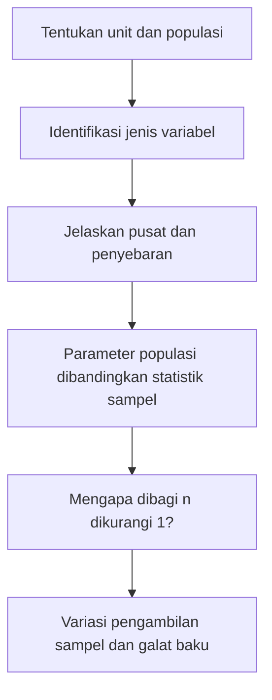
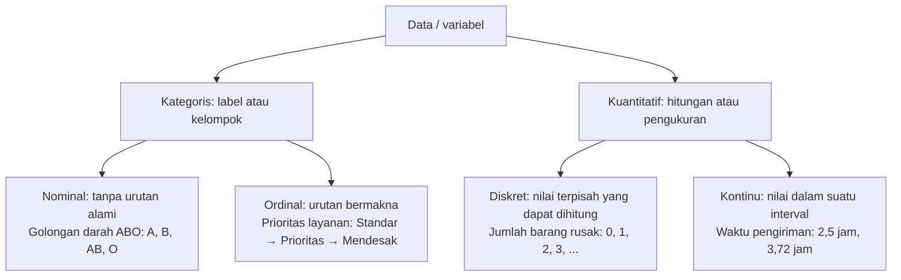
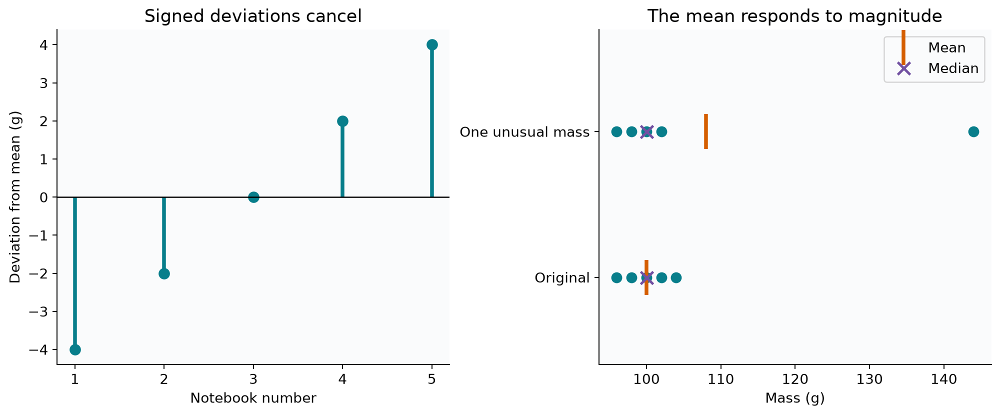
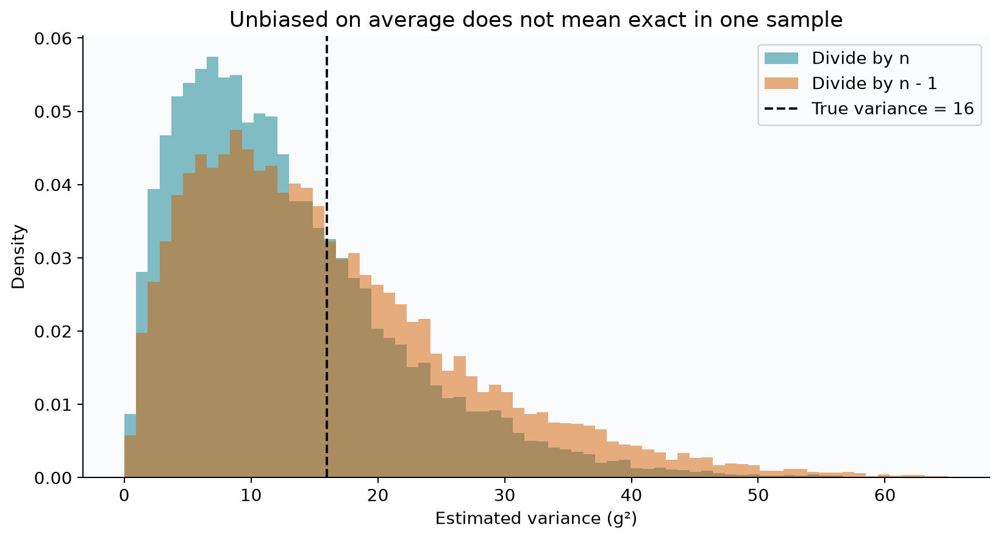
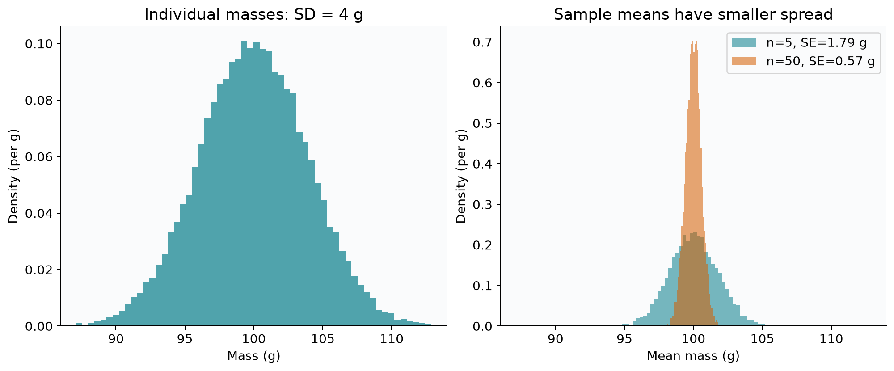

# 01 · Populasi, sampel, dan variasi

Rata-rata menunjukkan titik keseimbangan pengamatan; simpangan baku menunjukkan seberapa lebar variasinya. Ketika kita hanya mengamati sampel, keduanya merupakan estimasi. Memahami perbedaan antara penyebaran pengamatan dan ketidakpastian estimasi merupakan dasar inferensi.

**Alur pembelajaran:** jenis data → ringkasan deskriptif → estimasi → ketidakpastian. Prasyarat: penjumlahan, kuadrat, dan akar kuadrat; lihat [AA](../AA_Prerequisite/AA_Prerequisite.md).

## 1. Apa yang dimaksud dengan satu pengamatan?

Misalkan kita mengukur massa buku tulis yang dikemas oleh sebuah bengkel alat tulis kecil. Unit pengamatannya adalah satu buku tulis, variabel numeriknya adalah massa dalam gram, dan populasi sasarannya dapat berupa seluruh buku tulis yang dibuat bengkel tersebut minggu ini. “Seluruh buku tulis di mana pun” merupakan populasi yang berbeda dan tidak terwakili hanya dengan mengumpulkan lebih banyak pengukuran di satu bengkel.

### Data dan variabel: pohon klasifikasi

**Variabel** adalah karakteristik yang dicatat untuk setiap unit pengamatan, seperti warna sampul atau massa sebuah buku tulis. **Data** adalah nilai-nilai variabel yang diamati: misalnya, “biru” untuk warna sampul dan “96 gram” untuk massa. Dalam tabel data yang umum, setiap baris mewakili satu unit dan setiap kolom mewakili satu variabel.

Variabel terbagi menjadi dua kelompok besar: variabel **kategoris** menggambarkan label atau kelompok, sedangkan variabel **kuantitatif (numerik)** menggambarkan hasil hitungan atau pengukuran. Variabel kategoris mencakup **nominal** dan **ordinal**; variabel kuantitatif mencakup **diskret** dan **kontinu**.

| Jenis variabel | Makna | Contoh | Apa yang dapat disimpulkan dari nilainya |
|---|---|---|---|
| **Nominal (kategoris)** | Kategori tanpa peringkat alami atau jarak numerik | Golongan darah ABO: A, B, AB, O; warna sampul buku tulis: biru, merah, hijau | Kita dapat membandingkan keanggotaan kategori dan menghitung frekuensinya. Golongan darah A tidak “lebih tinggi” daripada B, dan mengurangkan labelnya tidak bermakna. |
| **Ordinal (kategoris)** | Kategori dengan urutan bermakna, tetapi tidak menyiratkan jarak yang sama | Tingkat layanan yang ditetapkan dari paling rendah hingga paling tinggi urgensinya: Standar → Prioritas → Mendesak | Mendesak berperingkat di atas Prioritas, tetapi jarak dari Standar ke Prioritas belum tentu sama dengan jarak dari Prioritas ke Mendesak. |
| **Diskret (kuantitatif)** | Nilai numerik dari himpunan berhingga atau himpunan yang dapat dihitung | Jumlah barang rusak dalam satu paket: 0, 1, 2, 3, ... | Satu paket dapat memuat 2 atau 3 barang rusak, tetapi bukan 2,5 barang rusak. Selisih jumlah barang bermakna. |
| **Kontinu (kuantitatif)** | Pengukuran yang dimodelkan dapat mengambil nilai apa pun dalam suatu interval | Waktu pengiriman: 2,5 atau 3,72 jam; massa buku tulis dalam gram | Nilai di antaranya, seperti 2,51 jam, mungkin terjadi. Selisih numerik menggambarkan besaran waktu atau massa. |

**Adanya urutan tidak berarti jaraknya sama.** Memberi kode 1, 2, dan 3 pada Standar, Prioritas, dan Mendesak mempertahankan urutannya, tetapi tidak membuktikan bahwa Mendesak tiga kali lebih mendesak daripada Standar atau bahwa kedua langkah memiliki jarak yang sama. Demikian pula, kode produk berupa angka tetap merupakan label nominal; rata-ratanya tidak menggambarkan karakteristik produk yang bermakna.

**Ketelitian pencatatan tidak menentukan jenis variabel yang mendasarinya.** Durasi pengiriman tetap merupakan pengukuran kontinu meskipun dibulatkan ke menit bulat. Ketelitian pencatatannya bergantung pada alat ukur, prosedur pencatatan, dan pembulatan. Sebaliknya, jumlah barang rusak bersifat diskret karena hanya nilai hitungan yang terpisah yang mungkin terjadi. Rata-rata hitungan dalam sampel tetap dapat berupa pecahan: paket dengan 2 dan 3 barang rusak memiliki rata-rata 2,5 barang rusak per paket.

**Satu konteks dapat memuat beberapa jenis variabel.** Untuk satu pengiriman, nama perusahaan pengirimannya bersifat nominal, kategori prioritasnya ordinal, jumlah barang rusaknya diskret, dan durasi pengirimannya kontinu. Klasifikasikan karakteristik tertentu yang sedang dicatat.

Ketergantungan juga penting. Mengukur buku tulis yang sama sepuluh kali memberi informasi tentang keterulangan alat ukur, tetapi tidak memberikan informasi tentang variasi produksi yang setara dengan sepuluh buku tulis independen. Selalu hitung unit yang relevan dengan pertanyaan.

## 2. Pusat: rata-rata dan median menjawab pertanyaan berbeda

Untuk pengamatan $x_1,\ldots,x_n$, rata-rata aritmetika adalah

$$\bar x=\frac{1}{n}\sum_{i=1}^{n}x_i.$$

**Median** membagi data yang telah diurutkan menjadi dua bagian; untuk $n$ genap, median sampel yang lazim adalah rata-rata dua nilai tengah. Rata-rata menggunakan besarnya setiap pengamatan. Median terutama bergantung pada urutan dan kurang sensitif terhadap pengamatan ekstrem.

Gunakan massa rekaan berikut: **96, 98, 100, 102, 104 gram**. Jumlahnya 500, rata-ratanya 100, dan mediannya 100. Mengganti 104 dengan 144 meningkatkan rata-rata menjadi 108 tetapi mempertahankan median pada 100. Perhitungannya benar dalam kedua kasus. Pertanyaannya adalah ringkasan mana yang menyampaikan karakteristik yang Anda anggap penting. Jika konsumsi bahan total yang penting, rata-rata berguna secara langsung; jika buku tulis yang tipikal yang penting, median mungkin lebih mewakili ketika distribusinya menceng.

Rata-rata meminimalkan $\sum_i(x_i-a)^2$ terhadap pilihan pusat $a$. Median meminimalkan $\sum_i|x_i-a|$. Fungsi kerugian yang berbeda menjelaskan respons keduanya yang berbeda terhadap pengamatan ekstrem.

## 3. Penyebaran: menghitung varians langkah demi langkah

Untuk lima massa semula, simpangan dari rata-rata adalah $-4,-2,0,2,4$. Jumlahnya nol, sehingga merata-ratakan simpangan bertanda tidak dapat mengukur penyebaran. Penguadratan membuat seluruh simpangan tidak negatif dan memberi bobot lebih pada simpangan besar.

| Massa $x_i$ | Simpangan $x_i-100$ | Kuadrat simpangan |
|---:|---:|---:|
| 96 | -4 | 16 |
| 98 | -2 | 4 |
| 100 | 0 | 0 |
| 102 | 2 | 4 |
| 104 | 4 | 16 |
| **Jumlah** | **0** | **40** |

Jika kelima buku tulis ini merupakan **seluruh populasi berhingga yang menjadi perhatian**, variansnya adalah $40/5=8\text{ g}^2$, dan simpangan bakunya adalah $\sqrt8\approx2.828$ gram. Secara lebih umum,

$$\mu=\frac{1}{N}\sum_{i=1}^N x_i,\qquad
\sigma_{\mathrm{finite}}^2=\frac{1}{N}\sum_{i=1}^N(x_i-\mu)^2.$$

Jika kelima pengamatan tersebut merupakan sampel independen dari proses yang terus berlangsung dengan varians $\sigma^2$, estimator varians tak bias yang lazim adalah

$$s^2=\frac{\sum_i(x_i-\bar x)^2}{n-1}=\frac{40}{4}=10\text{ g}^2,
\qquad s=\sqrt{10}\approx3.162\text{ g}.$$

Varians memiliki satuan kuadrat; simpangan baku kembali ke satuan semula. Keduanya bukan rata-rata simpangan absolut. Dalam NumPy, `np.var(x, ddof=0)` membagi dengan $n$ dan `np.var(x, ddof=1)` membagi dengan $n-1$. Tentukan penyebutnya secara sadar.

### Parameter populasi dan statistik sampel: tabel ringkasan

**Parameter** merangkum populasi yang ingin kita pahami. **Statistik** dihitung dari sampel; ketika digunakan untuk mengestimasi parameter populasi, aturan perhitungannya disebut **estimator**, sedangkan nilai numerik yang diperoleh disebut **estimasi**.

Dalam tabel ini, tuliskan nilai populasi berhingga sebagai $y_1,\ldots,y_N$ dan nilai sampel sebagai $x_1,\ldots,x_n$. Huruf yang berbeda membedakan kedua kumpulan nilai; rumus sebelumnya menggunakan $x_i$ untuk salah satunya sesuai konteks. Misalkan $K$ adalah jumlah unit populasi yang memenuhi suatu kondisi, dan $k$ adalah jumlah unit sampel yang memenuhi kondisi yang sama. Misalnya, kondisinya adalah “buku tulis memiliki setidaknya satu halaman robek.” Tuliskan $\mathbf y=(y_1,\ldots,y_N)$ dan $\mathbf x=(x_1,\ldots,x_n)$. Notasi $Q(\mathbf z,\tau)$ berarti kuantil dari nilai-nilai $\mathbf z$ pada tingkat probabilitas $0<\tau<1$, dengan konvensi kuantil yang dinyatakan.

| Aspek | Parameter / besaran populasi | Statistik / estimasi dari sampel |
|---|---|---|
| Menggambarkan | Seluruh populasi yang telah ditentukan | Sampel yang diamati; dapat digunakan untuk mengestimasi karakteristik populasi |
| Ketersediaan | Sering tidak diketahui kecuali seluruh populasi diamati | Dihitung dari data sampel yang diamati |
| Variasi | Tetap untuk populasi yang telah ditentukan | Dapat berubah dari satu sampel ke sampel lain |
| Ukuran | $N$: jumlah unit populasi | $n$: jumlah unit yang diambil sebagai sampel |
| Rata-rata | $\mu=\frac{\sum_{j=1}^{N}y_j}{N}$ | $\bar x=\frac{\sum_{i=1}^{n}x_i}{n}$ mengestimasi $\mu$ |
| Varians | $\sigma_{\mathrm{finite}}^2=\frac{\sum_{j=1}^{N}(y_j-\mu)^2}{N}$ | $s^2=\frac{\sum_{i=1}^{n}(x_i-\bar x)^2}{n-1}$ untuk $n>1$; lihat konvensi varians di bawah |
| Simpangan baku | $\sigma_{\mathrm{finite}}=\sqrt{\frac{\sum_{j=1}^{N}(y_j-\mu)^2}{N}}$ | $s=\sqrt{\frac{\sum_{i=1}^{n}(x_i-\bar x)^2}{n-1}}$ untuk $n>1$; estimasi SD populasi yang lazim dari sampel |
| Proporsi | $p=\frac{K}{N}$ | $\hat p=\frac{k}{n}$ mengestimasi $p$ |
| Minimum | $y_{\min}=\min(y_1,\ldots,y_N)$ | $x_{\min}=\min(x_1,\ldots,x_n)$; dapat melewatkan minimum populasi |
| Maksimum | $y_{\max}=\max(y_1,\ldots,y_N)$ | $x_{\max}=\max(x_1,\ldots,x_n)$; dapat melewatkan maksimum populasi |
| Kuantil pada tingkat $\tau$ | $q_\tau=Q(\mathbf y,\tau)$ | $\hat q_\tau=Q(\mathbf x,\tau)$ mengestimasi $q_\tau$ |
| Kuartil pertama (25%) | $Q_{1,\mathrm{pop}}=Q(\mathbf y,0.25)$ | $Q_{1,\mathrm{sample}}=Q(\mathbf x,0.25)$ mengestimasi $Q_{1,\mathrm{pop}}$ |
| Median (50%) | $Q_{2,\mathrm{pop}}=Q(\mathbf y,0.50)$ | $Q_{2,\mathrm{sample}}=Q(\mathbf x,0.50)$ mengestimasi $Q_{2,\mathrm{pop}}$ |
| Kuartil ketiga (75%) | $Q_{3,\mathrm{pop}}=Q(\mathbf y,0.75)$ | $Q_{3,\mathrm{sample}}=Q(\mathbf x,0.75)$ mengestimasi $Q_{3,\mathrm{pop}}$ |

**Konvensi varians perlu diperhatikan.** Kolom populasi menggambarkan kumpulan nilai berhingga dengan penyebut $N$. Untuk pengamatan iid dari proses yang terus berlangsung, $s^2$ tak bias untuk varians proses tersebut, yaitu $\sigma^2$, seperti yang diturunkan pada bagian berikutnya. Untuk pengambilan sampel acak sederhana tanpa pengembalian dari kumpulan nilai berhingga, $s^2$ justru tak bias untuk $S^2=\sum_{j=1}^{N}(y_j-\mu)^2/(N-1)$; karena itu, $\frac{N-1}{N}s^2$ tak bias untuk $\sigma_{\mathrm{finite}}^2$. Simpangan baku $s$ umumnya bias sebagai estimator SD populasi, meskipun $s^2$ tak bias untuk varians yang bersangkutan.

**Estimasi bukan jaminan.** Untuk sampel yang diambil dari populasi berhingga ini, $x_{\min}\ge y_{\min}$ dan $x_{\max}\le y_{\max}$: unit yang tidak diamati dapat memperluas rentang nilainya. Nilai ekstrem sampel umumnya merupakan estimator yang bias untuk nilai ekstrem populasi. Rata-rata, proporsi, dan kuantil juga memerlukan rancangan pengambilan sampel yang sesuai untuk mendukung inferensi tentang populasi sasaran. Untuk kuantil, nyatakan konvensi interpolasinya; gunakan konvensi yang menghasilkan rata-rata dua nilai tengah sebagai median ketika jumlah pengamatan genap.

<!-- lab: summaries -->

## 4. Mengapa $n-1$? Penurunan rumus, bukan aturan untuk dihafal

Asumsikan $X_1,\ldots,X_n$ independen dan berdistribusi identik, dengan rata-rata $\mu$ dan varians berhingga $\sigma^2$. Rata-rata sampel dicocokkan dengan pengamatan yang sama, sehingga kuadrat jarak pengamatan terhadapnya secara sistematis lebih kecil daripada kuadrat jaraknya terhadap rata-rata populasi yang tidak diketahui. Secara aljabar,

$$\sum_i(X_i-\bar X)^2
=\sum_i(X_i-\mu)^2-n(\bar X-\mu)^2.$$

Untuk melihat mengapa suku silang menghilang, uraikan $X_i-\mu=(X_i-\bar X)+(\bar X-\mu)$ dan gunakan $\sum_i(X_i-\bar X)=0$.

Dengan mengambil nilai harapan, jumlah pertama memiliki nilai harapan $n\sigma^2$. Independensi menghasilkan $\operatorname{Var}(\bar X)=\sigma^2/n$, sehingga suku terakhir memiliki nilai harapan $n(\sigma^2/n)=\sigma^2$. Akibatnya,

$$E\!\left[\sum_i(X_i-\bar X)^2\right]=(n-1)\sigma^2.$$

Karena itu, membagi dengan $n-1$ menghasilkan $E[s^2]=\sigma^2$. Pembagian dengan $n$ memiliki nilai harapan $(n-1)\sigma^2/n$. Dengan $n=5$, rata-ratanya hanya 80% dari varians sebenarnya.

Sudut pandang lainnya adalah **derajat kebebasan**: setelah rata-rata ditetapkan, jumlah simpangan harus nol, sehingga simpangan terakhir ditentukan oleh simpangan lainnya. Ini menjelaskan satu kendala yang berasal dari pencocokan; perhitungan nilai harapan membuktikan ketakbiasan. Tak bias berarti benar **secara rata-rata dalam pengambilan sampel berulang**, bukan benar pada setiap sampel. Selain itu, $\sqrt{s^2}$ umumnya bukan estimator tak bias untuk $\sigma$ karena pengambilan akar kuadrat bersifat nonlinier.

**Eksperimen notebook:** ambil sampel lima pengamatan berulang kali dari proses normal dengan simpangan baku 4 gram. Bandingkan rata-rata kedua estimator varians dengan $\sigma^2=16$. Ubah $n$ menjadi 20. Bias pembagian dengan $n$ menyusut, sementara kedua estimator menjadi lebih stabil.

<!-- lab: variance_bias -->

## 5. Simpangan baku bukan galat baku

**Galat baku** suatu statistik adalah simpangan baku distribusi samplingnya. Untuk rata-rata pengamatan yang independen dan berdistribusi identik (iid),

$$\operatorname{SE}(\bar X)=\frac{\sigma}{\sqrt n},\qquad
\widehat{\operatorname{SE}}(\bar X)=\frac{s}{\sqrt n}.$$

SD menjawab “Seberapa bervariasi massa buku tulis individual?” SE menjawab “Seberapa bervariasi rata-rata sampel dalam pengambilan sampel berulang?” Untuk lima massa kita, estimasi SE adalah $\sqrt{10}/\sqrt5=\sqrt2\approx1.414$ gram. Ini bukan penyebaran kelima massa individual.

Jika $n$ meningkat empat kali lipat pada proses iid yang sama, SE berkurang menjadi setengah. Variasi individual $\sigma$ tetap sama. Untuk memperbaiki variasi produk itu sendiri, kita perlu mengubah proses produksinya, bukan sekadar mengukur lebih banyak produk.

<!-- lab: sampling_means -->

Pengambilan sampel tanpa pengembalian dari populasi berhingga yang kecil memerlukan perhatian tambahan. Jika $S^2=\sum(x_i-\mu)^2/(N-1)$ menyatakan varians populasi berhingga dengan penyebut $N-1$, pengambilan sampel acak sederhana menghasilkan $\operatorname{Var}(\bar X)=(1-n/N)S^2/n$. Faktor tersebut memperhitungkan bertambahnya informasi ketika sampel mendekati sensus. Rumus iid dalam materi ini berlaku untuk proses yang terus berlangsung atau fraksi pengambilan sampel yang dapat diabaikan, kecuali dinyatakan lain.

## 6. Apa yang tidak ditampilkan oleh ringkasan

Dua kumpulan data dapat memiliki rata-rata dan SD yang sama tetapi berbeda dalam bentuk, kelompok, atau pencilan. Tampilkan data individual ketika $n$ kecil dan histogram ketika besar. Untuk data yang sangat menceng, laporkan median dan rentang antarkuartil, $IQR=Q_3-Q_1$, bersama grafik. Paket perangkat lunak menggunakan konvensi interpolasi berbeda untuk kuantil sampel, jadi catat metodenya jika reproduksi eksak penting.

Pernyataan yang umum, “sekitar 95% pengamatan berada dalam jarak dua SD dari rata-rata”, merupakan pernyataan pendekatan untuk **distribusi normal**. Ini bukan konsekuensi universal dari menghitung SD. Sensus menghilangkan ketidakpastian pengambilan sampel tentang nilai-nilai yang diukurnya sendiri; sensus tidak menghilangkan kesalahan pengukuran atau ketidakpastian tentang produksi mendatang.

## 7. Latihan

1. Sampel panjang kabel adalah 8, 10, 10, 12 cm. Hitung rata-rata, median, varians sampel, SD sampel, dan estimasi SE rata-rata.
2. Setiap panjang kabel dikalikan 10 untuk mengubahnya menjadi milimeter. Apa yang terjadi pada varians dan SD?
3. Jelaskan mengapa $n=1$ tidak dapat mengestimasi varians populasi yang tidak diketahui menggunakan $s^2$.
4. Anda mengukur lima perangkat masing-masing 100 kali. Dapatkah Anda menggunakan $n=500$ dalam rumus SE iid untuk menggambarkan variasi antarperangkat?
5. Suatu proses normal memiliki varians 25. Berapa nilai harapan estimator varians yang membagi dengan $n$ untuk $n=10$?

## 8. Pembahasan jawaban

1. Rata-rata dan median adalah 10 cm. Jumlah kuadrat simpangan adalah 8, sehingga $s^2=8/3\approx2.667\text{ cm}^2$, $s\approx1.633$ cm, dan estimasi SE adalah $1.633/2\approx0.816$ cm.
2. Varians dikalikan $10^2=100$; SD dikalikan 10. Jika yang dilakukan adalah menambahkan konstanta, rata-rata berubah tetapi varians dan SD tetap.

   Ini adalah **dua operasi yang berbeda**. Mengalikan setiap nilai dengan 10 membuat variansnya menjadi 100 kali lipat dan SD-nya menjadi 10 kali lipat. Menambahkan 10 pada setiap nilai menggeser rata-rata sebesar 10, tetapi tidak mengubah varians maupun SD. Di sini, $10^2$ berarti “10 kuadrat,” atau $10\times10=100$, bukan bilangan 102.

   Sebagai contoh sederhana, gunakan nilai 1, 2, dan 3, lalu hitung **varians sampel dengan penyebut $n-1$**:

   | Operasi | Data | Rata-rata | Varians sampel | SD sampel |
   |---|---|---:|---:|---:|
   | Semula | 1, 2, 3 | 2 | 1 | 1 |
   | Tambahkan 10 pada setiap nilai | 11, 12, 13 | 12 | 1 | 1 |
   | Kalikan setiap nilai dengan 10 | 10, 20, 30 | 20 | 100 | 10 |

   **Mengapa penambahan tidak mengubah penyebaran?** Varians dan SD mengukur jarak pengamatan dari rata-ratanya. Menambahkan 10 menggeser pengamatan sekaligus rata-ratanya sebesar 10. Simpangan semula adalah $1-2,\;2-2,\;3-2$, yang menghasilkan $-1,0,1$. Setelah ditambahkan 10, simpangannya adalah $11-12,\;12-12,\;13-12$, yang tetap menghasilkan $-1,0,1$. Karena itu, kuadrat simpangan, varians, dan SD-nya tetap sama.

   **Perkalian memperbesar jaraknya.** Setelah setiap nilai dikalikan 10, rata-ratanya menjadi 20 dan simpangannya menjadi $-10,0,10$. Setiap simpangan menjadi 10 kali lipat, sehingga setiap kuadrat simpangan menjadi $10^2=100$ kali lipat. Varians sampelnya menjadi $(100+0+100)/(3-1)=100$, dan SD-nya menjadi $\sqrt{100}=10$.

   Pada contoh kabel, konversi dari sentimeter ke milimeter mengalikan nilai numerik panjang dan SD dengan 10, serta nilai numerik varians dengan 100. Ini mencerminkan perubahan satuan; panjang fisik kabel dan variasi fisiknya tidak berubah.

3. Pengamatan tunggal sama dengan rata-rata sampelnya. Tidak ada simpangan tersisa untuk mengestimasi variasi, dan penyebutnya nol.
4. Tidak. Pengukuran berulang pada perangkat yang sama saling bergantung untuk pertanyaan tersebut. Rancangan atau model harus membedakan variasi antarperangkat dari derau pengukuran dalam perangkat.
5. $(9/10)25=22.5$. Ini merupakan nilai harapan dalam pengulangan, bukan klaim bahwa setiap estimasi varians bernilai 22.5.

   **Apa yang sedang diestimasi?** Proses tersebut memiliki varians sebenarnya sebesar $\sigma^2=25$. Asumsikan kita mengambil $n=10$ pengamatan independen dari proses normal yang sama. Soal ini menanyakan estimator yang menghitung kuadrat simpangan dari **rata-rata sampel**, lalu membagi jumlahnya dengan **$n$**:

   $$v_n=\frac{1}{n}\sum_{i=1}^{n}(X_i-\bar X)^2.$$

   Setiap sampel baru memiliki rata-rata $\bar X$ dan estimasi varians $v_n$ sendiri. Varians proses tetap 25, tetapi estimasinya berubah sesuai pengamatan yang terambil.

   **Dari mana $9/10$ berasal?** Bagian 4 menunjukkan bahwa nilai harapan jumlah kuadrat simpangan dari rata-rata sampel adalah $(n-1)\sigma^2$. Rata-rata sampel dihitung dari data yang sama, sehingga kuadrat simpangan ini secara rata-rata lebih kecil daripada kuadrat simpangan terhadap rata-rata proses yang sebenarnya. Membaginya dengan $n$ menghasilkan

   $$E[v_n]=\frac{n-1}{n}\sigma^2
   =\frac{10-1}{10}\times25
   =\frac{9}{10}\times25
   =22.5.$$

   Di sini, $E[v_n]$ berarti **nilai harapan (expected value)**, yaitu rata-rata estimator berdasarkan distribusi samplingnya. Secara numerik, nilai harapan jumlah kuadrat simpangannya adalah $9\times25=225$, dan pembagian dengan 10 menghasilkan $225/10=22.5$. Kita dapat menghitung nilai harapan ini tanpa mengetahui nilai-nilai dalam suatu sampel tertentu.

   **Bayangkan studi tersebut diulang.** Ambil 10 pengamatan, hitung rata-rata sampelnya, lalu hitung satu estimasi varians dengan penyebut 10. Kemudian ambil kelompok baru yang berisi 10 pengamatan dan ulangi perhitungannya. Jika kita melakukannya secara independen berkali-kali, rata-rata estimasi varians yang dihasilkan akan mendekati 22.5. Dengan jumlah pengulangan yang terbatas, rata-ratanya umumnya tidak tepat 22.5, dan estimasi individual dapat berada di bawah atau di atas 22.5, bahkan di atas varians sebenarnya sebesar 25.

   **Estimator ini secara rata-rata memiliki bias ke bawah.** Biasnya adalah $E[v_n]-\sigma^2=22.5-25=-2.5$, sehingga nilai harapannya 10% lebih rendah daripada varians sebenarnya. Ini tidak berarti estimasi dari setiap sampel selalu tepat 10% terlalu rendah. Mengulang studi lebih sering memperlihatkan perilaku rata-ratanya; pengulangan tidak menghilangkan bias selama setiap sampel tetap hanya berisi 10 pengamatan.

   Jika jumlah kuadrat simpangan yang sama dibagi dengan $n-1=9$, kita memperoleh varians sampel yang lazim, yaitu $s^2$. Nilai harapannya adalah $225/9=25$, sehingga estimator ini tak bias berdasarkan asumsi tersebut. Nilai individual $s^2$ tetap bervariasi dari satu sampel ke sampel lain; sifat tak bias tidak membuat setiap estimasi sama dengan 25.

<!-- lab: practice -->

## Referensi dan langkah berikutnya

Kaitan bacaan: Starmer (2026), Bab 1, [SQ](../Reference.md#sq-statquest). Definisi formal varians dan ketidakpastian didukung oleh [ukuran skala NIST](https://www.itl.nist.gov/div898/handbook/eda/section3/eda356.htm) dan [batas kepercayaan](https://www.itl.nist.gov/div898/handbook/eda/section3/eda352.htm). Penurunan rumus dan simulasi di sini merupakan karya orisinal.

Berikutnya: [02 · Histogram](../02_Histogram/02_Histogram.md).
