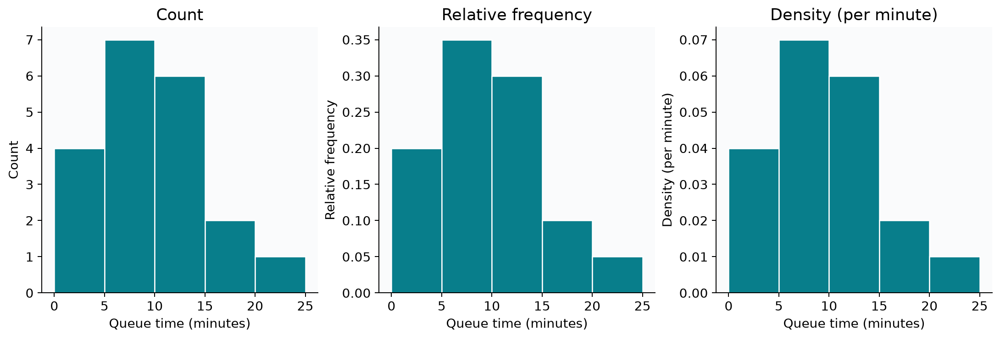
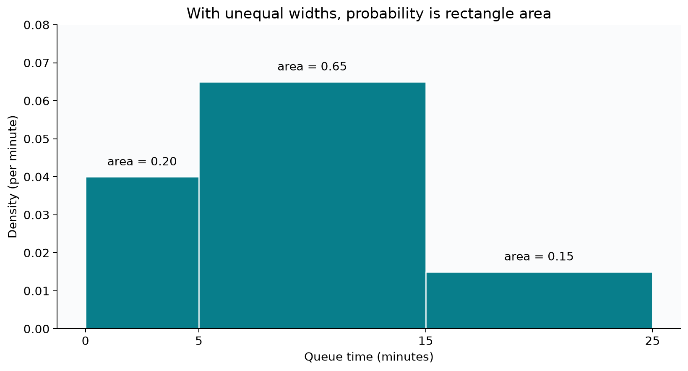
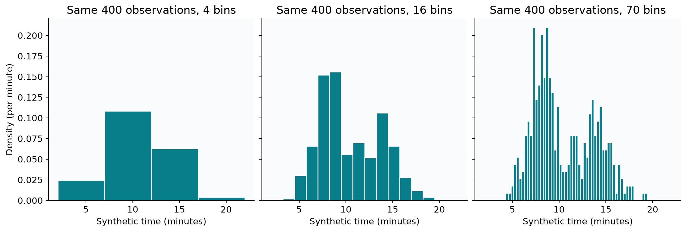
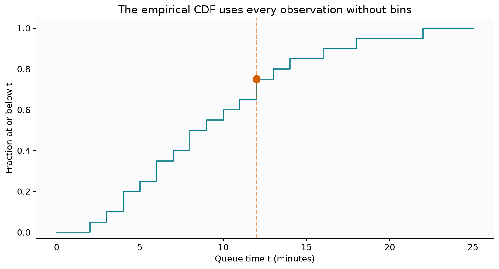

# 02 · Histograms and empirical probability

A histogram groups nearby numerical observations into intervals so that we can see the shape of a distribution. It can reveal concentration, skewness, multiple groups, and unusual values that a mean alone would miss. Its vertical scale determines how to read probabilities.

**Learning route:** bins → counts → proportions → density → limitations. Prerequisites: [Chapter 1](../01_Fundamental_Concepts_in_Statistics/01_Fundamental_Concepts_in_Statistics.md).

## 1. Build a histogram by hand

Imagine measuring how many minutes twenty independent printing jobs spend in a workshop queue:

$$2,3,4,4,5,6,6,7,8,8,9,10,11,12,12,13,14,16,18,22.$$

These are invented teaching data. Use edges $0,5,10,15,20,25$. Our convention is **left inclusive, right exclusive**: $[5,10)$ includes 5 but not 10. The last bin also includes its rightmost edge, matching NumPy's convention.

| Interval, minutes | Count $c_j$ | Relative frequency $c_j/n$ |
|---|---:|---:|
| $[0,5)$ | 4 | 0.20 |
| $[5,10)$ | 7 | 0.35 |
| $[10,15)$ | 6 | 0.30 |
| $[15,20)$ | 2 | 0.10 |
| $[20,25]$ | 1 | 0.05 |
| **Total** | **20** | **1.00** |

The interval from 5 through just below 15 minutes contains $7+6=13$ jobs, so its empirical probability is $13/20=0.65$. That calculation is a statement about this sample. Using it to predict future jobs assumes the sample represents a sufficiently stable future process.

<!-- lab: histogram_scales -->

## 2. Three vertical scales, three interpretations

A **count histogram** has height $c_j$. Counts sum to $n$. A **relative-frequency histogram** has height $c_j/n$. Heights sum to one, but its area need not be one.

A **density histogram** has height

$$h_j=\frac{c_j}{n\,w_j},$$

where $w_j$ is the width of bin $j$. Its rectangle area is $h_jw_j=c_j/n$, so the total area is one. Density has units reciprocal to the horizontal variable. For time in minutes, density is “per minute.” In the bin $[5,10)$, height is $7/(20\times5)=0.07$ per minute and area is $0.07\times5=0.35$.

This distinction becomes essential with unequal bin widths. Suppose one bin spans 0–5 minutes and another spans 5–15. The second is twice as wide and has twice as much opportunity to collect observations even if the underlying density is constant. Plotting raw counts as if height represented concentration would be misleading. Divide by width and compare areas.

**Read the plot:** the wide rectangle can contain more probability without being proportionally taller. The labels report its area, which is the observed fraction of jobs in that interval. Integrating the density histogram means adding height times width, not adding heights.

<!-- lab: unequal_bins -->

## 3. Bins are choices, not discoveries

Very wide bins can hide a second cluster. Very narrow bins can turn ordinary sampling noise into apparent peaks. Shifting the bin origin can change the visible shape even when the width stays fixed. A pattern that survives several reasonable choices is more convincing than one that appears under only a carefully selected choice.

Common starting rules include Sturges' rule, approximately $1+\log_2n$ bins, and the Freedman–Diaconis width,

$$w=2\,IQR\,n^{-1/3}.$$

The latter uses a spread measure less sensitive to extremes than SD. It is still a starting point, and it can be unhelpful when the IQR is zero or the sample is tiny. Choose bins in meaningful units, inspect alternatives, and use the same edges when directly comparing groups. `np.histogram_bin_edges(x, bins="fd")` supplies a reproducible starting choice.

**Notebook experiment:** the three panels use exactly the same observations from a mixture of two normal populations. Change the number of bins or their starting edge, without regenerating the observations. Which visible features remain? Do not claim that every bump represents a real subpopulation.

<!-- lab: bin_sensitivity -->

## 4. Probabilities do not require bins

For an event $A$, the empirical probability is

$$\widehat P(A)=\frac1n\sum_{i=1}^n\mathbf 1\{x_i\in A\}.$$

The indicator $\mathbf1$ is one when the condition holds and zero otherwise. This formula avoids bin-boundary ambiguity. For example, to estimate $P(X>12)$ in the queue data, count 13, 14, 16, 18, and 22: $5/20=0.25$.

If a requested interval cuts through a bin, the histogram alone cannot reveal exactly how many observations lie inside the partial bin. Assuming constant density within that bin gives an approximation. The original observations give the exact empirical fraction.

The **empirical cumulative distribution function**, or ECDF, is

$$\widehat F(t)=\frac{\#\{i:x_i\le t\}}n.$$

It increases by $1/n$ at each observation, or by a larger jump at ties. It needs no bin choices and makes threshold probabilities easy to read. Here $\widehat F(12)=15/20=0.75$, so $\widehat P(X>12)=1-0.75=0.25$.

<!-- lab: empirical_cdf -->

## 5. Empty bins are not proof of impossibility

No observed queue time exceeded 25 minutes. Its empirical frequency is zero, but a rare future delay could still exceed 25. Under independent Bernoulli trials, the probability of seeing zero occurrences of an event with probability $p$ is $(1-p)^n$.

One useful benchmark solves $(1-p)^n=0.05$, giving a one-sided 95% upper bound after zero events:

$$p_U=1-0.05^{1/n}.$$

With only twenty trials, $p_U\approx0.139$. Zero observed events leaves substantial uncertainty. For larger $n$, the approximation $p_U\approx3/n$ is the “rule of three.” This requires independent representative trials and a defined event; choosing an event after inspecting many gaps changes the inferential problem.

More generally, a histogram describes observed data. It cannot fix a biased sample, identify a causal effect, or show time dependence after the time order has been discarded. A run chart may reveal a machine slowing over the day even when its histogram looks ordinary.

## 6. Practical reading checklist

Identify the measured variable and units, then read the vertical-axis label. Check that bin boundaries cover all observations and ask whether groups use compatible scales. Look for overall shape before interpreting individual bumps. Report sample size. For small samples, show a dot plot alongside the histogram so no observations disappear into a bar.

Do not confuse a histogram with a categorical bar chart. Numerical intervals have an order, a width, and meaningful distances. Categories such as printer brands do not have those properties; their bar widths do not encode a continuous measurement scale.

## 7. Practice

1. Eight synthetic travel distances are 1, 2, 2, 3, 5, 6, 7, 9 km. Using bins $[0,3),[3,6),[6,10]$, find counts, probabilities, and density heights.
2. What is the empirical probability of a distance at least 6 km? What is $\widehat F(6)$?
3. A density histogram has height 0.2 per second over an interval of width 3 seconds. What probability does its area represent?
4. Why can a valid density exceed one?
5. After zero failures in 100 independent tests, calculate the one-sided 95% upper bound on the failure probability.

## 8. Worked answers

1. Counts are 3, 2, 3; proportions are $3/8,2/8,3/8$. Widths are 3, 3, 4, so heights are $1/8\approx0.125$, $1/12\approx0.0833$, and $3/32\approx0.09375$ per km. The areas sum to one.
2. Three distances are at least 6, giving $3/8$. Six are at most 6, giving $\widehat F(6)=6/8$. Notice that the equality at 6 matters for these discrete observations.
3. $0.2\times3=0.6$.
4. Density is not probability. A uniform distribution over a width of 0.1 has density 10 and total area $10\times0.1=1$.
5. $1-0.05^{1/100}\approx0.02951$, close to $3/100=0.03$.

<!-- lab: practice -->

## References and next step

Reading connection: Starmer (2026), Chapter 2, [SQ](../Reference.md#sq-statquest). Additional definitions: [NIST histogram](https://www.itl.nist.gov/div898/handbook/eda/section3/histogra.htm) and [NumPy histogram](https://numpy.org/doc/stable/reference/generated/numpy.histogram.html). ECDF and unequal-bin examples extend the reading.

Next: [03 · Probability models](../03_Probability_Models/03_Probability_Models.md).
