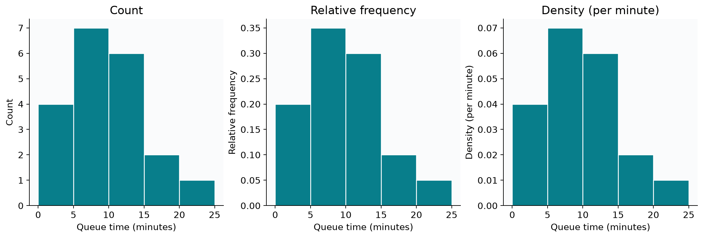
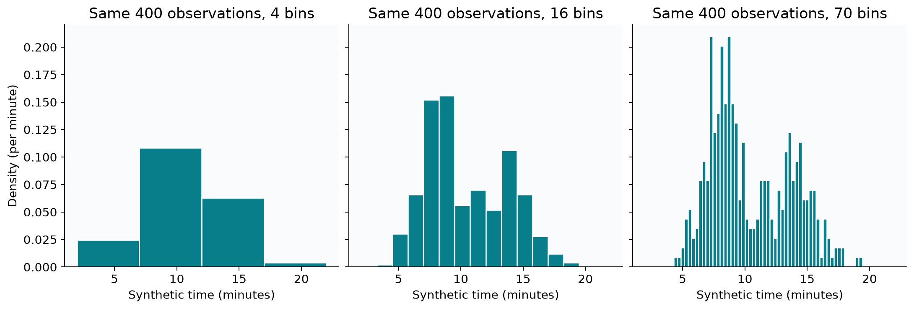
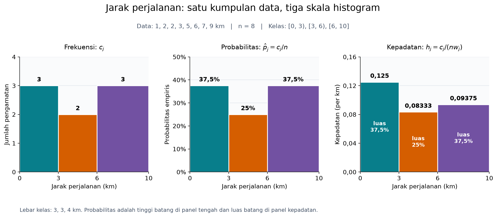
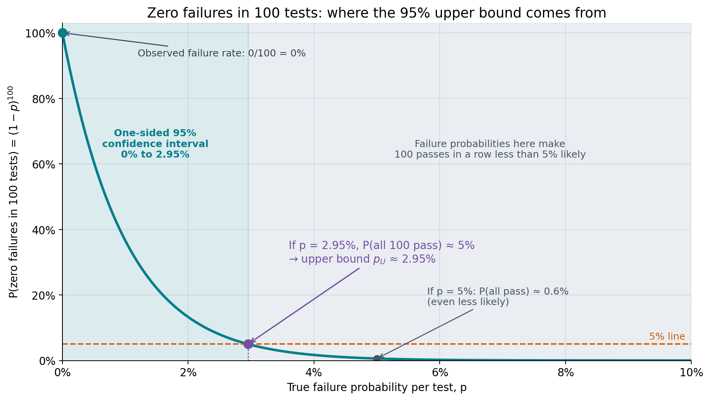

# 02 · Histogram dan probabilitas empiris

Histogram mengelompokkan pengamatan numerik yang berdekatan ke dalam interval agar kita dapat melihat bentuk distribusi. Histogram dapat memperlihatkan konsentrasi, kemencengan, beberapa kelompok, dan nilai tidak biasa yang tidak tampak dari rata-rata saja. Skala vertikalnya menentukan cara membaca probabilitas.

**Alur pembelajaran:** kelas → frekuensi → proporsi → kepadatan → keterbatasan. Prasyarat: [Bab 1](../01_Fundamental_Concepts_in_Statistics/01_Fundamental_Concepts_in_Statistics.md).

## 1. Membuat histogram secara manual

Bayangkan mengukur berapa menit dua puluh pekerjaan pencetakan independen menunggu dalam antrean sebuah bengkel:

$$2,3,4,4,5,6,6,7,8,8,9,10,11,12,12,13,14,16,18,22.$$

Ini adalah data rekaan untuk pembelajaran. Gunakan batas $0,5,10,15,20,25$. Konvensi kita adalah **batas kiri termasuk, batas kanan tidak termasuk**: $[5,10)$ mencakup 5 tetapi tidak mencakup 10. Kelas terakhir juga mencakup batas paling kanannya, sesuai konvensi NumPy.

| Interval, menit | Frekuensi $c_j$ | Frekuensi relatif $c_j/n$ |
|---|---:|---:|
| $[0,5)$ | 4 | 0.20 |
| $[5,10)$ | 7 | 0.35 |
| $[10,15)$ | 6 | 0.30 |
| $[15,20)$ | 2 | 0.10 |
| $[20,25]$ | 1 | 0.05 |
| **Jumlah** | **20** | **1.00** |

Interval dari 5 hingga tepat di bawah 15 menit berisi $7+6=13$ pekerjaan, sehingga probabilitas empirisnya adalah $13/20=0.65$. Perhitungan itu merupakan pernyataan tentang sampel ini. Menggunakannya untuk memprediksi pekerjaan mendatang mengasumsikan bahwa sampel mewakili proses mendatang yang cukup stabil.

<!-- lab: histogram_scales -->

## 2. Tiga skala vertikal, tiga interpretasi

**Histogram frekuensi** memiliki tinggi $c_j$. Jumlah frekuensi adalah $n$. **Histogram frekuensi relatif** memiliki tinggi $c_j/n$. Jumlah tingginya satu, tetapi luasnya tidak harus satu.

**Histogram kepadatan** memiliki tinggi

$$h_j=\frac{c_j}{n\,w_j},$$

dengan $w_j$ adalah lebar kelas $j$. Luas persegi panjangnya adalah $h_jw_j=c_j/n$, sehingga luas totalnya satu. Kepadatan memiliki satuan kebalikan dari variabel horizontal. Untuk waktu dalam menit, kepadatan bersatuan “per menit”. Pada kelas $[5,10)$, tingginya $7/(20\times5)=0.07$ per menit dan luasnya $0.07\times5=0.35$.

Perbedaan ini menjadi sangat penting ketika lebar kelas tidak sama. Misalkan satu kelas membentang 0–5 menit dan kelas lain 5–15. Kelas kedua dua kali lebih lebar dan memiliki kesempatan dua kali lebih besar untuk menampung pengamatan, bahkan ketika kepadatan yang mendasarinya konstan. Menggambarkan frekuensi mentah seolah-olah tinggi mewakili konsentrasi akan menyesatkan. Bagilah dengan lebar dan bandingkan luasnya.

**Membaca grafik:** persegi panjang yang lebar dapat memuat probabilitas lebih besar tanpa memiliki tinggi yang lebih besar secara proporsional. Label menunjukkan luasnya, yaitu proporsi pekerjaan yang diamati dalam interval tersebut. Mengintegralkan histogram kepadatan berarti menjumlahkan hasil kali tinggi dan lebar, bukan menjumlahkan tinggi.

<!-- lab: unequal_bins -->

## 3. Kelas merupakan pilihan, bukan penemuan

Kelas yang sangat lebar dapat menyembunyikan kelompok kedua. Kelas yang sangat sempit dapat membuat derau pengambilan sampel biasa tampak seperti puncak. Menggeser titik awal kelas dapat mengubah bentuk yang terlihat meskipun lebarnya tetap. Pola yang bertahan pada beberapa pilihan wajar lebih meyakinkan daripada pola yang hanya muncul pada satu pilihan yang sengaja diseleksi.

Aturan awal yang umum mencakup aturan Sturges, sekitar $1+\log_2n$ kelas, dan lebar Freedman–Diaconis,

$$w=2\,IQR\,n^{-1/3}.$$

Aturan kedua menggunakan ukuran penyebaran yang kurang sensitif terhadap nilai ekstrem dibandingkan SD. Ini tetap merupakan titik awal, dan dapat kurang berguna ketika IQR nol atau sampelnya sangat kecil. Pilih kelas dalam satuan yang bermakna, periksa alternatif, dan gunakan batas yang sama ketika membandingkan kelompok secara langsung. `np.histogram_bin_edges(x, bins="fd")` memberikan pilihan awal yang dapat direproduksi.

**Eksperimen notebook:** ketiga panel menggunakan pengamatan yang persis sama dari campuran dua populasi normal. Ubah jumlah kelas atau batas awalnya tanpa membuat ulang pengamatan. Ciri-ciri apa yang tetap terlihat? Jangan menyatakan bahwa setiap tonjolan mewakili subpopulasi nyata.

<!-- lab: bin_sensitivity -->

## 4. Probabilitas tidak memerlukan kelas

Untuk kejadian $A$, probabilitas empirisnya adalah

$$\widehat P(A)=\frac1n\sum_{i=1}^n\mathbf 1\{x_i\in A\}.$$

Indikator $\mathbf1$ bernilai satu ketika kondisi terpenuhi dan nol jika tidak. Rumus ini menghindari ambiguitas batas kelas. Misalnya, untuk mengestimasi $P(X>12)$ pada data antrean, hitung 13, 14, 16, 18, dan 22: $5/20=0.25$.

Jika interval yang diminta memotong suatu kelas, histogram saja tidak dapat mengungkapkan secara tepat berapa pengamatan yang berada dalam bagian kelas tersebut. Mengasumsikan kepadatan konstan dalam kelas itu memberikan pendekatan. Pengamatan asli memberikan proporsi empiris yang eksak.

**Fungsi distribusi kumulatif empiris**, atau ECDF, adalah

$$\widehat F(t)=\frac{\#\{i:x_i\le t\}}n.$$

Fungsi ini meningkat sebesar $1/n$ pada setiap pengamatan, atau dengan lompatan lebih besar pada nilai yang sama. Fungsi ini tidak memerlukan pilihan kelas dan memudahkan pembacaan probabilitas berdasarkan ambang. Di sini $\widehat F(12)=15/20=0.75$, sehingga $\widehat P(X>12)=1-0.75=0.25$.

<!-- lab: empirical_cdf -->

## 5. Kelas kosong bukan bukti kemustahilan

Tidak ada waktu antrean yang diamati melebihi 25 menit. Frekuensi empirisnya nol, tetapi penundaan langka di masa mendatang tetap dapat melebihi 25. Dalam $n$ percobaan Bernoulli independen dengan probabilitas kejadian yang sama, yaitu $p$, pada setiap percobaan, probabilitas tidak melihat satu pun kejadian adalah $(1-p)^n$.

### Menurunkan probabilitas tidak melihat satu pun kejadian

**Percobaan Bernoulli** mencatat satu dari dua hasil: kejadian terjadi atau tidak terjadi. Di sini, satu percobaan adalah satu waktu antrean yang diamati, dan kejadian yang dimaksud adalah “waktu antrean melebihi 25 menit.” Misalkan $B_i=1$ jika kejadian tersebut terjadi pada percobaan ke-$i$, dan $B_i=0$ jika tidak. Probabilitas $p$ merujuk pada terjadinya kejadian dalam **satu percobaan**.

1. **Untuk satu percobaan, probabilitas kejadian tidak terjadi adalah $1-p$.** Kedua hasil tersebut mencakup seluruh kemungkinan, sehingga jumlah probabilitasnya adalah satu:

   $$P(B_i=0)=1-P(B_i=1)=1-p.$$

2. **Untuk dua percobaan independen, kalikan probabilitasnya.** Tidak melihat satu pun kejadian berarti kejadian tidak terjadi pada percobaan pertama **dan** tidak terjadi pada percobaan kedua. Independensi memungkinkan kita mengalikan probabilitas masing-masing:

   $$P(B_1=0,B_2=0)=P(B_1=0)P(B_2=0)=(1-p)(1-p)=(1-p)^2.$$

3. **Untuk $n$ percobaan independen, ulangi perkalian sebanyak $n$ faktor.** Misalkan $S=\sum_{i=1}^{n}B_i$ menghitung jumlah total kejadian. Kondisi $S=0$ berarti setiap percobaan menghasilkan nol:

   $$\begin{aligned}
   P(S=0)
   &=P(B_1=0,\ldots,B_n=0)\\
   &=\prod_{i=1}^{n}P(B_i=0)\\
   &=\underbrace{(1-p)(1-p)\cdots(1-p)}_{n\text{ faktor}}\\
   &=(1-p)^n.
   \end{aligned}$$

   Huruf $n$ di atas merupakan **pangkat**: kalikan $1-p$ dengan dirinya sendiri sebanyak $n$ faktor. Ini tidak berarti mengalikan $1-p$ dengan bilangan $n$.

**Contoh numerik.** Misalkan probabilitas sebenarnya bahwa waktu antrean melebihi 25 menit adalah $p=0.05$, dan kita mengamati $n=20$ waktu antrean yang independen. Maka

$$P(S=0)=(1-0.05)^{20}=0.95^{20}\approx0.3585.$$

Ada sekitar **35,85% peluang tidak melihat satu pun penundaan tersebut**, meskipun setiap percobaan memiliki peluang 5% untuk mengalaminya. Jadi, kelas kosong dapat muncul ketika probabilitas kejadian yang sebenarnya positif. Probabilitas komplemennya, yaitu melihat **setidaknya satu** penundaan tersebut, adalah $P(S\ge1)=1-(1-p)^n\approx0.6415$, atau 64,15%. Nilai $p=0.05$ merupakan asumsi untuk ilustrasi ini, bukan nilai yang disimpulkan dari nol kejadian yang diamati.

**Mengapa asumsi tersebut penting?** Perkalian probabilitas masing-masing memerlukan independensi antarpercobaan. Misalnya, waktu antrean yang dipengaruhi gangguan layanan sementara yang sama dapat saling bergantung. Jika percobaan independen tetapi memiliki probabilitas kejadian $p_i$ yang berbeda, probabilitas tidak melihat satu pun kejadian adalah $\prod_{i=1}^{n}(1-p_i)$; bentuk ini menjadi $(1-p)^n$ ketika seluruh probabilitas tersebut sama dengan $p$.

### Menghubungkan nol kejadian dengan batas atas

Acuan yang berguna diperoleh dengan menyelesaikan $(1-p)^n=0.05$, yang memberikan batas atas satu sisi 95% setelah nol kejadian:

$$p_U=1-0.05^{1/n}.$$

Dengan hanya dua puluh percobaan, $p_U\approx0.139$. Nol kejadian yang diamati masih menyisakan ketidakpastian besar. Untuk $n$ lebih besar, pendekatan $p_U\approx3/n$ disebut “aturan tiga”. Ini memerlukan percobaan independen yang representatif dan kejadian yang telah ditentukan; memilih kejadian setelah memeriksa banyak celah mengubah persoalan inferensinya.

Secara lebih umum, histogram menggambarkan data yang diamati. Histogram tidak dapat memperbaiki sampel bias, mengidentifikasi efek kausal, atau menunjukkan ketergantungan waktu setelah urutan waktunya dibuang. Grafik pengamatan menurut waktu dapat memperlihatkan mesin yang melambat sepanjang hari meskipun histogramnya tampak biasa.

## 6. Daftar pemeriksaan praktis untuk membaca grafik

Identifikasi variabel yang diukur dan satuannya, lalu baca label sumbu vertikal. Periksa apakah batas kelas mencakup seluruh pengamatan dan apakah kelompok menggunakan skala yang sesuai untuk dibandingkan. Perhatikan bentuk keseluruhan sebelum menafsirkan tonjolan individual. Laporkan ukuran sampel. Untuk sampel kecil, tampilkan diagram titik di samping histogram agar tidak ada pengamatan yang tersembunyi di dalam batang.

Jangan menyamakan histogram dengan diagram batang kategoris. Interval numerik memiliki urutan, lebar, dan jarak yang bermakna. Kategori seperti merek printer tidak memiliki sifat tersebut; lebar batangnya tidak mewakili skala pengukuran kontinu.

## 7. Latihan

1. Delapan jarak perjalanan sintetis adalah 1, 2, 2, 3, 5, 6, 7, 9 km. Dengan kelas $[0,3),[3,6),[6,10]$, tentukan frekuensi, probabilitas, dan tinggi kepadatannya.
2. Berapa probabilitas empiris jarak setidaknya 6 km? Berapa $\widehat F(6)$?
3. Histogram kepadatan memiliki tinggi 0.2 per detik pada interval selebar 3 detik. Probabilitas berapa yang diwakili luasnya?
4. Mengapa kepadatan yang valid dapat melebihi satu?
5. Setelah nol kegagalan dalam 100 pengujian independen, hitung batas atas satu sisi 95% untuk probabilitas kegagalan.

## 8. Pembahasan jawaban

1. Frekuensinya 3, 2, 3; proporsinya $3/8,2/8,3/8$. Lebarnya 3, 3, 4, sehingga tingginya $1/8\approx0.125$, $1/12\approx0.0833$, dan $3/32\approx0.09375$ per km. Jumlah luasnya satu.

   **Masukkan setiap pengamatan ke kelasnya terlebih dahulu.** Interval $[0,3)$ mencakup 0 tetapi tidak mencakup 3, sehingga nilai pengamatan 3 masuk ke $[3,6)$. Demikian pula, 6 masuk ke $[6,10]$. Kelas terakhir mencakup batas kanannya, yaitu 10, meskipun tidak ada nilai 10 dalam sampel ini. Kedua pengamatan yang bernilai 2 dihitung secara terpisah.

   **Gunakan rumusnya.** Untuk kelas $B_j$ dengan batas bawah $a_j$ dan batas atas $b_j$, serta $n=8$ pengamatan,

   $$c_j=\sum_{i=1}^{n}\mathbf 1\{x_i\in B_j\},\qquad
   w_j=b_j-a_j,\qquad
   \hat p_j=\frac{c_j}{n},\qquad
   h_j=\frac{\hat p_j}{w_j}=\frac{c_j}{n w_j}.$$

   Indikator menyumbang 1 untuk setiap pengamatan di dalam kelas dan 0 jika di luar, sehingga $c_j$ adalah frekuensinya. Lebar $w_j$ diukur dalam km, probabilitas empiris $\hat p_j$ tidak memiliki satuan, dan tinggi kepadatan $h_j$ memiliki satuan $\mathrm{km}^{-1}$. Lebarnya adalah $3-0=3$, $6-3=3$, dan $10-6=4$ km. Dengan menyubstitusikan frekuensi dan lebar tersebut, diperoleh:

   | Kelas (km) | Jarak yang diamati (km) | Frekuensi $c_j$ | Lebar $w_j$ (km) | Probabilitas empiris $c_j/8$ | Tinggi kepadatan $c_j/(8w_j)$ (per km) |
   |---|---|---:|---:|---:|---:|
   | $[0,3)$ | 1, 2, 2 | 3 | 3 | $3/8=0.375$ | $3/(8\times3)=0.125$ |
   | $[3,6)$ | 3, 5 | 2 | 3 | $2/8=0.25$ | $2/(8\times3)\approx0.08333$ |
   | $[6,10]$ | 6, 7, 9 | 3 | 4 | $3/8=0.375$ | $3/(8\times4)=0.09375$ |

   

   **Membaca ketiga panel:** pengamatan dan batas kelas tetap sama; hanya skala vertikalnya yang berubah. Pada panel frekuensi, tinggi menunjukkan jumlah pengamatan. Pada panel probabilitas, tinggi menunjukkan proporsi empiris dalam setiap kelas. Pada panel kepadatan, **luas menunjukkan probabilitas**, karena tinggi kepadatan adalah probabilitas dibagi lebar kelas:

   $$h_j=\frac{c_j}{n w_j},\qquad h_jw_j=\frac{c_j}{n},\qquad n=8.$$

   Kelas pertama dan ketiga masing-masing memuat tiga pengamatan, sehingga tinggi frekuensi dan probabilitasnya sama. Kelas ketiga lebih lebar (4 km dibandingkan 3 km), sehingga tinggi kepadatannya lebih kecil: $0.09375$ dibandingkan $0.125$ per km. Luas batang kepadatannya tetap sama: $0.125\times3=0.375$ dan $0.09375\times4=0.375$. Dengan menyertakan kelas tengah, luas totalnya adalah $0.375+0.25+0.375=1$. Jika lebar kelas berbeda, gunakan tinggi kepadatan ketika ingin luas batang mewakili probabilitas.

2. Tiga jarak setidaknya 6, menghasilkan $3/8$. Enam jarak paling besar 6, menghasilkan $\widehat F(6)=6/8$. Perhatikan bahwa kesamaan pada 6 penting untuk pengamatan diskret ini.
3. Luasnya mewakili probabilitas sebesar $0.2\times3=0.6$, atau **60%**.

   **Pada histogram kepadatan, luas batang mewakili probabilitas.** Setiap batang berbentuk persegi panjang, sehingga luasnya adalah tinggi dikalikan lebar. Di sini, tingginya $h=0.2$ per detik dan lebarnya $w=3$ detik:

   $$\begin{aligned}
   \text{Probabilitas yang diwakili batang}
   &=\text{tinggi}\times\text{lebar}\\
   &=(0.2\ \mathrm{s}^{-1})(3\ \mathrm{s})\\
   &=0.6=60\%.
   \end{aligned}$$

   **Mengapa satuannya saling menghilangkan?** “Per detik” berarti $\mathrm{s}^{-1}=1/\mathrm{s}$. Mengalikannya dengan lebar yang diukur dalam detik menghasilkan $\mathrm{s}^{-1}\times\mathrm{s}=1$. Hasilnya adalah probabilitas tanpa satuan. Misalnya, kelas dari 2 sampai 5 detik memiliki lebar $5-2=3$ detik; dengan tinggi 0,2 per detik, luasnya adalah 0,6.

   **Hubungkan luas dengan pengamatan.** Jika suatu kelas memuat $c$ dari $n$ pengamatan dan memiliki lebar $w$, tinggi kepadatannya adalah

   $$h=\frac{c}{n w},\qquad
   h w=\frac{c}{n w}\times w=\frac{c}{n}.$$

   Jadi, luasnya sama dengan proporsi pengamatan dalam kelas tersebut. Misalnya, 60 dari 100 pengamatan dalam kelas selebar 3 detik akan menghasilkan $h=60/(100\times3)=0.2$ per detik dan luas $60/100=0.6$. Seluruh kelas lainnya bersama-sama memuat 40% pengamatan yang tersisa.

   **Tinggi saja bukan probabilitas kelas.** Tinggi 0,2 per detik tidak berarti bahwa seluruh kelas memuat 20% pengamatan. Lebarnya 3 detik, sehingga probabilitas yang diwakili adalah $0.2\times3=0.6$, atau 60%.

4. Kepadatan bukan probabilitas. Distribusi seragam pada lebar 0.1 memiliki kepadatan 10 dan luas total $10\times0.1=1$.
5. $1-0.05^{1/100}\approx0.02951$, mendekati $3/100=0.03$.

   **Arti “batas atas” (upper bound).** Batas atas adalah ujung atas interval kepercayaan untuk probabilitas kegagalan yang sebenarnya. Batas ini merupakan batas statistik berdasarkan data, bukan jaminan bahwa probabilitas yang sebenarnya tidak mungkin lebih tinggi. Dalam soal ini:

   - **Nol kegagalan dalam 100 pengujian:** seluruh 100 pengujian lolos. Tingkat kegagalan yang diamati adalah $0/100=0\%$.
   - **Probabilitas kegagalan $p$:** peluang yang tidak diketahui bahwa satu pengujian gagal. Peluang ini tetap bisa positif meskipun tidak ada kegagalan yang diamati.
   - **Satu sisi:** kita hanya menghitung batas atas. Intervalnya dimulai dari nilai minimum alaminya, yaitu $0$.
   - **Kepercayaan 95%:** metode ini dirancang sehingga, dalam eksperimen yang diulang, setidaknya 95% intervalnya memuat $p$ yang sebenarnya, dengan asumsi pengujian independen dan memiliki probabilitas kegagalan yang sama.

   Untuk nol kegagalan, batas atasnya adalah

   $$p_U=1-0.05^{1/100}\approx0.02951=2.95\%.$$

   Jadi, kita melaporkan interval kepercayaan satu sisi 95% sekitar $0\%$ sampai $2.95\%$.

   **Mengapa 2,95%?** Jika probabilitas kegagalan yang sebenarnya adalah 2,95%, peluang bahwa seluruh 100 pengujian lolos kira-kira adalah

   $$P(\text{nol kegagalan})=(1-0.02951)^{100}\approx5\%.$$

   Probabilitas kegagalan yang lebih tinggi akan membuat hasil sempurna ini semakin kecil kemungkinannya. Dengan cara itulah metode ini memilih batas atas.

   

   **Membaca grafik:** kurva menunjukkan, untuk setiap kemungkinan probabilitas kegagalan sebenarnya $p$, peluang melihat nol kegagalan dalam 100 pengujian, yaitu $(1-p)^{100}$. Pada $p=0$ peluangnya 100%, sesuai dengan tingkat kegagalan yang diamati sebesar 0%. Ketika $p$ meningkat, hasil sempurna menjadi semakin kecil kemungkinannya. Kurva memotong garis 5% pada $p\approx2{,}95\%$; titik potong itulah batas atasnya. Daerah terarsir di kiri, dari 0% sampai 2,95%, adalah interval kepercayaan satu sisi 95%. Di daerah abu-abu, 100 kali lolos berturut-turut memiliki peluang kurang dari 5%; misalnya pada $p=5\%$, peluangnya hanya sekitar 0,6%.

   **Interpretasi praktis:** “Kami tidak mengamati kegagalan, tetapi data masih menyisakan ketidakpastian tentang tingkat kegagalan yang kecil; batas atas kepercayaan 95% adalah sekitar 3%.” Ini tidak menjamin bahwa 100 pengujian berikutnya akan memiliki paling banyak tiga kegagalan.

<!-- lab: practice -->

## Referensi dan langkah berikutnya

Kaitan bacaan: Starmer (2026), Bab 2, [SQ](../Reference.md#sq-statquest). Definisi tambahan: [histogram NIST](https://www.itl.nist.gov/div898/handbook/eda/section3/histogra.htm) dan [histogram NumPy](https://numpy.org/doc/stable/reference/generated/numpy.histogram.html). Contoh ECDF dan kelas tidak sama lebar memperluas bacaan.

Berikutnya: [03 · Model probabilitas](../03_Probability_Models/03_Probability_Models.md).
