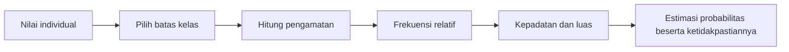
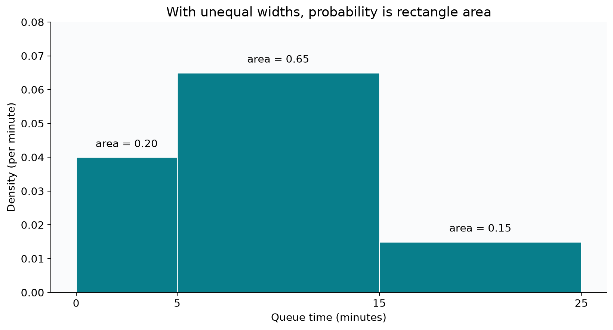
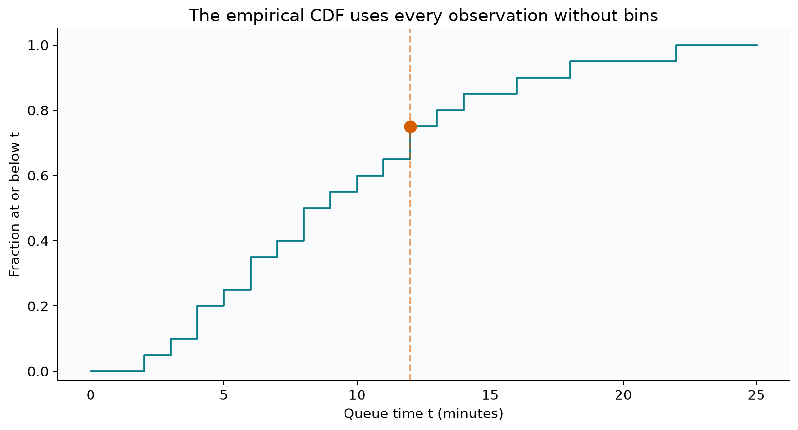

# 02 · Histogram dan probabilitas empiris

Histogram mengelompokkan pengamatan numerik yang berdekatan ke dalam interval agar kita dapat melihat bentuk distribusi. Histogram dapat memperlihatkan konsentrasi, kemencengan, beberapa kelompok, dan nilai tidak biasa yang tidak tampak dari rata-rata saja. Skala vertikalnya menentukan cara membaca probabilitas.

**Alur pembelajaran:** kelas → frekuensi → proporsi → kepadatan → keterbatasan. Prasyarat: [Bab 1](../01_Fundamental_Concepts_in_Statistics/01_Fundamental_Concepts_in_Statistics.md).

## 1. Membuat histogram secara manual

Bayangkan mengukur berapa menit dua puluh pekerjaan pencetakan independen menunggu dalam antrean sebuah bengkel:

$$2,3,4,4,5,6,6,7,8,8,9,10,11,12,12,13,14,16,18,22.$$

Ini adalah data rekaan untuk pembelajaran. Gunakan batas $0,5,10,15,20,25$. Konvensi kita adalah **batas kiri termasuk, batas kanan tidak termasuk**: $[5,10)$ mencakup 5 tetapi tidak mencakup 10. Kelas terakhir juga mencakup batas paling kanannya, sesuai konvensi NumPy.

| Interval, menit | Frekuensi $c_j$ | Frekuensi relatif $c_j/n$ |
|---|---:|---:|
| $[0,5)$ | 4 | 0.20 |
| $[5,10)$ | 7 | 0.35 |
| $[10,15)$ | 6 | 0.30 |
| $[15,20)$ | 2 | 0.10 |
| $[20,25]$ | 1 | 0.05 |
| **Jumlah** | **20** | **1.00** |

Interval dari 5 hingga tepat di bawah 15 menit berisi $7+6=13$ pekerjaan, sehingga probabilitas empirisnya adalah $13/20=0.65$. Perhitungan itu merupakan pernyataan tentang sampel ini. Menggunakannya untuk memprediksi pekerjaan mendatang mengasumsikan bahwa sampel mewakili proses mendatang yang cukup stabil.

<!-- lab: histogram_scales -->

## 2. Tiga skala vertikal, tiga interpretasi

**Histogram frekuensi** memiliki tinggi $c_j$. Jumlah frekuensi adalah $n$. **Histogram frekuensi relatif** memiliki tinggi $c_j/n$. Jumlah tingginya satu, tetapi luasnya tidak harus satu.

**Histogram kepadatan** memiliki tinggi

$$h_j=\frac{c_j}{n\,w_j},$$

dengan $w_j$ adalah lebar kelas $j$. Luas persegi panjangnya adalah $h_jw_j=c_j/n$, sehingga luas totalnya satu. Kepadatan memiliki satuan kebalikan dari variabel horizontal. Untuk waktu dalam menit, kepadatan bersatuan “per menit”. Pada kelas $[5,10)$, tingginya $7/(20\times5)=0.07$ per menit dan luasnya $0.07\times5=0.35$.

Perbedaan ini menjadi sangat penting ketika lebar kelas tidak sama. Misalkan satu kelas membentang 0–5 menit dan kelas lain 5–15. Kelas kedua dua kali lebih lebar dan memiliki kesempatan dua kali lebih besar untuk menampung pengamatan, bahkan ketika kepadatan yang mendasarinya konstan. Menggambarkan frekuensi mentah seolah-olah tinggi mewakili konsentrasi akan menyesatkan. Bagilah dengan lebar dan bandingkan luasnya.

**Membaca grafik:** persegi panjang yang lebar dapat memuat probabilitas lebih besar tanpa memiliki tinggi yang lebih besar secara proporsional. Label menunjukkan luasnya, yaitu proporsi pekerjaan yang diamati dalam interval tersebut. Mengintegralkan histogram kepadatan berarti menjumlahkan hasil kali tinggi dan lebar, bukan menjumlahkan tinggi.

<!-- lab: unequal_bins -->

## 3. Kelas merupakan pilihan, bukan penemuan

Kelas yang sangat lebar dapat menyembunyikan kelompok kedua. Kelas yang sangat sempit dapat membuat derau pengambilan sampel biasa tampak seperti puncak. Menggeser titik awal kelas dapat mengubah bentuk yang terlihat meskipun lebarnya tetap. Pola yang bertahan pada beberapa pilihan wajar lebih meyakinkan daripada pola yang hanya muncul pada satu pilihan yang sengaja diseleksi.

Aturan awal yang umum mencakup aturan Sturges, sekitar $1+\log_2n$ kelas, dan lebar Freedman–Diaconis,

$$w=2\,IQR\,n^{-1/3}.$$

Aturan kedua menggunakan ukuran penyebaran yang kurang sensitif terhadap nilai ekstrem dibandingkan SD. Ini tetap merupakan titik awal, dan dapat kurang berguna ketika IQR nol atau sampelnya sangat kecil. Pilih kelas dalam satuan yang bermakna, periksa alternatif, dan gunakan batas yang sama ketika membandingkan kelompok secara langsung. `np.histogram_bin_edges(x, bins="fd")` memberikan pilihan awal yang dapat direproduksi.

**Eksperimen notebook:** ketiga panel menggunakan pengamatan yang persis sama dari campuran dua populasi normal. Ubah jumlah kelas atau batas awalnya tanpa membuat ulang pengamatan. Ciri-ciri apa yang tetap terlihat? Jangan menyatakan bahwa setiap tonjolan mewakili subpopulasi nyata.

<!-- lab: bin_sensitivity -->

## 4. Probabilitas tidak memerlukan kelas

Untuk kejadian $A$, probabilitas empirisnya adalah

$$\widehat P(A)=\frac1n\sum_{i=1}^n\mathbf 1\{x_i\in A\}.$$

Indikator $\mathbf1$ bernilai satu ketika kondisi terpenuhi dan nol jika tidak. Rumus ini menghindari ambiguitas batas kelas. Misalnya, untuk mengestimasi $P(X>12)$ pada data antrean, hitung 13, 14, 16, 18, dan 22: $5/20=0.25$.

Jika interval yang diminta memotong suatu kelas, histogram saja tidak dapat mengungkapkan secara tepat berapa pengamatan yang berada dalam bagian kelas tersebut. Mengasumsikan kepadatan konstan dalam kelas itu memberikan pendekatan. Pengamatan asli memberikan proporsi empiris yang eksak.

**Fungsi distribusi kumulatif empiris**, atau ECDF, adalah

$$\widehat F(t)=\frac{\#\{i:x_i\le t\}}n.$$

Fungsi ini meningkat sebesar $1/n$ pada setiap pengamatan, atau dengan lompatan lebih besar pada nilai yang sama. Fungsi ini tidak memerlukan pilihan kelas dan memudahkan pembacaan probabilitas berdasarkan ambang. Di sini $\widehat F(12)=15/20=0.75$, sehingga $\widehat P(X>12)=1-0.75=0.25$.

<!-- lab: empirical_cdf -->

## 5. Kelas kosong bukan bukti kemustahilan

Tidak ada waktu antrean yang diamati melebihi 25 menit. Frekuensi empirisnya nol, tetapi penundaan langka di masa mendatang tetap dapat melebihi 25. Dalam percobaan Bernoulli independen, probabilitas tidak melihat satu pun kejadian dengan probabilitas $p$ adalah $(1-p)^n$.

Acuan yang berguna diperoleh dengan menyelesaikan $(1-p)^n=0.05$, yang memberikan batas atas satu sisi 95% setelah nol kejadian:

$$p_U=1-0.05^{1/n}.$$

Dengan hanya dua puluh percobaan, $p_U\approx0.139$. Nol kejadian yang diamati masih menyisakan ketidakpastian besar. Untuk $n$ lebih besar, pendekatan $p_U\approx3/n$ disebut “aturan tiga”. Ini memerlukan percobaan independen yang representatif dan kejadian yang telah ditentukan; memilih kejadian setelah memeriksa banyak celah mengubah persoalan inferensinya.

Secara lebih umum, histogram menggambarkan data yang diamati. Histogram tidak dapat memperbaiki sampel bias, mengidentifikasi efek kausal, atau menunjukkan ketergantungan waktu setelah urutan waktunya dibuang. Grafik pengamatan menurut waktu dapat memperlihatkan mesin yang melambat sepanjang hari meskipun histogramnya tampak biasa.

## 6. Daftar pemeriksaan praktis untuk membaca grafik

Identifikasi variabel yang diukur dan satuannya, lalu baca label sumbu vertikal. Periksa apakah batas kelas mencakup seluruh pengamatan dan apakah kelompok menggunakan skala yang sesuai untuk dibandingkan. Perhatikan bentuk keseluruhan sebelum menafsirkan tonjolan individual. Laporkan ukuran sampel. Untuk sampel kecil, tampilkan diagram titik di samping histogram agar tidak ada pengamatan yang tersembunyi di dalam batang.

Jangan menyamakan histogram dengan diagram batang kategoris. Interval numerik memiliki urutan, lebar, dan jarak yang bermakna. Kategori seperti merek printer tidak memiliki sifat tersebut; lebar batangnya tidak mewakili skala pengukuran kontinu.

## 7. Latihan

1. Delapan jarak perjalanan sintetis adalah 1, 2, 2, 3, 5, 6, 7, 9 km. Dengan kelas $[0,3),[3,6),[6,10]$, tentukan frekuensi, probabilitas, dan tinggi kepadatannya.
2. Berapa probabilitas empiris jarak setidaknya 6 km? Berapa $\widehat F(6)$?
3. Histogram kepadatan memiliki tinggi 0.2 per detik pada interval selebar 3 detik. Probabilitas berapa yang diwakili luasnya?
4. Mengapa kepadatan yang valid dapat melebihi satu?
5. Setelah nol kegagalan dalam 100 pengujian independen, hitung batas atas satu sisi 95% untuk probabilitas kegagalan.

## 8. Pembahasan jawaban

1. Frekuensinya 3, 2, 3; proporsinya $3/8,2/8,3/8$. Lebarnya 3, 3, 4, sehingga tingginya $1/8\approx0.125$, $1/12\approx0.0833$, dan $3/32\approx0.09375$ per km. Jumlah luasnya satu.
2. Tiga jarak setidaknya 6, menghasilkan $3/8$. Enam jarak paling besar 6, menghasilkan $\widehat F(6)=6/8$. Perhatikan bahwa kesamaan pada 6 penting untuk pengamatan diskret ini.
3. $0.2\times3=0.6$.
4. Kepadatan bukan probabilitas. Distribusi seragam pada lebar 0.1 memiliki kepadatan 10 dan luas total $10\times0.1=1$.
5. $1-0.05^{1/100}\approx0.02951$, mendekati $3/100=0.03$.

<!-- lab: practice -->

## Referensi dan langkah berikutnya

Kaitan bacaan: Starmer (2026), Bab 2, [SQ](../Reference.md#sq-statquest). Definisi tambahan: [histogram NIST](https://www.itl.nist.gov/div898/handbook/eda/section3/histogra.htm) dan [histogram NumPy](https://numpy.org/doc/stable/reference/generated/numpy.histogram.html). Contoh ECDF dan kelas tidak sama lebar memperluas bacaan.

Berikutnya: [03 · Model probabilitas](../03_Probability_Models/03_Probability_Models.md).
