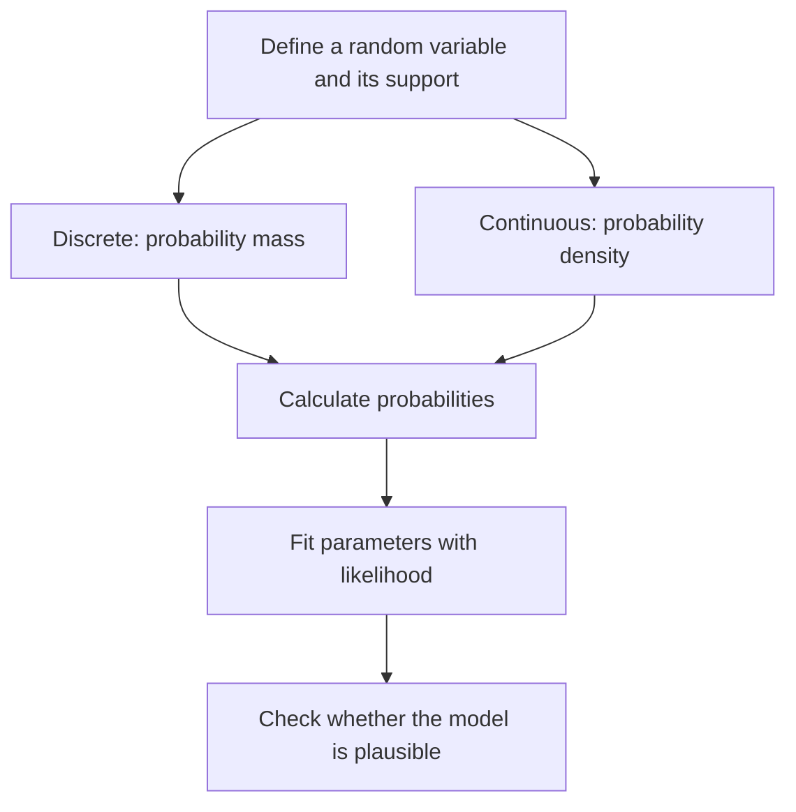
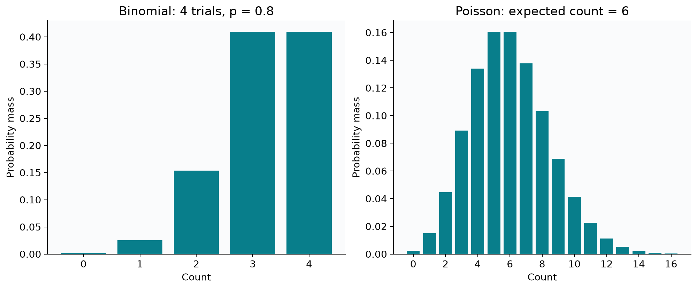

# 03 · Probability distributions, models, and likelihood

A probability model is an explicit description of what can vary and how likely its possible outcomes are. It can make predictions beyond the observed sample, but those predictions inherit the model's assumptions. A smooth curve fills gaps mathematically; it does not create new evidence.

**Learning route:** PMF/PDF/CDF → five common distributions → likelihood → model checks. Prerequisites: [histograms](../02_Histogram/02_Histogram.md); factorials and logarithms are reviewed in [AA](../AA_Prerequisite/AA_Prerequisite.md).

## 1. What a distribution specifies

A **random variable** maps outcomes to numbers. Capital $X$ denotes the random quantity; lowercase $x$ denotes a particular value. Its **support** is the set of values it can take. A discrete variable has a probability mass function, $p_X(x)=P(X=x)$, whose nonnegative masses sum to one.

A continuous variable can have a probability density function $f_X(x)$, with $f_X(x)\ge0$ and $\int f_X(x)\,dx=1$. Interval probabilities are areas:

$$P(a\le X\le b)=\int_a^b f_X(x)\,dx.$$

For either type, the **cumulative distribution function** is $F(t)=P(X\le t)$. For a continuous variable, $P(a<X\le b)=F(b)-F(a)$. For integer counts, $P(a\le X\le b)=F(b)-F(a-1)$ when $a,b$ are integers. The equality at a boundary matters when there is probability mass there.

Expectation is a probability-weighted average: $E[X]=\sum_x xp_X(x)$ or $\int xf_X(x)\,dx$, when defined. Variance is $E[(X-E[X])^2]$. These describe a model even before any observations have been collected.

## 2. Binomial: count successes in a fixed number of trials

Suppose each independent message has probability $p=0.8$ of arriving within one second. For four messages, let $K$ count timely arrivals. If the probability is constant across messages,

$$K\sim\operatorname{Binomial}(n=4,p=0.8),\qquad
P(K=k)=\binom nk p^k(1-p)^{n-k}.$$

To get exactly three timely arrivals, a **particular** arrangement such as timely, late, timely, timely has probability $0.8^3(0.2)=0.1024$. The late arrival can occupy any of four positions. These arrangements are mutually exclusive, so their probabilities add:

$$P(K=3)=4(0.1024)=0.4096.$$

The factor $\binom nk=n!/[k!(n-k)!]$ counts arrangements. It must not be omitted when only the number of successes is specified. The mean and variance are $np$ and $np(1-p)$, respectively. Here they are 3.2 and 0.64.

The binomial model requires a fixed number of trials, two outcomes per trial, independence, and a common success probability. Messages sharing an outage are not independent. A collection of different success probabilities generally gives a different distribution of the total.

## 3. Poisson: count events over an exposure

For randomly arriving messages, a Poisson process with rate $r$ per minute gives a count over $t$ minutes with parameter $\lambda=rt$:

$$K\sim\operatorname{Poisson}(\lambda),\qquad
P(K=k)=e^{-\lambda}\frac{\lambda^k}{k!},\quad k=0,1,\ldots.$$

If $r=2$ messages per minute and $t=3$ minutes, then $\lambda=6$, so $P(K=0)=e^{-6}\approx0.00248$. Here $\lambda$ is an expected count over a specified interval, not automatically a rate. Both the mean and variance of this count model equal $\lambda$.

A homogeneous Poisson process assumes a constant rate and independent increments, with no simultaneous batches in its idealized limit. Bursty traffic, trends, or clustered arrivals can violate these assumptions and produce much more variation than a Poisson model predicts.

<!-- lab: discrete_models -->

## 4. Normal: a location and a spread

The normal distribution is

$$X\sim N(\mu,\sigma^2),\qquad
f(x)=\frac1{\sigma\sqrt{2\pi}}
\exp\!\left[-\frac{(x-\mu)^2}{2\sigma^2}\right],\quad \sigma>0.$$

The mean $\mu$ sets its center. The SD $\sigma$ sets its width. A narrow curve must be taller to keep its total area equal to one. In this notation the second argument of $N(\mu,\sigma^2)$ is **variance**; SciPy's `scale` argument is **SD**.

Suppose a hypothetical sensor error is $N(0,2^2)$ millimeters. Then

$$P(-2\le X\le2)=\Phi(1)-\Phi(-1)\approx0.6827,$$

where $Z=(X-\mu)/\sigma$ has the standard normal distribution and $\Phi$ is its CDF. Approximately 68.27%, 95.45%, and 99.73% lie within one, two, and three SDs for a normal model. These percentages do not apply to every dataset with a mean and SD.

Under a continuous model, $P(X=0)=0$ even though $f(0)$ is the highest density. A recorded value of “0.0 mm” after rounding instead represents an interval such as $[-0.05,0.05)$; that interval has positive probability. A density value can exceed one and carries inverse measurement units.

## 5. Exponential and uniform: different shapes, different assumptions

If events follow a homogeneous Poisson process with rate $r$, the time $T$ until the next event is exponential:

$$f_T(t)=r e^{-rt}\quad(t\ge0),\qquad
P(T>t)=e^{-rt},\qquad E[T]=1/r.$$

At $r=0.25$ events per minute, mean waiting time is four minutes and $P(T>6)=e^{-1.5}\approx0.2231$. In SciPy use `expon(scale=1/r)`, not `scale=r`. The exponential distribution is memoryless: $P(T>s+t\mid T>s)=P(T>t)$. This assumption is unsuitable when an item wears out or a service schedule makes a long wait change the chance of imminent arrival.

A continuous uniform model on $[a,b]$ has density $1/(b-a)$ inside the interval and zero outside. Equal-length subintervals have equal probability. If a randomized delay is uniform between 2 and 6 seconds, $P(3\le X\le4.5)=1.5/4=0.375$. SciPy uses `uniform(loc=a, scale=b-a)`. Equal point probabilities are all zero; equality of interval probabilities is the useful statement.

<!-- lab: continuous_models -->

## 6. Probability versus likelihood: what is held fixed?

Probability calculations hold the model parameters fixed and vary possible data. A **likelihood** holds the observed data fixed and varies candidate parameter values. For independent observations,

$$L(\theta;x_1,\ldots,x_n)=\prod_{i=1}^n f(x_i\mid\theta),\qquad
\ell(\theta)=\log L(\theta)=\sum_{i=1}^n\log f(x_i\mid\theta).$$

For discrete data, use probability masses in place of densities. Products arise from independence. A **sum of density heights is not the joint likelihood** of independent observations. Summing log densities is correct because $\log(ab)=\log a+\log b$. Log likelihood also avoids numerical underflow when multiplying many small values.

The maximum likelihood estimate (MLE) maximizes this function over allowed parameters. It is not the probability that the parameter is true; a likelihood need not integrate to one over parameter values. Bayesian posterior probabilities require an additional prior and normalization.

For three invented sensor readings $x=(9,10,14)$ with known $\sigma=2$,

$$\ell(\mu)=-3\log(2\sqrt{2\pi})-\frac{(9-\mu)^2+(10-\mu)^2+(14-\mu)^2}{8}.$$

The first term is constant in $\mu$. Maximizing $\ell$ therefore minimizes the sum of squared distances, producing $\hat\mu=\bar x=11$. At $\mu=11$, the squared distances sum to 14; at $\mu=10$, they sum to 17. Thus $\ell(11)-\ell(10)=3/8$, and $L(11)/L(10)=e^{3/8}\approx1.455$. This compares the same observed data under two means with the same units and SD.

When both parameters of an iid normal model are unknown, the MLE of variance divides squared deviations by $n$. The unbiased estimator divides by $n-1$. They optimize different criteria, so there is no contradiction.

<!-- lab: likelihood -->

## 7. Model checking and limits

First check support: a normal model gives some probability to negative values, so it can be poor for waiting times near zero. Next compare simulated observations to the observed shape, including tails and variation. Check whether mean and variance agree approximately with a proposed Poisson model. Consider how data were generated rather than selecting a distribution solely because a histogram resembles a familiar curve.

Estimating parameters and treating them as known understates predictive uncertainty. A model fitted to a tiny sample can make precise-looking predictions that have little evidential support. Validation, sensitivity to alternative models, and interval estimates help expose that uncertainty.

## 8. Practice

1. For six independent trials with $p=0.3$, calculate $P(K=2)$ and $P(K\ge1)$.
2. An idealized Poisson counter records 3 events per hour. What parameter applies to a two-hour window, and what is the probability of zero events?
3. If a thickness is modeled as $N(12,1.5^2)$ mm, calculate $P(10.5\le X\le15)$.
4. A uniform density spans 0 to 0.2 seconds. What is its height, and what is $P(X<0.05)$?
5. Independent observations have densities 0.2 and 0.4 at a candidate parameter. What is their joint likelihood? What is the log likelihood?

## 9. Worked answers

1. $\binom62(0.3)^2(0.7)^4=0.324135$; $1-P(K=0)=1-0.7^6=0.882351$.
2. $\lambda=3\times2=6$; $P(K=0)=e^{-6}\approx0.002479$.
3. The standardized boundaries are $-1$ and $2$, so $\Phi(2)-\Phi(-1)\approx0.81859$.
4. Height is $1/0.2=5$ per second, and the requested area is $5(0.05)=0.25$.
5. $L=0.2\times0.4=0.08$ and $\ell=\log(0.08)\approx-2.52573$. The sum 0.6 is not their joint likelihood.

<!-- lab: practice -->

## References and next step

Reading connection: Starmer (2026), Chapter 3, [SQ](../Reference.md#sq-statquest). The joint-likelihood convention follows [NIST maximum likelihood](https://www.itl.nist.gov/div898/handbook/apr/section4/apr412.htm). Computational definitions: [SciPy statistical distributions](https://docs.scipy.org/doc/scipy/reference/stats.html). Examples and parameter comparisons are original.

Next: [04 · Hypothesis testing](../04_Hypothesis_Testing/04_Hypothesis_Testing.md).
