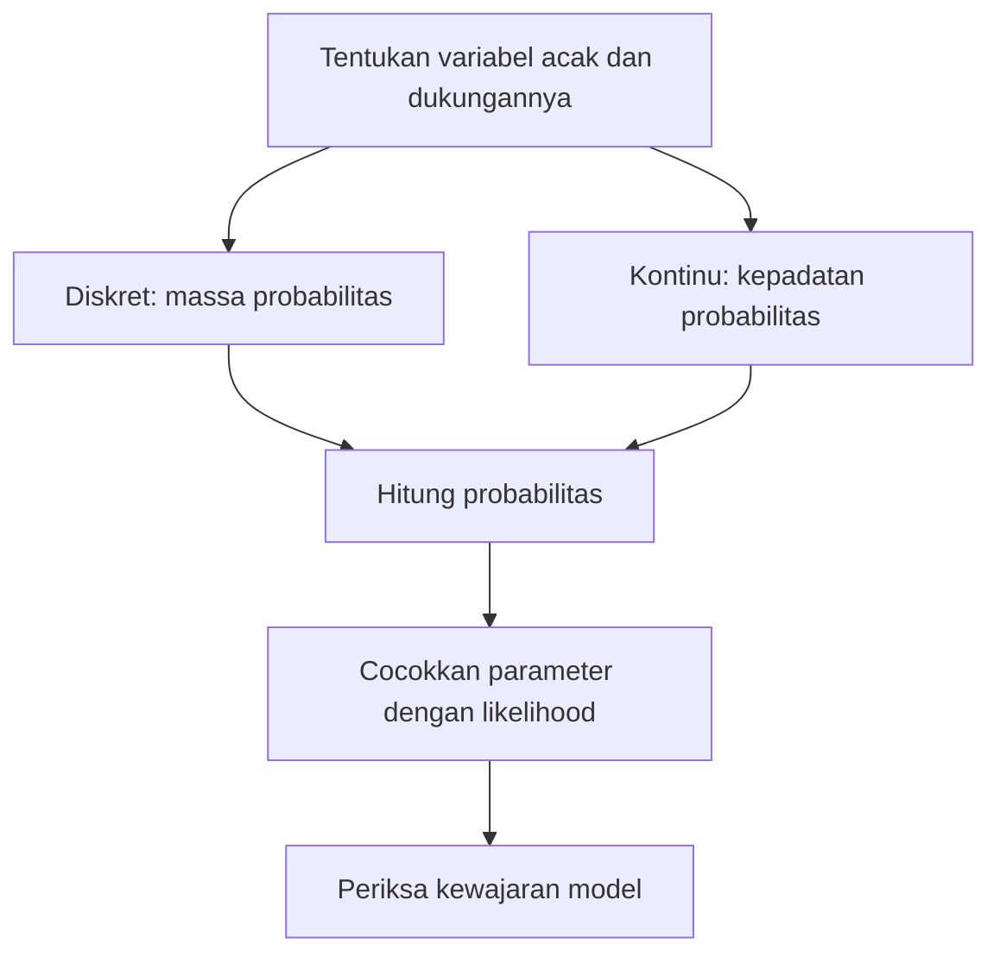
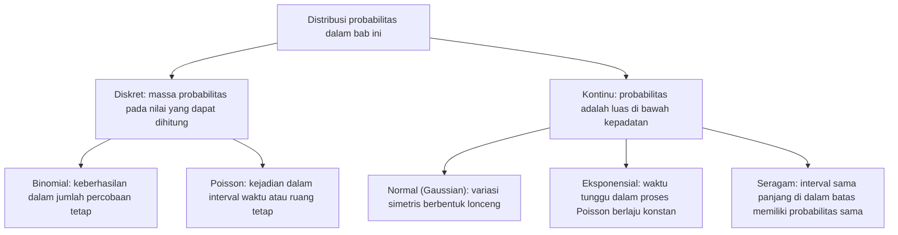
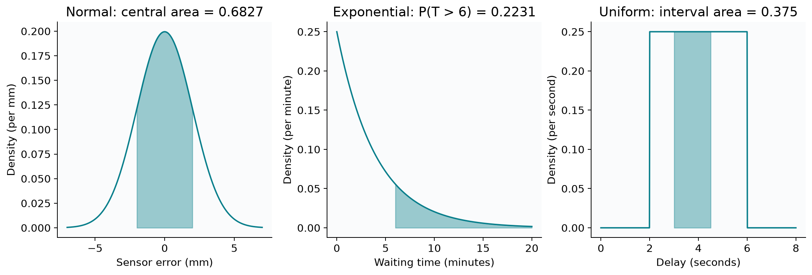
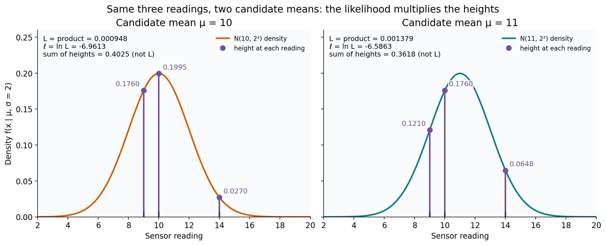

# 03 · Distribusi probabilitas, model, dan likelihood

Model probabilitas merupakan deskripsi eksplisit tentang apa yang dapat bervariasi dan seberapa mungkin hasil-hasilnya terjadi. Model dapat membuat prediksi di luar sampel yang diamati, tetapi prediksi tersebut mewarisi asumsi model. Kurva mulus mengisi celah secara matematis; kurva tersebut tidak menciptakan bukti baru.

**Alur pembelajaran:** PMF/PDF/CDF → notasi model → lima distribusi umum → keluarga lain → likelihood → pemeriksaan model. Prasyarat: [histogram](../02_Histogram/02_Histogram.md); faktorial dan logaritma ditinjau dalam [AA](../AA_Prerequisite/AA_Prerequisite.md).

## 1. Apa yang ditentukan oleh distribusi

**Variabel acak** memetakan hasil ke bilangan. Huruf kapital $X$ menyatakan besaran acak; huruf kecil $x$ menyatakan nilai tertentu. **Dukungan** distribusinya adalah himpunan nilai yang dapat diambil. Variabel diskret memiliki fungsi massa probabilitas, $p_X(x)=P(X=x)$, dengan massa tidak negatif yang berjumlah satu.

Variabel kontinu dapat memiliki fungsi kepadatan probabilitas $f_X(x)$, dengan $f_X(x)\ge0$ dan $\int f_X(x)\,dx=1$. Probabilitas interval adalah luas:

$$P(a\le X\le b)=\int_a^b f_X(x)\,dx.$$

Untuk kedua jenis, **fungsi distribusi kumulatif** adalah $F(t)=P(X\le t)$. Untuk variabel kontinu, $P(a<X\le b)=F(b)-F(a)$. Untuk hitungan bilangan bulat, $P(a\le X\le b)=F(b)-F(a-1)$ ketika $a,b$ bilangan bulat. Kesamaan pada batas penting ketika terdapat massa probabilitas di sana.

Nilai harapan adalah rata-rata berbobot probabilitas: $E[X]=\sum_x xp_X(x)$ atau $\int xf_X(x)\,dx$, jika terdefinisi. Varians adalah $E[(X-E[X])^2]$. Keduanya menggambarkan model bahkan sebelum pengamatan dikumpulkan.

### Distribusi, keluarga, dan model

**Distribusi probabilitas** menggambarkan seberapa mungkin setiap nilai yang dapat diambil suatu variabel acak. Distribusi memberikan seluruh himpunan hasil yang mungkin beserta probabilitas masing-masing, atau probabilitas setiap rentang nilai. **Keluarga** distribusi memiliki satu rumus yang sama dan hanya berbeda pada nilai parameternya; “binomial” dan “normal” adalah nama keluarga. **Model probabilitas** adalah keluarga yang dipilih untuk mewakili suatu proses nyata, misalnya “model binomial untuk banyaknya barang cacat.” Matematikanya sama; kata *model* menjelaskan cara kita menggunakannya.

Secara formal, model statistik adalah himpunan kandidat distribusi yang diindeks oleh parameter $\theta$:

$$\mathcal M=\{P_\theta:\theta\in\Theta\}.$$

Bacalah sebagai “$\mathcal M$ adalah himpunan semua distribusi $P_\theta$, dengan $\theta$ berada dalam $\Theta$.” Setiap $P_\theta$ adalah distribusi probabilitas atas hasil-hasil yang mungkin.

| Simbol | Dibaca | Arti |
|---|---|---|
| $\mathcal M$ | “M skrip” atau “model” | Model: kumpulan distribusi |
| $=$ | “adalah” atau “didefinisikan sebagai” | Mendefinisikan ruas kiri |
| $\{\ldots\}$ | “himpunan” | Kumpulan objek |
| $P_\theta$ | “P subskrip theta” | Satu distribusi, ditetapkan oleh nilai parameter $\theta$ tertentu |
| $:$ | “sedemikian sehingga” atau “dengan” | Memisahkan objek dari syarat yang berlaku padanya |
| $\theta$ | “theta” | Satu nilai parameter tertentu, misalnya $\theta=(\mu,\sigma)$ |
| $\in$ | “dalam” atau “anggota dari” | Keanggotaan |
| $\Theta$ | “Theta kapital” | **Ruang parameter**: seluruh nilai yang boleh diambil $\theta$ |

**Mengapa menulis $\theta\in\Theta$?** Tidak setiap bilangan merupakan parameter yang sah. Untuk model normal, $\theta=(\mu,\sigma)=(5,2)$ diperbolehkan, sehingga termasuk dalam $\Theta$. Nilai $\theta=(5,-2)$ tidak diperbolehkan, karena simpangan baku tidak mungkin negatif. Karena itu, ruang parameter normal adalah $\Theta=\{(\mu,\sigma):\mu\in\mathbb R,\ \sigma>0\}$. Untuk model binomial dengan $n$ diketahui, $\Theta$ adalah interval $0\le p\le1$; untuk model Poisson, $\lambda>0$. Memilih satu nilai $\theta$ menentukan satu distribusi. Mengestimasi $\theta$ dari data, seperti pada Bagian 7, memilih anggota keluarga yang sesuai dengan pengamatan.

**Kaitan dengan histogram.** Histogram adalah distribusi empiris: histogram mengestimasi probabilitas setiap kelas, tetapi memerlukan banyak pengamatan dan tidak memberi informasi tentang daerah kosong. Model menggantikan estimasi per kelas tersebut dengan rumus yang dikendalikan oleh sedikit parameter. Hal ini memungkinkan prediksi di antara dan di luar nilai yang diamati, dengan konsekuensi adanya asumsi yang harus diperiksa (Bagian 8).

### Lima keluarga dalam bab ini

| Model | Jenis dan nilai yang mungkin | Yang dimodelkan | Parameter | Massa atau kepadatan | Rata-rata | Varians |
|---|---|---|---|---|---|---|
| Binomial | Diskret: $0,1,\ldots,n$ | Banyaknya keberhasilan dalam $n$ percobaan independen dengan probabilitas keberhasilan yang sama | $n$: percobaan; $p$: probabilitas keberhasilan | $P(K=k)=\binom nk p^k(1-p)^{n-k}$ | $np$ | $np(1-p)$ |
| Poisson | Diskret: $0,1,2,\ldots$ | Banyaknya kejadian dalam interval tetap pada proses Poisson | $\lambda>0$: nilai harapan hitungan dalam interval tersebut | $P(K=k)=e^{-\lambda}\lambda^k/k!$ | $\lambda$ | $\lambda$ |
| Normal (Gaussian) | Kontinu: semua bilangan real | Variasi simetris berbentuk lonceng, seperti galat pengukuran | $\mu$: rata-rata; $\sigma>0$: SD | $f(x)=\dfrac{1}{\sigma\sqrt{2\pi}}e^{-(x-\mu)^2/(2\sigma^2)}$ | $\mu$ | $\sigma^2$ |
| Eksponensial | Kontinu: $t\ge0$ | Waktu tunggu hingga kejadian berikutnya dalam proses Poisson berlaju konstan | $r>0$: laju kejadian | $f(t)=re^{-rt}$ | $1/r$ | $1/r^2$ |
| Seragam | Kontinu: $a\le x\le b$ | Nilai dalam batas tetap, dengan probabilitas sama untuk interval sama panjang | $a<b$: batas bawah dan atas | $f(x)=1/(b-a)$ | $(a+b)/2$ | $(b-a)^2/12$ |

Untuk distribusi eksponensial dan seragam, kepadatannya nol di luar rentang yang dinyatakan. **Model diskret:** probabilitas diperoleh dengan menjumlahkan massa. **Model kontinu:** probabilitas diperoleh dari luas di bawah kurva kepadatan,

$$P(u\le X\le v)=\int_u^v f(x)\,dx=F(v)-F(u).$$

Tinggi kepadatan kontinu bukanlah probabilitas. Bagian 2–5 membahas setiap keluarga dengan contoh; Bagian 6 mendaftar keluarga lain yang akan Anda temui kemudian.

## 2. Binomial: menghitung keberhasilan dalam jumlah percobaan tetap

Misalkan setiap pesan independen memiliki probabilitas $p=0.8$ untuk tiba dalam satu detik. Untuk empat pesan, misalkan $K$ menghitung kedatangan tepat waktu. Jika probabilitasnya konstan untuk semua pesan,

$$K\sim\operatorname{Binomial}(n=4,p=0.8),\qquad
P(K=k)=\binom nk p^k(1-p)^{n-k}.$$

Untuk memperoleh tepat tiga kedatangan tepat waktu, suatu susunan **tertentu**, seperti tepat waktu, terlambat, tepat waktu, tepat waktu, memiliki probabilitas $0.8^3(0.2)=0.1024$. Kedatangan terlambat dapat menempati salah satu dari empat posisi. Susunan-susunan ini saling lepas, sehingga probabilitasnya dijumlahkan:

$$P(K=3)=4(0.1024)=0.4096.$$

Faktor $\binom nk=n!/[k!(n-k)!]$ menghitung susunan. Faktor ini tidak boleh dihilangkan ketika hanya jumlah keberhasilan yang ditentukan. Rata-rata dan variansnya masing-masing $np$ dan $np(1-p)$. Di sini nilainya 3.2 dan 0.64.

Model binomial memerlukan jumlah percobaan tetap, dua hasil per percobaan, independensi, dan probabilitas keberhasilan yang sama. Pesan-pesan yang terdampak gangguan yang sama tidak independen. Kumpulan probabilitas keberhasilan yang berbeda umumnya menghasilkan distribusi total yang berbeda.

## 3. Poisson: menghitung kejadian selama suatu paparan

Untuk pesan yang tiba secara acak, proses Poisson dengan laju $r$ per menit menghasilkan hitungan selama $t$ menit dengan parameter $\lambda=rt$:

$$K\sim\operatorname{Poisson}(\lambda),\qquad
P(K=k)=e^{-\lambda}\frac{\lambda^k}{k!},\quad k=0,1,\ldots.$$

Jika $r=2$ pesan per menit dan $t=3$ menit, maka $\lambda=6$, sehingga $P(K=0)=e^{-6}\approx0.00248$. Di sini $\lambda$ adalah nilai harapan hitungan selama interval tertentu, bukan otomatis suatu laju. Rata-rata dan varians model hitungan ini sama-sama $\lambda$.

Distribusi Poisson hanya memiliki satu parameter, sehingga $\lambda$ menentukan pusat sekaligus penyebarannya:

$$E[K]=\lambda,\qquad \operatorname{Var}(K)=\lambda,\qquad \operatorname{SD}(K)=\sqrt\lambda.$$

| $\lambda$ | Rata-rata | Varians | Simpangan baku |
|---:|---:|---:|---:|
| 1 | 1 | 1 | 1 |
| 3 | 3 | 3 | $\sqrt3\approx1.732$ |
| 6 | 6 | 6 | $\sqrt6\approx2.449$ |
| 9 | 9 | 9 | 3 |

Jika rata-ratanya 3 per menit, SD-nya harus $\sqrt3\approx1{,}732$; Anda tidak dapat menetapkan SD sebesar 4 dan tetap memperoleh distribusi Poisson. Distribusi normal berbeda: $\mu$ dan $\sigma$ adalah parameter yang terpisah. Hubungan ini menggambarkan model. Rata-rata dan varians sampel berhingga umumnya sedikit berbeda meskipun modelnya sesuai; varians yang terus-menerus jauh lebih besar daripada rata-rata menunjukkan perlunya alternatif seperti binomial negatif (Bagian 6).

Proses Poisson homogen mengasumsikan laju konstan dan pertambahan independen, tanpa kelompok kejadian serentak dalam limit idealnya. Lalu lintas yang melonjak, tren, atau kedatangan berkelompok dapat melanggar asumsi tersebut dan menghasilkan variasi jauh lebih besar daripada prediksi model Poisson.

<!-- lab: discrete_models -->

## 4. Normal: lokasi dan penyebaran

Distribusi normal adalah

$$X\sim N(\mu,\sigma^2),\qquad
f(x)=\frac1{\sigma\sqrt{2\pi}}
\exp\!\left[-\frac{(x-\mu)^2}{2\sigma^2}\right],\quad \sigma>0.$$

Rata-rata $\mu$ menentukan pusatnya. SD $\sigma$ menentukan lebarnya. Kurva sempit harus lebih tinggi agar luas totalnya tetap satu. Dalam notasi ini, argumen kedua $N(\mu,\sigma^2)$ adalah **varians**; argumen `scale` SciPy adalah **SD**.

Misalkan galat sensor hipotetis mengikuti $N(0,2^2)$ milimeter. Maka

$$P(-2\le X\le2)=\Phi(1)-\Phi(-1)\approx0.6827,$$

dengan $Z=(X-\mu)/\sigma$ mengikuti distribusi normal standar dan $\Phi$ adalah CDF-nya. Sekitar 68.27%, 95.45%, dan 99.73% berada dalam jarak satu, dua, dan tiga SD pada model normal. Persentase ini tidak berlaku untuk setiap kumpulan data yang memiliki rata-rata dan SD.

Dalam model kontinu, $P(X=0)=0$ meskipun $f(0)$ merupakan kepadatan tertinggi. Nilai tercatat “0.0 mm” setelah pembulatan justru mewakili interval seperti $[-0.05,0.05)$; interval tersebut memiliki probabilitas positif. Nilai kepadatan dapat melebihi satu dan memiliki satuan kebalikan dari satuan pengukuran.

## 5. Eksponensial dan seragam: bentuk berbeda, asumsi berbeda

Jika kejadian mengikuti proses Poisson homogen dengan laju $r$, waktu $T$ hingga kejadian berikutnya berdistribusi eksponensial:

$$f_T(t)=r e^{-rt}\quad(t\ge0),\qquad
P(T>t)=e^{-rt},\qquad E[T]=1/r.$$

Pada $r=0.25$ kejadian per menit, rata-rata waktu tunggu adalah empat menit dan $P(T>6)=e^{-1.5}\approx0.2231$. Dalam SciPy gunakan `expon(scale=1/r)`, bukan `scale=r`. Distribusi eksponensial tidak memiliki ingatan: $P(T>s+t\mid T>s)=P(T>t)$. Asumsi ini tidak sesuai ketika suatu barang mengalami keausan atau jadwal layanan membuat waktu tunggu yang panjang mengubah peluang kedatangan dalam waktu dekat.

Model seragam kontinu pada $[a,b]$ memiliki kepadatan $1/(b-a)$ di dalam interval dan nol di luarnya. Subinterval dengan panjang sama memiliki probabilitas sama. Jika penundaan acak berdistribusi seragam antara 2 dan 6 detik, $P(3\le X\le4.5)=1.5/4=0.375$. SciPy menggunakan `uniform(loc=a, scale=b-a)`. Probabilitas setiap titik sama-sama nol; kesamaan probabilitas interval adalah pernyataan yang berguna.

<!-- lab: continuous_models -->

## 6. Di luar lima keluarga: distribusi lain yang akan Anda temui

Lima keluarga di atas merupakan titik awal yang berguna, bukan klasifikasi lengkap. Tabel berikut mendaftar keluarga umum lainnya, apa yang dimodelkan masing-masing, dan cara memanggilnya di SciPy. Bacalah “Rata-rata” sebagai nilai harapan pada parameter yang dinyatakan.

**Keluarga diskret**

| Model | Nilai yang mungkin | Yang dimodelkan | Parameter | Rata-rata | SciPy |
|---|---|---|---|---|---|
| Bernoulli | $0,1$ | Satu percobaan dengan dua hasil, seperti lulus/gagal | $p$: probabilitas keberhasilan | $p$ | `bernoulli(p)` |
| Kategoris | Salah satu dari $k$ label | Satu hasil dari beberapa kategori, seperti merah, hijau, atau biru | $p_1,\ldots,p_k$: probabilitas kategori yang berjumlah 1 | $P(\text{kategori } j)=p_j$ | `multinomial(1, [p1, ..., pk])` |
| Multinomial | Hitungan $(x_1,\ldots,x_k)$ yang berjumlah $n$ | Hitungan pada beberapa kategori setelah sejumlah tetap percobaan independen | $n$: percobaan; $p_1,\ldots,p_k$ | $E[X_j]=np_j$ | `multinomial(n, [p1, ..., pk])` |
| Geometrik | $1,2,3,\ldots$ | Banyaknya percobaan independen hingga keberhasilan pertama | $p$: probabilitas keberhasilan per percobaan | $1/p$ | `geom(p)` |
| Binomial negatif | $0,1,2,\ldots$ | Banyaknya kegagalan sebelum keberhasilan ke-$r$; juga hitungan dengan variasi lebih besar daripada Poisson | $r$: keberhasilan yang diperlukan; $p$: probabilitas keberhasilan | $r(1-p)/p$ | `nbinom(r, p)` |
| Hipergeometrik | $0,\ldots,\min(n,M)$ | Banyaknya barang bertanda dalam $n$ pengambilan **tanpa pengembalian** | $N$: ukuran populasi; $M$: barang bertanda; $n$: pengambilan | $nM/N$ | `hypergeom(M=N, n=M, N=n)` |
| Seragam diskret | Bilangan bulat $a,\ldots,b$ | Hasil bilangan bulat yang sama mungkin, seperti lemparan dadu yang adil | $a,b$: bilangan bulat terkecil dan terbesar | $(a+b)/2$ | `randint(a, b + 1)` |

**Keluarga kontinu**

| Model | Nilai yang mungkin | Yang dimodelkan | Parameter | Rata-rata | SciPy |
|---|---|---|---|---|---|
| Beta | $0<x<1$ | Nilai antara 0 dan 1; sering digunakan untuk memodelkan probabilitas yang tidak diketahui | $\alpha,\beta>0$: parameter bentuk | $\alpha/(\alpha+\beta)$ | `beta(a, b)` |
| Gamma | $x>0$ | Besaran positif, termasuk waktu tunggu hingga beberapa kejadian proses Poisson | $\alpha>0$: bentuk; $\theta>0$: skala | $\alpha\theta$ | `gamma(a, scale=theta)` |
| Khi-kuadrat | $x\ge0$ | Jumlah kuadrat $\nu$ variabel normal baku independen; digunakan dalam uji varians dan uji kecocokan | $\nu$: derajat kebebasan | $\nu$ | `chi2(nu)` |
| $t$ Student | Semua bilangan real | Variasi simetris dengan ekor lebih tebal daripada normal; digunakan dalam inferensi tentang rata-rata | $\nu$: derajat kebebasan | $0$ untuk $\nu>1$ | `t(nu)` |
| $F$ | $x\ge0$ | Rasio dua variabel khi-kuadrat independen, masing-masing dibagi derajat kebebasannya; digunakan untuk membandingkan varians dan model | $d_1,d_2$: derajat kebebasan pembilang dan penyebut | $d_2/(d_2-2)$ untuk $d_2>2$ | `f(d1, d2)` |
| Log-normal | $x>0$ | Besaran positif yang logaritmanya berdistribusi normal | $\mu,\sigma$: rata-rata dan SD dari $\log X$ | $e^{\mu+\sigma^2/2}$ | `lognorm(s=sigma, scale=exp(mu))` |
| Weibull | $x\ge0$ | Umur pakai atau waktu kegagalan dengan pola risiko kegagalan yang berbeda | $k>0$: bentuk; $\lambda>0$: skala | $\lambda\,\Gamma(1+1/k)$ | `weibull_min(c=k, scale=lam)` |

Di sini $\Gamma$ pada rata-rata Weibull adalah fungsi gamma, yang memperluas faktorial: $\Gamma(m)=(m-1)!$ untuk bilangan bulat positif $m$. Bentuk Weibull $k$ menggambarkan bagaimana risiko kegagalan berubah terhadap umur: $k<1$ berarti risiko menurun (kegagalan dini), $k=1$ berarti risiko konstan, dan $k>1$ berarti risiko meningkat (keausan).

**Perhatikan konvensi parameter.** Buku teks dan perangkat lunak menamai dan mengurutkan parameter secara berbeda:

- Distribusi geometrik dapat menghitung **percobaan** hingga keberhasilan pertama (dukungan $1,2,\ldots$; `geom` di SciPy) atau **kegagalan** sebelumnya (dukungan $0,1,\ldots$). Rata-rata keduanya berbeda satu.
- `hypergeom(M, n, N)` di SciPy menggunakan $M$ untuk ukuran populasi, $n$ untuk banyaknya barang bertanda, dan $N$ untuk banyaknya pengambilan. Huruf $N,M,n$ pada tabel mengikuti notasi buku teks yang lebih umum, sehingga argumennya tampak tertukar.
- Distribusi gamma dan eksponensial ditulis dengan **laju** $r$ atau **skala** $\theta=1/r$. SciPy menggunakan skala.
- Log-normal di SciPy menggunakan `s` untuk $\sigma$ dan `scale` untuk $e^{\mu}$.

**Hubungan yang berguna.** Hubungan berikut mengaitkan keluarga baru dengan keluarga yang sudah Anda kenal:

- Bernoulli adalah distribusi binomial dengan $n=1$.
- Kategoris adalah distribusi multinomial dengan $n=1$.
- Distribusi geometrik menghitung percobaan hingga keberhasilan pertama; binomial negatif dengan $r=1$ menghitung kegagalan sebelum keberhasilan tersebut, sehingga keduanya berbeda satu.
- Eksponensial adalah distribusi gamma dengan bentuk $\alpha=1$, dan juga distribusi Weibull dengan bentuk $k=1$.
- Khi-kuadrat dengan $\nu$ derajat kebebasan adalah distribusi gamma dengan bentuk $\nu/2$ dan skala 2.
- $t$ Student mendekati distribusi normal baku ketika derajat kebebasannya bertambah.
- Distribusi binomial adalah padanan hipergeometrik untuk pengambilan dengan pengembalian; keduanya mirip ketika populasi jauh lebih besar daripada banyaknya pengambilan.

**Membaca grafik:** batang hijau toska adalah massa probabilitas keluarga diskret; jumlahkan untuk memperoleh probabilitas. Kurva adalah kepadatan keluarga kontinu; probabilitas adalah luas di bawahnya. Mengubah parameter dapat mengubah bentuk sepenuhnya: kepadatan Beta dapat memuncak di tengah atau menumpuk di kedua ujung, dan kepadatan Weibull dengan $k=0{,}8$ menurun sejak nol sedangkan $k=2{,}5$ naik menuju puncak. Pada panel $t$ Student, kurva dengan $\nu=2$ jelas memiliki ekor lebih tebal daripada normal baku; dengan $\nu=10$, kurvanya sudah dekat.

**Eksperimen notebook:** kode memeriksa setiap hubungan di atas secara numerik dan membandingkan setiap rumus rata-rata dengan SciPy. Ubah suatu parameter, prediksi bagaimana bentuk dan rata-ratanya akan bergeser, lalu jalankan ulang sel tersebut.

<!-- lab: distribution_catalog -->

## 7. Probabilitas dibandingkan likelihood: apa yang ditetapkan?

Probabilitas dan likelihood menggunakan **rumus yang sama**, $f(x\mid\theta)$, tetapi membacanya dari arah yang berlawanan. Perhitungan **probabilitas** menetapkan parameter model $\theta$ dan menanyakan data yang mungkin muncul. **Likelihood** menetapkan data yang diamati dan membandingkan kandidat nilai parameter.

| | Probabilitas | Likelihood |
|---|---|---|
| Yang ditetapkan | Parameter $\theta$ | Data yang diamati $x_1,\ldots,x_n$ |
| Yang divariasikan | Nilai data yang mungkin | Kandidat nilai parameter |
| Pertanyaan | “Jika $\theta$ benar, seberapa mungkin hasil-hasil ini?” | “Berdasarkan data ini, seberapa baik setiap $\theta$ menjelaskannya?” |
| Berjumlah satu atas | Semua data yang mungkin | Tidak harus atas $\theta$ |

**Definisi.** Untuk pengamatan independen, **likelihood** dari $\theta$ adalah hasil kali nilai kepadatan (atau, untuk data diskret, massa) pada setiap pengamatan. **Log-likelihood** adalah logaritma naturalnya:

$$L(\theta;x_1,\ldots,x_n)=\prod_{i=1}^n f(x_i\mid\theta),\qquad
\ell(\theta)=\ln L(\theta)=\sum_{i=1}^n\ln f(x_i\mid\theta).$$

Dalam statistika, “log” tanpa basis berarti **logaritma natural** $\ln$, dengan basis $e\approx2{,}718$. NumPy mengikuti konvensi yang sama: `np.log` adalah $\ln$, sedangkan `np.log10` berbasis 10.

### Langkah demi langkah: dua pengamatan

Misalkan suatu model dengan parameter $\theta$ memberikan tinggi kepadatan 0,5 dan 0,25 untuk dua pengamatan independen pada kandidat $\theta_A$, serta 0,4 dan 0,1 pada kandidat lain $\theta_B$.

1. **Baca tinggi kepadatan pada setiap pengamatan.** Setiap tinggi menunjukkan seberapa wajar pengamatan tersebut pada kandidat itu. Tinggi kepadatan bukan probabilitas; satuannya “per satuan $x$” dan nilainya dapat melebihi satu.
2. **Kalikan tingginya.** Data terdiri atas pengamatan 1 **dan** pengamatan 2. Untuk pengamatan independen, “dan” berarti perkalian, sama seperti $P(A\cap B)=P(A)P(B)$ untuk kejadian independen:

   $$L(\theta_A)=0.5\times0.25=0.125,\qquad L(\theta_B)=0.4\times0.1=0.04.$$

3. **Ambil logaritma natural.** Karena $\ln(ab)=\ln a+\ln b$, hasil kali berubah menjadi jumlah logaritma:

   $$\ell(\theta_A)=\ln0.5+\ln0.25=-0.69315-1.38629=-2.07944,$$
   $$\ell(\theta_B)=\ln0.4+\ln0.1=-0.91629-2.30259=-3.21888.$$

   Nilai negatif adalah hal yang wajar: logaritma setiap bilangan antara 0 dan 1 bernilai negatif. Log-likelihood bukan probabilitas.

4. **Bandingkan kandidat pada data yang sama.** $\theta_A$ menjelaskan data lebih baik. Rasio likelihood-nya adalah $L(\theta_A)/L(\theta_B)=0.125/0.04=3.125$, dan selisih log-likelihood-nya adalah $-2.07944-(-3.21888)=1.13943=\ln3.125$. Satu nilai likelihood saja, seperti 0,125, tidak bermakna dengan sendirinya; yang bermakna adalah perbandingan antarkandidat.

**Mengapa dikalikan, bukan dijumlahkan?** Penjumlahan digunakan untuk “A **atau** B” dengan hasil yang saling lepas; di sini kedua pengamatan terjadi bersama-sama. Penjumlahan juga gagal mendeteksi kecocokan yang buruk. Tambahkan pengamatan ketiga dengan tinggi 0,001 pada $\theta_A$, yaitu pengamatan yang dijelaskan sangat buruk oleh kandidat tersebut. Hasil kalinya turun dari 0,125 menjadi 0,000125, penurunan seribu kali lipat yang dengan tepat menandai ketidakcocokan. Jumlahnya hampir tidak berubah, dari 0,75 menjadi 0,751. **Jumlah tinggi kepadatan bukan likelihood bersama.**

**Mengapa mengambil logaritma?** Pertama, keamanan numerik: mengalikan 1.000 kepadatan yang lebih kecil dari satu dapat menghasilkan bilangan yang terlalu kecil untuk disimpan komputer, sehingga dibulatkan menjadi nol (**underflow**). Menjumlahkan 1.000 logaritma menghindari hal itu. Kedua, aljabar yang lebih sederhana: logaritma mengubah hasil kali menjadi jumlah dan menghilangkan eksponensial pada kepadatan seperti normal. Karena $\ln$ fungsi naik, parameter yang memaksimalkan $\ell$ juga memaksimalkan $L$.

**Apakah basisnya berpengaruh?** Tidak terhadap kandidat yang unggul. Mengganti basis mengalikan setiap log-likelihood dengan konstanta positif yang sama: $\log_{10}L=\ln L/\ln10=\ln L/2.302585$. Untuk $\theta_A$, $\ln0.125=-2.07944$ sedangkan $\log_{10}0.125=-0.90309$; urutan kandidat tidak berubah. Gunakan $\ln$, karena turunan, uji rasio likelihood, AIC, dan BIC semuanya didefinisikan dengan logaritma natural.

### Contoh lengkap: rata-rata mana yang paling baik menjelaskan tiga pembacaan?

Tiga pembacaan sensor rekaan adalah $x=(9,10,14)$, dimodelkan sebagai $N(\mu,2^2)$ independen dengan $\sigma=2$ diketahui. Datanya tetap; yang kita geser adalah kandidat rata-rata $\mu$. Setiap tinggi kepadatan adalah

$$f(x_i\mid\mu)=\frac{1}{2\sqrt{2\pi}}\exp\!\left[-\frac{(x_i-\mu)^2}{8}\right],\qquad \frac{1}{2\sqrt{2\pi}}\approx0.19947.$$

| Kandidat $\mu$ | $f(9\mid\mu)$ | $f(10\mid\mu)$ | $f(14\mid\mu)$ | Likelihood $L(\mu)$ | Log-likelihood $\ell(\mu)$ | Jumlah tinggi |
|---:|---:|---:|---:|---:|---:|---:|
| 10 | 0.17603 | 0.19947 | 0.02700 | 0.000948 | $-6.9613$ | 0.4025 |
| 11 | 0.12099 | 0.17603 | 0.06476 | 0.001379 | $-6.5863$ | 0.3618 |

**Membaca grafik:** ketiga pembacaan, yang ditandai pada sumbu horizontal, sama persis pada kedua panel; hanya kurvanya yang bergeser. Dengan $\mu=10$, pembacaan 9 dan 10 berada dekat puncak, tetapi 14 berada jauh di ekor, dengan tinggi 0,027. Dengan $\mu=11$, dua tinggi pertama sedikit mengecil sementara tinggi pada 14 menjadi lebih dari dua kali lipat. Perkalian tinggi menguntungkan kandidat yang menjelaskan **semua** pengamatan secara wajar, sehingga $\mu=11$ unggul: $L(11)/L(10)=0.001379/0.000948\approx1.455$. Jumlah tinggi justru akan keliru memilih $\mu=10$ (0,4025 dibandingkan 0,3618), karena penjumlahan membiarkan dua titik yang cocok menutupi satu titik yang tidak cocok.

**Temukan $\mu$ terbaik secara aljabar.** Mengambil $\ln$ dari hasil kali menghasilkan

$$\ell(\mu)=-3\ln(2\sqrt{2\pi})-\frac{(9-\mu)^2+(10-\mu)^2+(14-\mu)^2}{8}.$$

Suku pertama tidak bergantung pada $\mu$. Karena itu, memaksimalkan $\ell$ berarti meminimalkan jumlah kuadrat jarak $(9-\mu)^2+(10-\mu)^2+(14-\mu)^2$. Menyamakan turunannya dengan nol, $-2[(9-\mu)+(10-\mu)+(14-\mu)]=0$, menghasilkan $\hat\mu=\bar x=33/3=11$. Pada $\mu=11$ jumlah kuadrat jaraknya $4+1+9=14$; pada $\mu=10$ jumlahnya $1+0+16=17$. Jadi

$$\ell(11)-\ell(10)=\frac{17-14}{8}=\frac38=0.375,\qquad \frac{L(11)}{L(10)}=e^{3/8}\approx1.455,$$

sesuai dengan tabel.

**Membaca grafik:** setiap titik pada kurva mengulang perhitungan tabel untuk satu kandidat rata-rata. Kurva mencapai puncak pada **estimasi likelihood maksimum (MLE)**, $\hat\mu=11$, dan menurun di kedua sisi. Sumbu vertikal dikurangi nilai maksimumnya, sehingga puncaknya berada di nol dan kurva menunjukkan seberapa buruk setiap kandidat lain menjelaskan data yang sama.

**Apa yang bukan MLE.** MLE adalah nilai parameter yang diperbolehkan dan memaksimalkan likelihood. Likelihood bukan probabilitas bahwa suatu parameter benar: likelihood adalah fungsi dari $\theta$ yang integralnya terhadap nilai parameter tidak harus satu. Mengubahnya menjadi probabilitas untuk parameter memerlukan distribusi prior dan normalisasi, seperti dalam analisis Bayesian.

**Catatan tentang varians.** Ketika kedua parameter model normal iid tidak diketahui, MLE varians membagi jumlah kuadrat simpangan dengan $n$, sedangkan estimator tak bias dari Bab 1 membaginya dengan $n-1$. Keduanya menjawab kriteria berbeda, yaitu likelihood maksimum dibandingkan benar secara rata-rata, sehingga tidak ada pertentangan.

<!-- lab: likelihood -->

## 8. Pemeriksaan model dan keterbatasan

Pertama, periksa dukungan distribusinya: model normal memberikan sebagian probabilitas pada nilai negatif, sehingga dapat kurang sesuai untuk waktu tunggu mendekati nol. Berikutnya, bandingkan pengamatan simulasi dengan bentuk data yang diamati, termasuk ekor dan variasinya. Periksa apakah rata-rata dan varians kira-kira sesuai dengan model Poisson yang diusulkan. Pertimbangkan bagaimana data dihasilkan, alih-alih memilih distribusi semata-mata karena histogram menyerupai kurva yang dikenal.

Mengestimasi parameter lalu memperlakukannya sebagai nilai yang diketahui akan meremehkan ketidakpastian prediksi. Model yang dicocokkan dengan sampel sangat kecil dapat menghasilkan prediksi yang tampak presisi tetapi hanya sedikit didukung bukti. Validasi, sensitivitas terhadap model alternatif, dan estimasi interval membantu mengungkap ketidakpastian tersebut.

## 9. Latihan

1. Untuk enam percobaan independen dengan $p=0.3$, hitung $P(K=2)$ dan $P(K\ge1)$.
2. Pencacah Poisson ideal mencatat 3 kejadian per jam. Parameter apa yang berlaku untuk jendela dua jam, dan berapa probabilitas nol kejadian?
3. Jika ketebalan dimodelkan sebagai $N(12,1.5^2)$ mm, hitung $P(10.5\le X\le15)$.
4. Kepadatan seragam membentang dari 0 hingga 0.2 detik. Berapa tingginya, dan berapa $P(X<0.05)$?
5. Pengamatan independen memiliki kepadatan 0.2 dan 0.4 pada suatu kandidat parameter. Berapa likelihood bersamanya? Berapa log-likelihood-nya?

## 10. Pembahasan jawaban

1. $\binom62(0.3)^2(0.7)^4=0.324135$; $1-P(K=0)=1-0.7^6=0.882351$.
2. $\lambda=3\times2=6$; $P(K=0)=e^{-6}\approx0.002479$.
3. Batas terstandarisasinya adalah $-1$ dan $2$, sehingga $\Phi(2)-\Phi(-1)\approx0.81859$.
4. Tingginya $1/0.2=5$ per detik, dan luas yang diminta $5(0.05)=0.25$.
5. $L=0.2\times0.4=0.08$ dan $\ell=\log(0.08)\approx-2.52573$. Jumlah 0.6 bukan likelihood bersamanya.

<!-- lab: practice -->

## Referensi dan langkah berikutnya

Kaitan bacaan: Starmer (2026), Bab 3, [SQ](../Reference.md#sq-statquest). Konvensi likelihood bersama mengikuti [likelihood maksimum NIST](https://www.itl.nist.gov/div898/handbook/apr/section4/apr412.htm). Definisi komputasi: [distribusi statistik SciPy](https://docs.scipy.org/doc/scipy/reference/stats.html). Keluarga tambahan: [galeri distribusi NIST](https://www.itl.nist.gov/div898/handbook/eda/section3/eda366.htm). Contoh dan perbandingan parameter merupakan karya orisinal.

Berikutnya: [04 · Pengujian hipotesis](../04_Hypothesis_Testing/04_Hypothesis_Testing.md).
