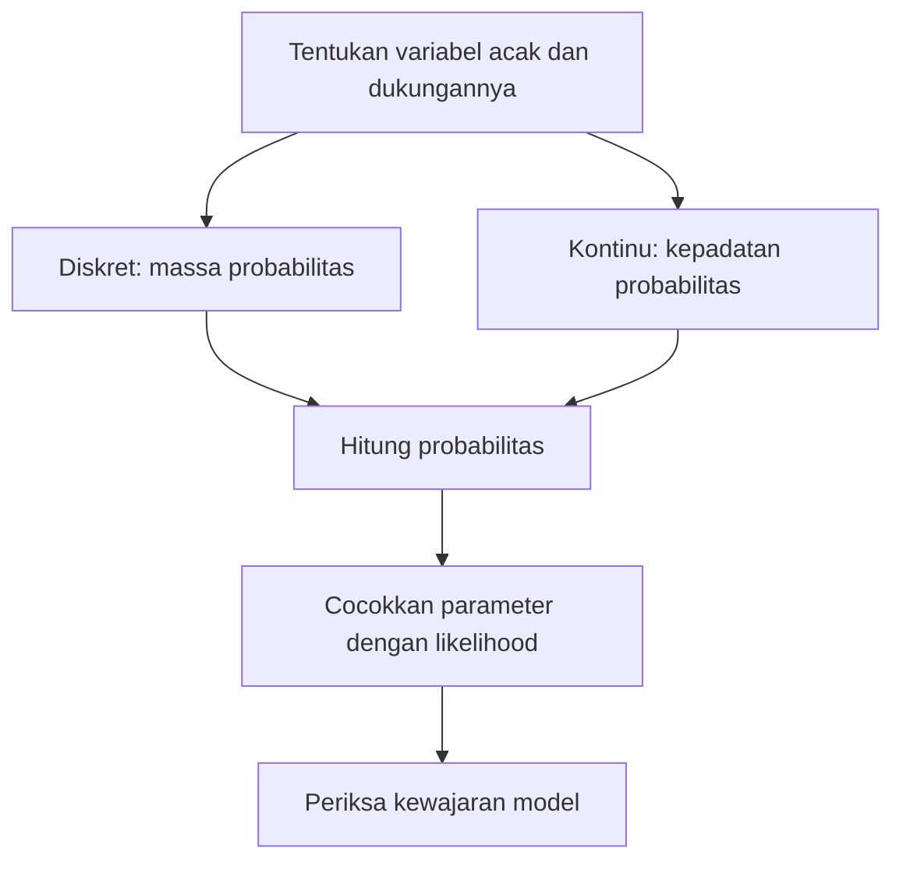
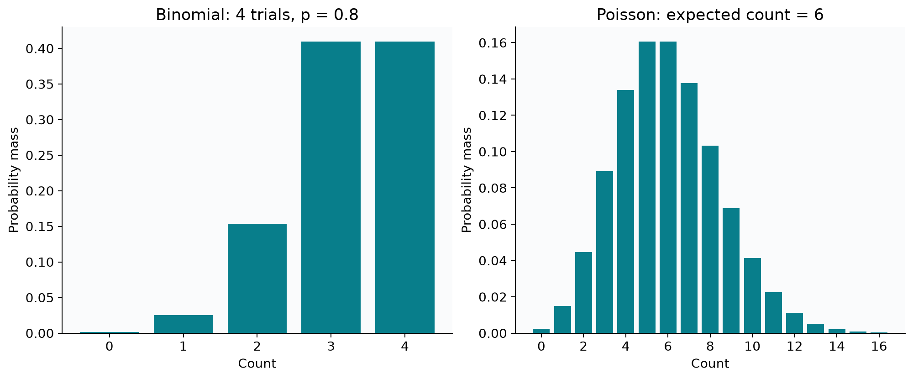
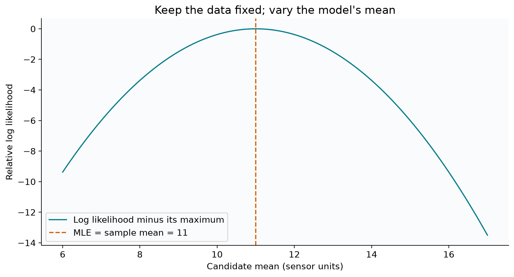

# 03 · Distribusi probabilitas, model, dan likelihood

Model probabilitas merupakan deskripsi eksplisit tentang apa yang dapat bervariasi dan seberapa mungkin hasil-hasilnya terjadi. Model dapat membuat prediksi di luar sampel yang diamati, tetapi prediksi tersebut mewarisi asumsi model. Kurva mulus mengisi celah secara matematis; kurva tersebut tidak menciptakan bukti baru.

**Alur pembelajaran:** PMF/PDF/CDF → lima distribusi umum → likelihood → pemeriksaan model. Prasyarat: [histogram](../02_Histogram/02_Histogram.md); faktorial dan logaritma ditinjau dalam [AA](../AA_Prerequisite/AA_Prerequisite.md).

## 1. Apa yang ditentukan oleh distribusi

**Variabel acak** memetakan hasil ke bilangan. Huruf kapital $X$ menyatakan besaran acak; huruf kecil $x$ menyatakan nilai tertentu. **Dukungan** distribusinya adalah himpunan nilai yang dapat diambil. Variabel diskret memiliki fungsi massa probabilitas, $p_X(x)=P(X=x)$, dengan massa tidak negatif yang berjumlah satu.

Variabel kontinu dapat memiliki fungsi kepadatan probabilitas $f_X(x)$, dengan $f_X(x)\ge0$ dan $\int f_X(x)\,dx=1$. Probabilitas interval adalah luas:

$$P(a\le X\le b)=\int_a^b f_X(x)\,dx.$$

Untuk kedua jenis, **fungsi distribusi kumulatif** adalah $F(t)=P(X\le t)$. Untuk variabel kontinu, $P(a<X\le b)=F(b)-F(a)$. Untuk hitungan bilangan bulat, $P(a\le X\le b)=F(b)-F(a-1)$ ketika $a,b$ bilangan bulat. Kesamaan pada batas penting ketika terdapat massa probabilitas di sana.

Nilai harapan adalah rata-rata berbobot probabilitas: $E[X]=\sum_x xp_X(x)$ atau $\int xf_X(x)\,dx$, jika terdefinisi. Varians adalah $E[(X-E[X])^2]$. Keduanya menggambarkan model bahkan sebelum pengamatan dikumpulkan.

## 2. Binomial: menghitung keberhasilan dalam jumlah percobaan tetap

Misalkan setiap pesan independen memiliki probabilitas $p=0.8$ untuk tiba dalam satu detik. Untuk empat pesan, misalkan $K$ menghitung kedatangan tepat waktu. Jika probabilitasnya konstan untuk semua pesan,

$$K\sim\operatorname{Binomial}(n=4,p=0.8),\qquad
P(K=k)=\binom nk p^k(1-p)^{n-k}.$$

Untuk memperoleh tepat tiga kedatangan tepat waktu, suatu susunan **tertentu**, seperti tepat waktu, terlambat, tepat waktu, tepat waktu, memiliki probabilitas $0.8^3(0.2)=0.1024$. Kedatangan terlambat dapat menempati salah satu dari empat posisi. Susunan-susunan ini saling lepas, sehingga probabilitasnya dijumlahkan:

$$P(K=3)=4(0.1024)=0.4096.$$

Faktor $\binom nk=n!/[k!(n-k)!]$ menghitung susunan. Faktor ini tidak boleh dihilangkan ketika hanya jumlah keberhasilan yang ditentukan. Rata-rata dan variansnya masing-masing $np$ dan $np(1-p)$. Di sini nilainya 3.2 dan 0.64.

Model binomial memerlukan jumlah percobaan tetap, dua hasil per percobaan, independensi, dan probabilitas keberhasilan yang sama. Pesan-pesan yang terdampak gangguan yang sama tidak independen. Kumpulan probabilitas keberhasilan yang berbeda umumnya menghasilkan distribusi total yang berbeda.

## 3. Poisson: menghitung kejadian selama suatu paparan

Untuk pesan yang tiba secara acak, proses Poisson dengan laju $r$ per menit menghasilkan hitungan selama $t$ menit dengan parameter $\lambda=rt$:

$$K\sim\operatorname{Poisson}(\lambda),\qquad
P(K=k)=e^{-\lambda}\frac{\lambda^k}{k!},\quad k=0,1,\ldots.$$

Jika $r=2$ pesan per menit dan $t=3$ menit, maka $\lambda=6$, sehingga $P(K=0)=e^{-6}\approx0.00248$. Di sini $\lambda$ adalah nilai harapan hitungan selama interval tertentu, bukan otomatis suatu laju. Rata-rata dan varians model hitungan ini sama-sama $\lambda$.

Proses Poisson homogen mengasumsikan laju konstan dan pertambahan independen, tanpa kelompok kejadian serentak dalam limit idealnya. Lalu lintas yang melonjak, tren, atau kedatangan berkelompok dapat melanggar asumsi tersebut dan menghasilkan variasi jauh lebih besar daripada prediksi model Poisson.

<!-- lab: discrete_models -->

## 4. Normal: lokasi dan penyebaran

Distribusi normal adalah

$$X\sim N(\mu,\sigma^2),\qquad
f(x)=\frac1{\sigma\sqrt{2\pi}}
\exp\!\left[-\frac{(x-\mu)^2}{2\sigma^2}\right],\quad \sigma>0.$$

Rata-rata $\mu$ menentukan pusatnya. SD $\sigma$ menentukan lebarnya. Kurva sempit harus lebih tinggi agar luas totalnya tetap satu. Dalam notasi ini, argumen kedua $N(\mu,\sigma^2)$ adalah **varians**; argumen `scale` SciPy adalah **SD**.

Misalkan galat sensor hipotetis mengikuti $N(0,2^2)$ milimeter. Maka

$$P(-2\le X\le2)=\Phi(1)-\Phi(-1)\approx0.6827,$$

dengan $Z=(X-\mu)/\sigma$ mengikuti distribusi normal standar dan $\Phi$ adalah CDF-nya. Sekitar 68.27%, 95.45%, dan 99.73% berada dalam jarak satu, dua, dan tiga SD pada model normal. Persentase ini tidak berlaku untuk setiap kumpulan data yang memiliki rata-rata dan SD.

Dalam model kontinu, $P(X=0)=0$ meskipun $f(0)$ merupakan kepadatan tertinggi. Nilai tercatat “0.0 mm” setelah pembulatan justru mewakili interval seperti $[-0.05,0.05)$; interval tersebut memiliki probabilitas positif. Nilai kepadatan dapat melebihi satu dan memiliki satuan kebalikan dari satuan pengukuran.

## 5. Eksponensial dan seragam: bentuk berbeda, asumsi berbeda

Jika kejadian mengikuti proses Poisson homogen dengan laju $r$, waktu $T$ hingga kejadian berikutnya berdistribusi eksponensial:

$$f_T(t)=r e^{-rt}\quad(t\ge0),\qquad
P(T>t)=e^{-rt},\qquad E[T]=1/r.$$

Pada $r=0.25$ kejadian per menit, rata-rata waktu tunggu adalah empat menit dan $P(T>6)=e^{-1.5}\approx0.2231$. Dalam SciPy gunakan `expon(scale=1/r)`, bukan `scale=r`. Distribusi eksponensial tidak memiliki ingatan: $P(T>s+t\mid T>s)=P(T>t)$. Asumsi ini tidak sesuai ketika suatu barang mengalami keausan atau jadwal layanan membuat waktu tunggu yang panjang mengubah peluang kedatangan dalam waktu dekat.

Model seragam kontinu pada $[a,b]$ memiliki kepadatan $1/(b-a)$ di dalam interval dan nol di luarnya. Subinterval dengan panjang sama memiliki probabilitas sama. Jika penundaan acak berdistribusi seragam antara 2 dan 6 detik, $P(3\le X\le4.5)=1.5/4=0.375$. SciPy menggunakan `uniform(loc=a, scale=b-a)`. Probabilitas setiap titik sama-sama nol; kesamaan probabilitas interval adalah pernyataan yang berguna.

<!-- lab: continuous_models -->

## 6. Probabilitas dibandingkan likelihood: apa yang ditetapkan?

Perhitungan probabilitas menetapkan parameter model dan memvariasikan data yang mungkin. **Likelihood** menetapkan data yang diamati dan memvariasikan kandidat nilai parameter. Untuk pengamatan independen,

$$L(\theta;x_1,\ldots,x_n)=\prod_{i=1}^n f(x_i\mid\theta),\qquad
\ell(\theta)=\log L(\theta)=\sum_{i=1}^n\log f(x_i\mid\theta).$$

Untuk data diskret, gunakan massa probabilitas sebagai pengganti kepadatan. Perkalian muncul dari independensi. **Jumlah tinggi kepadatan bukan likelihood bersama** pengamatan independen. Menjumlahkan log kepadatan benar karena $\log(ab)=\log a+\log b$. Log-likelihood juga menghindari underflow numerik ketika mengalikan banyak nilai kecil.

Estimasi likelihood maksimum (MLE) memaksimalkan fungsi ini pada parameter yang diperbolehkan. Nilainya bukan probabilitas bahwa parameter tersebut benar; integral likelihood terhadap nilai parameter tidak harus satu. Probabilitas posterior Bayesian memerlukan prior tambahan dan normalisasi.

Untuk tiga pembacaan sensor rekaan $x=(9,10,14)$ dengan $\sigma=2$ diketahui,

$$\ell(\mu)=-3\log(2\sqrt{2\pi})-\frac{(9-\mu)^2+(10-\mu)^2+(14-\mu)^2}{8}.$$

Suku pertama konstan terhadap $\mu$. Karena itu, memaksimalkan $\ell$ meminimalkan jumlah kuadrat jarak, menghasilkan $\hat\mu=\bar x=11$. Pada $\mu=11$, jumlah kuadrat jaraknya 14; pada $\mu=10$, jumlahnya 17. Jadi $\ell(11)-\ell(10)=3/8$, dan $L(11)/L(10)=e^{3/8}\approx1.455$. Ini membandingkan data pengamatan yang sama berdasarkan dua rata-rata dengan satuan dan SD yang sama.

Ketika kedua parameter model normal iid tidak diketahui, MLE varians membagi kuadrat simpangan dengan $n$. Estimator tak bias membaginya dengan $n-1$. Keduanya mengoptimalkan kriteria berbeda, sehingga tidak ada pertentangan.

<!-- lab: likelihood -->

## 7. Pemeriksaan model dan keterbatasan

Pertama, periksa dukungan distribusinya: model normal memberikan sebagian probabilitas pada nilai negatif, sehingga dapat kurang sesuai untuk waktu tunggu mendekati nol. Berikutnya, bandingkan pengamatan simulasi dengan bentuk data yang diamati, termasuk ekor dan variasinya. Periksa apakah rata-rata dan varians kira-kira sesuai dengan model Poisson yang diusulkan. Pertimbangkan bagaimana data dihasilkan, alih-alih memilih distribusi semata-mata karena histogram menyerupai kurva yang dikenal.

Mengestimasi parameter lalu memperlakukannya sebagai nilai yang diketahui akan meremehkan ketidakpastian prediksi. Model yang dicocokkan dengan sampel sangat kecil dapat menghasilkan prediksi yang tampak presisi tetapi hanya sedikit didukung bukti. Validasi, sensitivitas terhadap model alternatif, dan estimasi interval membantu mengungkap ketidakpastian tersebut.

## 8. Latihan

1. Untuk enam percobaan independen dengan $p=0.3$, hitung $P(K=2)$ dan $P(K\ge1)$.
2. Pencacah Poisson ideal mencatat 3 kejadian per jam. Parameter apa yang berlaku untuk jendela dua jam, dan berapa probabilitas nol kejadian?
3. Jika ketebalan dimodelkan sebagai $N(12,1.5^2)$ mm, hitung $P(10.5\le X\le15)$.
4. Kepadatan seragam membentang dari 0 hingga 0.2 detik. Berapa tingginya, dan berapa $P(X<0.05)$?
5. Pengamatan independen memiliki kepadatan 0.2 dan 0.4 pada suatu kandidat parameter. Berapa likelihood bersamanya? Berapa log-likelihood-nya?

## 9. Pembahasan jawaban

1. $\binom62(0.3)^2(0.7)^4=0.324135$; $1-P(K=0)=1-0.7^6=0.882351$.
2. $\lambda=3\times2=6$; $P(K=0)=e^{-6}\approx0.002479$.
3. Batas terstandarisasinya adalah $-1$ dan $2$, sehingga $\Phi(2)-\Phi(-1)\approx0.81859$.
4. Tingginya $1/0.2=5$ per detik, dan luas yang diminta $5(0.05)=0.25$.
5. $L=0.2\times0.4=0.08$ dan $\ell=\log(0.08)\approx-2.52573$. Jumlah 0.6 bukan likelihood bersamanya.

<!-- lab: practice -->

## Referensi dan langkah berikutnya

Kaitan bacaan: Starmer (2026), Bab 3, [SQ](../Reference.md#sq-statquest). Konvensi likelihood bersama mengikuti [likelihood maksimum NIST](https://www.itl.nist.gov/div898/handbook/apr/section4/apr412.htm). Definisi komputasi: [distribusi statistik SciPy](https://docs.scipy.org/doc/scipy/reference/stats.html). Contoh dan perbandingan parameter merupakan karya orisinal.

Berikutnya: [04 · Pengujian hipotesis](../04_Hypothesis_Testing/04_Hypothesis_Testing.md).
