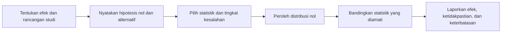
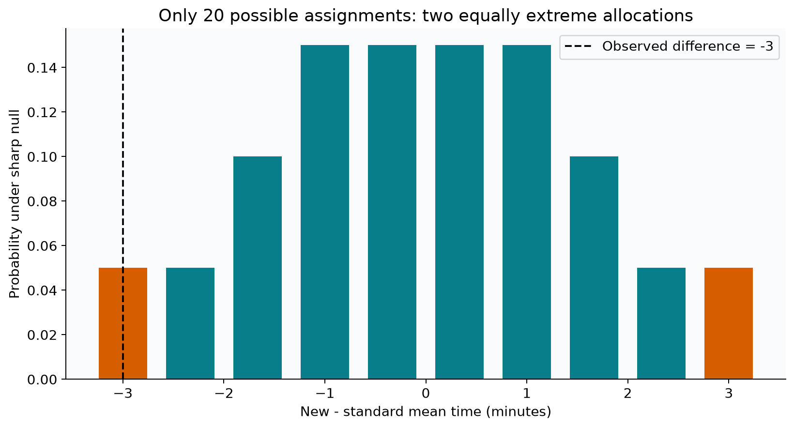
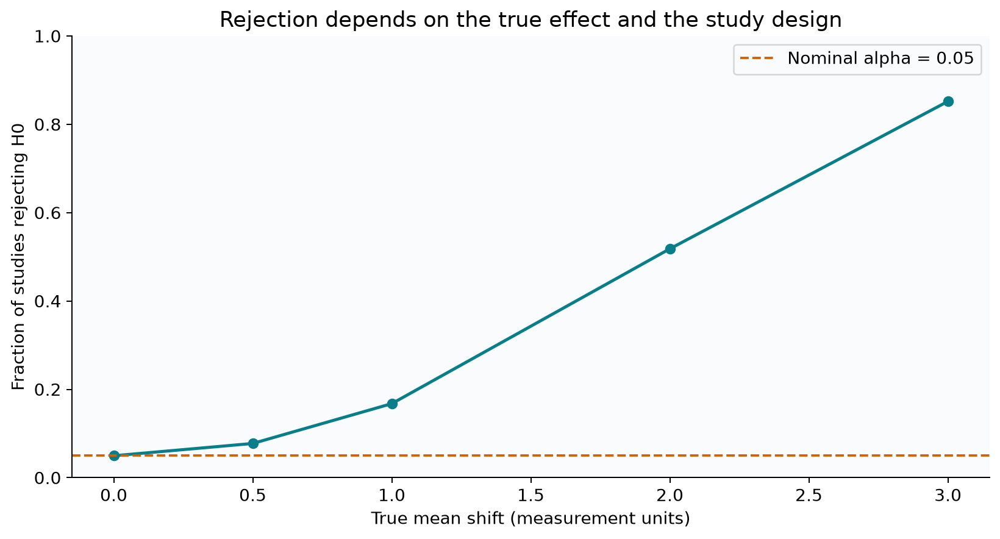

# 04 · Hipotesis, eksperimen, dan keputusan

Uji hipotesis menanyakan apakah hasil yang diamati menunjukkan ketidaksesuaian yang tidak biasa dengan model tertentu. Uji ini tidak membuktikan hipotesis, memperbaiki rancangan studi yang buruk, atau menentukan apakah suatu efek penting. Kegunaannya berasal dari menghubungkan pertanyaan eksplisit dengan aturan keputusan yang terkalibrasi.

**Alur pembelajaran:** klaim → hipotesis → statistik → distribusi nol → keputusan → interpretasi. Prasyarat: [model probabilitas](../03_Probability_Models/03_Probability_Models.md).

## 1. Menerjemahkan klaim sehari-hari menjadi parameter

Sebuah percetakan ingin mengetahui apakah prosedur persiapan baru mengubah waktu penyelesaian pekerjaan. Misalkan $\Delta=\mu_{\mathrm{new}}-\mu_{\mathrm{standard}}$, diukur dalam menit. Hipotesis dua sisi yang umum adalah

$$H_0:\Delta=0,\qquad H_1:\Delta\ne0.$$

**Hipotesis nol** adalah klaim acuan yang diuji; **hipotesis alternatif** menggambarkan penyimpangan yang ingin dideteksi oleh uji. Hipotesis nol tidak harus berarti nol: kita dapat menguji target rata-rata 10 menit atau selisih 2 menit. Hipotesis nol berkaitan dengan parameter populasi atau proses pembangkitan data, bukan apakah rata-rata sampel kebetulan sama persis.

Untuk pertanyaan berarah yang direncanakan, $H_0:\Delta\ge0$ dibandingkan $H_1:\Delta<0$ menanyakan apakah metode baru menurunkan rata-rata. Perhitungan satu sisi yang lazim menggunakan batas $\Delta=0$. Pilih arah sebelum memeriksa hasil. Suatu metode juga dapat lebih lambat; uji satu sisi untuk perbaikan tidak memberikan uji yang setara untuk kemunduran.

## 2. Rancangan studi mendahului pengujian

Jika staf memilih pekerjaan yang menerima prosedur baru, pekerjaan sulit mungkin terkonsentrasi dalam satu kelompok. Prosedur dan tingkat kesulitan pekerjaan kemudian tercampur. Uji dapat mendeteksi perbedaan tanpa mengidentifikasi penyebabnya.

Penempatan acak pekerjaan yang memenuhi kriteria membuat mekanisme penempatan diketahui dan menyeimbangkan karakteristik lain secara rata-rata. Pembentukan blok berdasarkan ukuran pekerjaan dapat meningkatkan presisi ketika ukuran sangat memengaruhi waktu penyelesaian. Jika satu pekerja menyelesaikan banyak pekerjaan, waktu-waktu tersebut mungkin berkorelasi; analisis harus memperhitungkan pengelompokan itu. Unit eksperimen terkecil yang menerima perlakuan yang ditempatkan secara independen menentukan replikasi efektif.

Rencanakan ukuran hasil utama, kontras, ukuran sampel, tingkat signifikansi, perlakuan terhadap pengecualian, dan penanganan nilai hilang sebelum melihat hasil. Grafik dan hipotesis eksploratif tetap berguna, tetapi hipotesis yang muncul dari pengamatan yang sama sudah diuntungkan oleh seleksi. Konfirmasikan dengan bukti baru atau analisis yang memperhitungkan seleksi tersebut.

## 3. Statistik uji merangkum ketidaksesuaian yang relevan

**Statistik uji** adalah fungsi numerik data yang digunakan untuk mengurutkan bukti terhadap $H_0$. Untuk selisih rata-rata, selisih mentah $T=\bar X_{\mathrm{new}}-\bar X_{\mathrm{standard}}$ mudah dipahami. Statistik terstandarisasi membagi selisih ini dengan estimasi galat baku, sehingga selisih dinilai relatif terhadap deraunya.

**Distribusi nol** menggambarkan bagaimana statistik akan bervariasi berdasarkan hipotesis nol dan mekanisme pengambilan sampel atau penempatan dalam studi. Distribusi ini biasanya bukan histogram pengamatan individual. Dua kelompok dapat memiliki individu yang sangat tersebar tetapi rata-rata yang diestimasi secara presisi jika sampelnya besar dan independen.

Dalam uji dua sisi yang simetris, nilai positif besar dan negatif besar menjadi bukti terhadap hipotesis nol efek nol. Kita dapat mengurutkannya berdasarkan $|T|$. Untuk uji perbaikan satu sisi dengan konvensi tanda ini, $T$ yang lebih negatif lebih ekstrem.

## 4. Contoh pengacakan eksak

Misalkan enam pekerjaan berbeda ditempatkan secara acak, tiga untuk setiap prosedur. Waktu pengamatan rekaan adalah:

| Prosedur | Waktu penyelesaian (menit) | Rata-rata |
|---|---|---:|
| Standar | 7, 8, 9 | 8 |
| Baru | 4, 5, 6 | 5 |

Statistik yang diamati adalah $T=5-8=-3$ menit. Untuk contoh kecil ini, pertimbangkan **hipotesis nol tajam**: mengubah prosedur yang ditetapkan tidak akan mengubah hasil satu pun dari enam pekerjaan. Berdasarkan hipotesis itu, keenam waktu tetap dan setiap alokasi dari $\binom63=20$ alokasi tiga pekerjaan ke kelompok baru memiliki probabilitas sama.

Untuk setiap alokasi, hitung rata-rata baru dikurangi rata-rata standar. Hanya dua alokasi memiliki $|T|\ge3$: pemisahan penuh yang diamati dan pemisahan terbalik. Karena itu, nilai p pengacakan eksak dua sisi adalah $2/20=0.10$.

<!-- lab: exact_randomization -->

Hasil ini sengaja dipilih untuk pembelajaran: ketiga pekerjaan dengan prosedur baru selesai lebih cepat daripada ketiga pekerjaan dengan prosedur standar, tetapi nilai p dua sisinya melebihi 0.05. Dengan hanya dua puluh penempatan yang mungkin, pemisahan yang tampak kuat tidak terlalu langka. Lebih mendasar lagi, perhitungan ini berlaku untuk hipotesis nol tajam yang dinyatakan dan penempatan acak. Mempermutasikan data observasional secara sembarang memerlukan asumsi keterpertukaran; kesamaan rata-rata populasi saja tidak menjaminnya ketika distribusi berbeda.

## 5. Keputusan dan kemungkinan kesalahannya

Pilih **tingkat signifikansi** $\alpha$, misalnya 0.05, sebelum analisis. Uji tingkat-$\alpha$ yang valid memiliki probabilitas penolakan paling besar $\alpha$ ketika hipotesis nol benar, berdasarkan asumsinya. Uji diskret eksak dapat memiliki tingkat penolakan aktual di bawah $\alpha$ karena hanya nilai p tertentu yang dapat dicapai.

| Kenyataan | Gagal menolak $H_0$ | Menolak $H_0$ |
|---|---|---|
| Hipotesis nol benar | Tidak menolak secara benar | Kesalahan Tipe I, positif palsu |
| Alternatif tertentu benar | Kesalahan Tipe II, negatif palsu | Deteksi benar |

Probabilitas kesalahan Tipe II $\beta$ bergantung pada alternatif tertentu, ukuran sampel, variasi, dan uji. **Daya uji** adalah $1-\beta$. Daya uji bukan sifat tetap suatu teknik yang tidak bergantung pada studi. [Bab 9](../09_Power_and_Power_Analysis/09_Power_and_Power_Analysis.md) mengembangkan daya uji untuk perencanaan pengumpulan data.

Untuk contoh enam pekerjaan pada $\alpha=0.05$, kita gagal menolak hipotesis nol tajam. Kita tetap dapat melaporkan selisih pengamatan $-3$ menit dan menjelaskan bahwa rancangan memberikan resolusi terbatas. Ambang tersebut tidak menghapus data atau membuat kedua prosedur setara.

## 6. Mengapa tidak menolak bukan berarti sama

Studi dapat gagal menolak karena efek tidak ada, karena efek kecil, atau karena ketidakpastiannya besar. Nilai p besar saja tidak membedakan kemungkinan tersebut. Estimasi interval memberikan konteks berguna: interval dari manfaat besar hingga kerugian besar membiarkan kedua kemungkinan belum terselesaikan.

Untuk mendukung **kesetaraan praktis**, tentukan batas yang dapat diterima $[-m,m]$ sebelum analisis dan gunakan metode yang dirancang untuk menilainya. Misalnya, jika selisih kurang dari satu menit dapat diabaikan, interval yang terkalibrasi dengan tepat dan seluruhnya berada di dalam $[-1,1]$ dapat mendukung kesetaraan. Sekadar memperoleh $p>0.05$ untuk uji selisih nol tidak dapat melakukannya.

Demikian pula, menolak $\Delta=0$ tidak membuktikan perbaikan yang berguna. Penurunan 0.01 menit yang diestimasi secara presisi mungkin tidak relevan secara operasional. Keputusan statistik dan praktis bergantung pada masukan berbeda: keputusan praktis juga menggunakan biaya, manfaat, kendala, dan besar efek yang bermakna.

## 7. Pengulangan menjelaskan kalibrasi

Notebook menyimulasikan banyak studi dengan SD pengukuran yang diketahui dan uji rata-rata normal. Ketika pergeseran sebenarnya nol, proporsi penolakan mendekati $\alpha$ yang dipilih. Ketika pergeseran meningkat, penolakan semakin sering. Studi individual tetap bervariasi: prosedur yang benar dapat menghasilkan positif palsu, dan efek nyata dapat terlewat.

<!-- lab: repeated_tests -->

Simulasi ini menguji rata-rata nol menggunakan SD yang diketahui agar distribusi nol sederhana. Ini tidak membenarkan memasukkan SD tebakan ke dalam uji z nyata. Uji t menangani SD yang diestimasi dalam [Bab 8](../08_T-test_for_Testing_the_Differences/08_T-test_for_Testing_the_Differences.md).

## 8. Latihan

1. Produsen menanyakan apakah rata-rata panjang sekrup sama dengan 30 mm. Tuliskan hipotesis nol dan alternatif dua sisi. Apakah hipotesis nol merujuk pada rata-rata sampel yang diamati?
2. Dalam eksperimen acak dengan dua unit per kelompok, berapa penempatan yang mungkin? Dengan pengurutan berdasarkan nilai absolut selisih rata-rata dan hasil berbeda yang terpisah maksimal, berapa nilai p dua sisi terkecil yang dapat dicapai?
3. Uji menghasilkan $p=0.12$. Apakah probabilitas hipotesis nol benar adalah 12%? Apakah ini membuktikan tidak ada efek?
4. Anda hanya menguji penurunan setelah mengetahui bahwa selisih yang diamati negatif. Apa yang keliru dalam rencana ini?
5. Interval 95% suatu studi untuk efek adalah $[-8,7]$ menit. Apakah ini mendukung kesetaraan dalam satu menit?

## 9. Pembahasan jawaban

1. $H_0:\mu=30$ dibandingkan $H_1:\mu\ne30$. Keduanya berkaitan dengan rata-rata populasi, bukan rata-rata sampel yang diamati.
2. $\binom42=6$ alokasi. Penempatan paling ekstrem dan kebalikannya menghasilkan $2/6=1/3$. Uji dua sisi 0.05 tidak dapat menolak dalam keadaan ini, bahkan pada pemisahan penuh.
3. Keduanya tidak. Nilai p dihitung dengan syarat model nol berlaku; nilai ini bukan probabilitas yang diberikan pada model tersebut. Kegagalan menolak membiarkan efek yang sesuai dengan ketidakpastian tetap belum terselesaikan.
4. Arah dipilih menggunakan derau yang sama dengan yang dievaluasi uji. Tingkat kesalahan nominal satu sisi tidak lagi menggambarkan seluruh prosedur seleksi dan pengujian.
5. Tidak. Interval mengizinkan efek jauh lebih besar daripada margin kesetaraan yang diusulkan. Yang diperlukan adalah presisi lebih tinggi, bukan mengganti label nilai p.

<!-- lab: practice -->

## Referensi dan langkah berikutnya

Kaitan bacaan: Starmer (2026), Bab 4, [SQ](../Reference.md#sq-statquest). Eksperimen penempatan eksak merupakan karya orisinal. Lihat [dokumentasi uji permutasi SciPy](https://docs.scipy.org/doc/scipy/reference/generated/scipy.stats.permutation_test.html) untuk hipotesis nol dan konvensi pengambilan sampel ulang, serta [pernyataan ASA](https://www.amstat.org/asa/files/pdfs/p-valuestatement.pdf) untuk prinsip interpretasi.

Berikutnya: [05 · Nilai p dan interval kepercayaan](../05_P-Values_for_Confidence_Quantification/05_P-Values_for_Confidence_Quantification.md).
