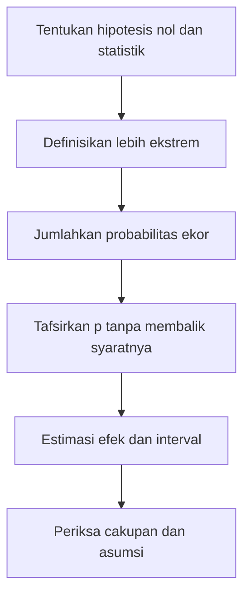
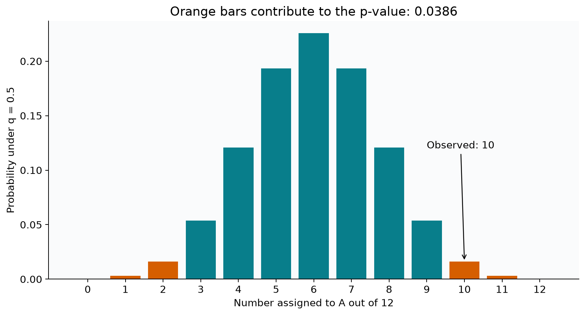
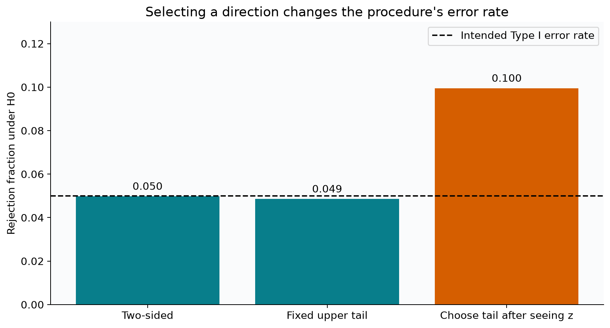
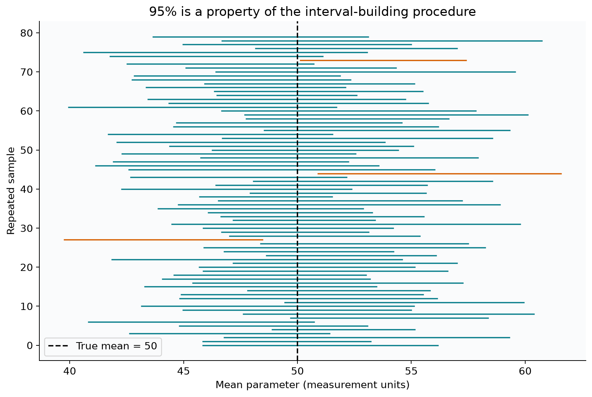

# 05 · Nilai p dan interval kepercayaan

Nilai p mengukur seberapa ekstrem suatu statistik tertentu relatif terhadap distribusi nolnya. Nilai ini bukan probabilitas bahwa suatu kesimpulan salah. Interval kepercayaan menggambarkan ketidakpastian tentang efek melalui prosedur dengan tingkat cakupan jangka panjang tertentu. Gunakan keduanya bersama estimasi efek dan rancangan studi.

**Alur pembelajaran:** probabilitas ekor → perhitungan eksak → arah → interpretasi → estimasi interval. Prasyarat: Bab [3](../03_Probability_Models/03_Probability_Models.md) dan [4](../04_Hypothesis_Testing/04_Hypothesis_Testing.md).

## 1. Definisikan probabilitas dengan cermat

Jika $T$ yang lebih besar lebih ekstrem, nilai p adalah

$$p=P_{H_0}(T\ge T_{\mathrm{observed}}).$$

Untuk statistik dua sisi simetris yang berpusat di nol, kita sering menggunakan $P_{H_0}(|T|\ge|T_{\mathrm{observed}}|)$. Subskrip berarti **dihitung berdasarkan model nol dan asumsinya**, termasuk mekanisme pengambilan sampel atau penempatan. Statistik dan aturan keekstreman harus ditentukan agar probabilitas ini bermakna.

Perhitungan mencakup hasil yang lebih ekstrem daripada hasil pengamatan karena prosedur akan menganggapnya sebagai ketidaksesuaian yang setidaknya sama kuat. Hanya melihat probabilitas suatu pengamatan yang persis sama mengabaikan pengurutan itu. Pengamatan kontinu yang eksak memiliki probabilitas nol bahkan dalam model yang sepenuhnya wajar.

Untuk nilai p yang valid, $P_{H_0}(p\le u)\le u$. Pada banyak uji eksak kontinu, kesamaan berlaku dan nilai p di bawah hipotesis nol berdistribusi seragam pada $[0,1]$. Uji diskret sering konservatif, dengan hanya sejumlah berhingga nilai p yang dapat dicapai. Nilai p yang dihitung dengan benar hanya terkalibrasi berdasarkan asumsi modelnya.

## 2. Mengerjakan contoh eksak dari awal hingga akhir

Program perutean seharusnya mengirim setiap pekerjaan independen ke salah satu dari dua server identik dengan probabilitas $q=0.5$. Audit terencana terhadap dua belas pekerjaan mengamati sepuluh pekerjaan dialokasikan ke server A. Kita menguji $H_0:q=0.5$ terhadap $H_1:q\ne0.5$.

Berdasarkan $H_0$, $K\sim\operatorname{Binomial}(12,0.5)$. Seluruh $2^{12}=4096$ urutan alokasi memiliki probabilitas sama. Probabilitas **tepat** sepuluh alokasi ke A adalah

$$P(K=10)=\binom{12}{10}/4096=66/4096\approx0.01611.$$

Namun, nilai p dua sisi juga mencakup 11 atau 12 alokasi ke A, serta hitungan 0, 1, dan 2 yang sama ekstremnya:

$$p=\frac{1+12+66+66+12+1}{4096}
=\frac{158}{4096}\approx0.03857.$$

<!-- lab: exact_binomial -->

Pada $\alpha=0.05$ yang dipilih sebelumnya, tolak $H_0$. Laporan yang tepat adalah: “Sepuluh dari dua belas pekerjaan masuk ke A; dengan perutean independen 50:50, nilai p eksak dua sisi adalah 0.0386.” Hasil ini tidak biasa berdasarkan model. Hasil tersebut tidak membuktikan bahwa $q=10/12$ secara tepat atau bahwa hasil memiliki peluang 3.86% untuk menjadi positif palsu.

Perhitungan mengasumsikan alokasi independen. Sesi yang dipertahankan pada server yang sama, pengelompokan pekerjaan, atau jadwal penyeimbangan yang disengaja akan mengubah distribusi nol yang relevan. Nilai p kecil dapat mengungkap kekeliruan model independensi, selain kemungkinan probabilitas perutean yang tidak sama.

## 3. Uji satu sisi dan dua sisi menjawab pertanyaan berbeda

Untuk alternatif $q>0.5$ yang direncanakan, nilai p adalah $P(K\ge10)=79/4096\approx0.01929$. Nilainya kebetulan setengah nilai dua sisi karena model nol ini simetris dan hitungan pengamatan berada di ekor atas.

Jalan pintas tersebut tidak universal. Untuk distribusi diskret asimetris, terdapat beberapa pengurutan dua sisi yang sah. Uji binomial eksak dua sisi SciPy menjumlahkan massa yang tidak lebih besar daripada massa pengamatan, dengan toleransi numerik. Nyatakan metodenya alih-alih otomatis menggandakan satu ekor.

Uji satu sisi dengan arah tetap dapat mengendalikan kesalahan Tipe I. Masalahnya adalah memilih arah yang menguntungkan setelah melihat data. Dalam kasus normal kontinu, memilih nilai lebih kecil dari dua nilai p satu sisi dan menguji pada 0.05 menolak sekitar 10% hipotesis nol yang benar. Notebook menunjukkan ketiga prosedur pada pengambilan acak dari model nol yang **sama**.

<!-- lab: direction_selection -->

## 4. Apa yang tidak dapat diberitahukan oleh nilai p

| Pernyataan keliru | Interpretasi yang lebih tepat |
|---|---|
| “$p=0.04$ berarti kemungkinan hipotesis nol benar adalah 4%.” | Probabilitas dihitung dengan mengasumsikan hipotesis nol; nilai ini tidak memberikan probabilitas posterior pada hipotesis nol. |
| “Ada peluang 96% bahwa temuan akan terulang.” | Replikasi bergantung pada efek sebenarnya, presisi, rancangan, dan analisis. |
| “Nilai p lebih kecil berarti efek lebih besar.” | Ukuran sampel dan variasi memengaruhi nilai p bersama estimasi efek. |
| “$p>0.05$ membuktikan tidak ada perbedaan.” | Data mungkin tidak presisi; periksa efek mana yang masih sesuai dengan interval. |
| “$p=0.049$ dan $p=0.051$ memberikan kebenaran ilmiah yang berlawanan.” | Ambang keputusan adalah aturan; bukti berubah secara bertahap. |

Perbedaan ini penting meskipun nama folder historisnya adalah “confidence quantification”. Di sini kita menggunakan **kepercayaan** dalam pengertian formal prosedur interval, dan **nilai p** untuk kesesuaian dengan model nol, bukan sebagai kepastian $1-p$ terhadap suatu klaim.

## 5. Interval kepercayaan menggambarkan cakupan suatu prosedur

Prosedur interval kepercayaan 95% mencakup parameter sebenarnya yang tetap pada 95% sampel berulang berdasarkan asumsinya. Untuk satu interval frequentist yang telah diperoleh, batas-batasnya kini tetap dan parameter berada di dalam atau di luar interval. Pernyataan cakupan tidak memberikan probabilitas posterior 95% kepada interval tetap tersebut.

Untuk pengamatan normal iid dengan SD tidak diketahui, interval dua sisi untuk rata-rata adalah

$$\bar x\pm t_{1-\alpha/2,n-1}\frac{s}{\sqrt n}.$$

Pusatnya adalah estimasi, $s/\sqrt n$ adalah estimasi galat bakunya, dan nilai kritis t memperhitungkan estimasi SD. Distribusi t dikembangkan dalam Bab 8. Untuk sementara, perangkat lunak dapat memberikan kuantilnya.

Lima waktu penyiapan mesin rekaan adalah 18, 20, 22, 24, dan 26 menit. Rata-ratanya 22, SD sampelnya $\sqrt{10}$, dan estimasi SE-nya $\sqrt2$. Dengan empat derajat kebebasan, $t_{0.975,4}\approx2.776$, menghasilkan

$$22\pm2.776\sqrt2\approx[18.074,25.926]\text{ minutes}.$$

Interval ini berkaitan dengan **rata-rata populasi**, bukan 95% waktu penyiapan individual. Interval prediksi untuk satu pengamatan mendatang juga harus mencakup variasi individual.

<!-- lab: confidence_interval -->

Untuk uji t dua sisi yang sama dan asumsi yang sama, interval kepercayaan 95% tidak mencakup rata-rata yang dihipotesiskan tepat ketika uji dua sisi menolaknya pada 0.05, dengan pengecualian konvensi batas. Di sini 20 berada di dalam interval, dan uji t untuk $\mu=20$ tidak menolak. Kesesuaian uji dan interval ini bukan izin untuk mencampurkan model berbeda atau prosedur satu sisi dan dua sisi.

## 6. Melihat cakupan alih-alih menghafalnya

Notebook berulang kali mengambil sampel dua belas pengamatan dari populasi normal dengan rata-rata diketahui 50, tetapi mengestimasi SD secara terpisah pada setiap sampel. Setiap interval menggunakan rata-rata dan SD-nya sendiri. Simulasi mengetahui nilai sebenarnya, sehingga dapat menandai interval yang meleset. Dalam analisis nyata, kita tidak dapat mewarnai interval berdasarkan apakah interval tersebut mencakup parameter yang tidak diketahui.

<!-- lab: coverage -->

Delapan puluh interval yang ditampilkan menggambarkan variasi; cakupannya tidak harus tepat 95%. Eksperimen Monte Carlo yang lebih besar mengestimasi cakupan jangka panjang dengan lebih presisi. Pendekatan SE Monte Carlo untuk proporsi simulasi $\hat c$ dari $B$ pengulangan independen adalah $\sqrt{\hat c(1-\hat c)/B}$. Ini adalah ketidakpastian simulasi, berbeda dari ketidakpastian rata-rata pada kumpulan data tertentu.

## 7. Latihan

1. Dalam delapan alokasi independen 50:50, semuanya masuk ke A. Hitung nilai p eksak dua sisi.
2. Dalam audit dua belas pekerjaan di atas, berapa probabilitas penolakan ketika hipotesis nol benar untuk uji eksak dua sisi pada $\alpha=0.05$? Mengapa nilainya tidak tepat 0.05?
3. Estimasi rata-rata normal dengan SD diketahui adalah 40 dengan SE 2. Tentukan pendekatan interval 95%. Apa yang terjadi jika ukuran sampel menjadi empat kali lipat dengan SD yang sama?
4. Dapatkah interval sempit di sekitar efek yang dapat diabaikan secara praktis muncul bersama nilai p sangat kecil untuk efek nol?
5. Tulis ulang: “Nilai p adalah 0.8, sehingga probabilitas bahwa kedua metode sama adalah 80%.”

## 8. Pembahasan jawaban

1. Sertakan semua A dan semua B: $2/2^8=0.0078125$.
2. Penolakan terjadi pada $K\le2$ atau $K\ge10$, sehingga probabilitasnya $158/4096\approx0.038574$. Distribusi diskret tidak dapat menggunakan tepat 5% massa probabilitasnya dengan aturan biasa tanpa pengacakan keputusan ini.
3. $40\pm1.96(2)=[36.08,43.92]$. Melipatgandakan ukuran sampel independen menjadi empat kali mengurangi SE menjadi 1, sehingga marginnya 1.96 jika pusat pengamatan tetap 40.
4. Ya. Presisi tinggi dapat membedakan efek sangat kecil yang tidak nol dari nol. Penting tidaknya efek itu memerlukan ukuran praktis.
5. “Statistik yang diamati masih tergolong wajar berdasarkan model nol rata-rata sama yang ditentukan. Ini tidak membuktikan kesamaan; kita juga memerlukan estimasi selisih dan ketidakpastiannya.”

<!-- lab: practice -->

## Referensi dan langkah berikutnya

Kaitan bacaan: Starmer (2026), Bab 5, [SQ](../Reference.md#sq-statquest). Interpretasi mengikuti prinsip dalam [pernyataan ASA](https://www.amstat.org/asa/files/pdfs/p-valuestatement.pdf). Rumus: [batas kepercayaan rata-rata NIST](https://www.itl.nist.gov/div898/handbook/eda/section3/eda352.htm). Konvensi uji eksak: [SciPy binomtest](https://docs.scipy.org/doc/scipy/reference/generated/scipy.stats.binomtest.html).

Berikutnya: [06 · Regresi linier](../06_Linear_Regression/06_Linear_Regression.md).
