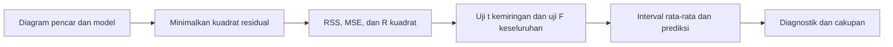
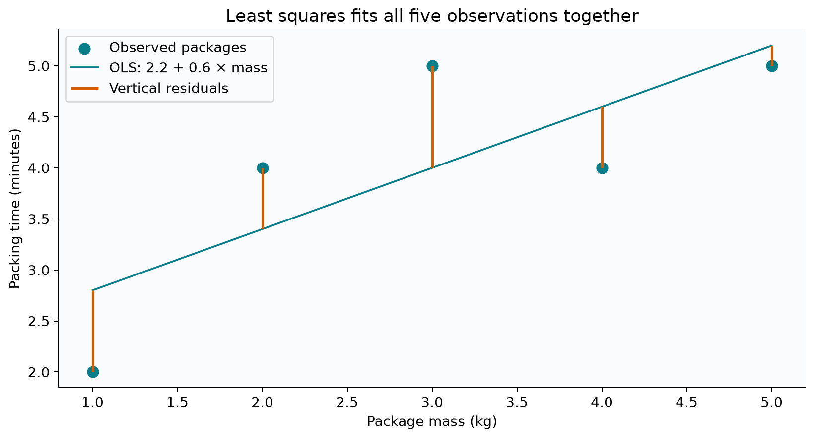
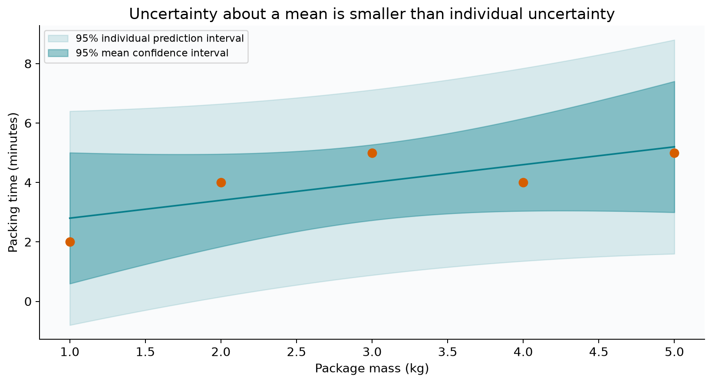
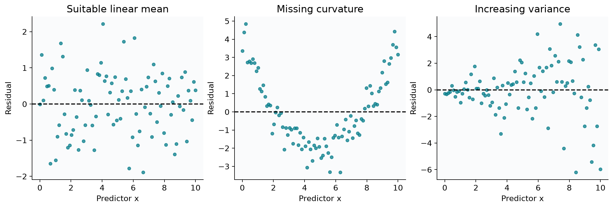

# 06 · Regresi linier sederhana

Regresi linier menggambarkan bagaimana rata-rata bersyarat suatu respons berubah seiring prediktor. Mencocokkan garis, mengukur kecocokannya pada data pelatihan, menguji kemiringan, dan memprediksi pengamatan baru merupakan tugas yang berkaitan tetapi berbeda.

**Alur pembelajaran:** model → pencocokan → evaluasi → inferensi → prediksi → pemeriksaan. Prasyarat: Bab 1–5; [AA](../AA_Prerequisite/AA_Prerequisite.md) menurunkan kuadrat terkecil menggunakan kalkulus.

## 1. Pisahkan garis dari pengamatan

Untuk massa paket $x_i$ dalam kilogram dan waktu pengemasan $Y_i$ dalam menit, model sederhana adalah

$$Y_i=\beta_0+\beta_1x_i+\varepsilon_i,\qquad E[\varepsilon_i\mid x_i]=0.$$

Jadi $E[Y_i\mid x_i]=\beta_0+\beta_1x_i$. Intersep $\beta_0$ adalah rata-rata respons pada $x=0$; kemiringan $\beta_1$ adalah perubahan rata-rata bersyarat per kenaikan satu unit $x$. Keduanya tidak menyatakan bahwa setiap paket mengikuti garis secara tepat. Galat $\varepsilon_i$ adalah simpangan dari garis populasi yang tidak diketahui; **residual** $e_i=y_i-\hat y_i$ adalah simpangan dari garis hasil pencocokan.

Istilah prediktor lebih jelas daripada “variabel independen”: sebutan tersebut tidak berarti bahwa nilai prediktor yang diamati independen secara probabilistik, ditempatkan secara acak, atau bebas dari kesalahan pengukuran. Respons ditempatkan pada sumbu vertikal karena model memprediksinya dengan syarat $x$.

## 2. Kuadrat terkecil memilih garis berdasarkan residualnya

Kuadrat terkecil biasa (OLS) meminimalkan

$$RSS(b_0,b_1)=\sum_i[y_i-(b_0+b_1x_i)]^2.$$

Residual adalah jarak **vertikal** pada $x_i$ yang diamati, bukan jarak geometris terpendek ke garis. Residual bertanda dapat saling meniadakan; kuadrat residual tidak. Penguadratan juga memberikan penalti lebih kuat pada kesalahan besar dibandingkan fungsi kerugian galat absolut.

Dengan $S_{xx}=\sum_i(x_i-\bar x)^2>0$ dan $S_{xy}=\sum_i(x_i-\bar x)(y_i-\bar y)$, koefisien yang meminimalkan adalah

$$\hat\beta_1=\frac{S_{xy}}{S_{xx}},\qquad
\hat\beta_0=\bar y-\hat\beta_1\bar x.$$

Garis hasil pencocokan melalui $(\bar x,\bar y)$ dan jumlah residual nol ketika intersep disertakan. Jika seluruh $x_i$ sama, $S_{xx}=0$: intersep dan kemiringan tidak dapat diestimasi secara terpisah. Dua nilai prediktor berbeda dapat menentukan garis dari dua titik, tetapi tidak ada derajat kebebasan residual untuk mengestimasi derau. Inferensi memerlukan $n>2$ dan rancangan yang sesuai, bukan sekadar garis melalui titik-titik.

## 3. Perhitungan lengkap pada lima paket

Gunakan pengamatan rekaan $x=(1,2,3,4,5)$ kg dan $y=(2,4,5,4,5)$ menit. Maka $\bar x=3$, $\bar y=4$, $S_{xx}=10$, dan $S_{xy}=6$. Akibatnya,

$$\hat y=2.2+0.6x.$$

| $x$ | $y$ | $\hat y$ | Residual | Kuadrat residual |
|---:|---:|---:|---:|---:|
| 1 | 2 | 2.8 | -0.8 | 0.64 |
| 2 | 4 | 3.4 | 0.6 | 0.36 |
| 3 | 5 | 4.0 | 1.0 | 1.00 |
| 4 | 4 | 4.6 | -0.6 | 0.36 |
| 5 | 5 | 5.2 | -0.2 | 0.04 |

Jumlah kuadrat residual adalah 2.4 menit kuadrat. Estimasi kemiringannya adalah tambahan 0.6 menit per kilogram. Intersep 2.2 menit berkaitan dengan paket hipotetis bermassa nol, di luar rentang pengamatan 1–5 kg, sehingga interpretasi praktisnya mungkin terbatas.

<!-- lab: least_squares -->

## 4. Ukur kecocokan dengan penyebut yang tepat

Definisikan $TSS=\sum_i(y_i-\bar y)^2$. Di sini $TSS=6$. Untuk OLS dengan intersep dan respons tidak konstan,

$$R^2=1-\frac{RSS}{TSS}=1-\frac{2.4}{6}=0.6.$$

Model hasil pencocokan mengurangi kesalahan kuadrat pelatihan sebesar 60% dibandingkan memprediksi rata-rata sampel untuk setiap pengamatan. Ini bukan akurasi prediksi 60%, persentase kausal, atau jaminan untuk paket baru. Dalam OLS sederhana dengan intersep, $R^2$ pelatihan ini sama dengan kuadrat korelasi Pearson sampel $r^2$. Identitas tersebut bukan rumus universal untuk sembarang model.

**Rata-rata kuadrat galat** pelatihan adalah $RSS/n=0.48$. **Akar rata-rata kuadrat galat** pelatihan adalah $\sqrt{RSS/n}\approx0.693$ menit. Estimator tak bias varians galat berdasarkan model homoskedastik yang lazim adalah $\hat\sigma^2=RSS/(n-2)=0.8$, menghasilkan SD residual $\hat\sigma\approx0.894$ menit. Sebagian perangkat lunak statistik menyebut estimasi varians terakhir ini “MSE”; selalu periksa penyebut yang dimaksud.

$R^2$ pelatihan berada antara nol dan satu untuk OLS dengan intersep. Pada data baru, $1-RSS_{\mathrm{test}}/TSS_{\mathrm{test}}$ dapat negatif: model hasil pencocokan dapat memprediksi lebih buruk daripada acuan rata-rata data uji. Tanpa intersep, bahkan konvensi pelatihan memerlukan kehati-hatian.

## 5. Uji kemiringan dan hubungkan t dengan F

Untuk inferensi eksak klasik, asumsikan galat normal independen dengan syarat prediktor, dengan rata-rata nol dan varians konstan $\sigma^2$. Maka

$$SE(\hat\beta_1)=\frac{\hat\sigma}{\sqrt{S_{xx}}},\qquad
t=\frac{\hat\beta_1-0}{SE(\hat\beta_1)}\sim t_{n-2}\quad\text{under }H_0:\beta_1=0.$$

Estimasi SE kita adalah $\sqrt{0.8/10}\approx0.28284$, sehingga $t\approx2.1213$. Dengan tiga derajat kebebasan, nilai p dua sisi sekitar 0.124. Lima pengamatan tidak cukup untuk memberikan bukti kuat di sini meskipun $R^2$ pelatihannya 0.6.

Bandingkan model tereduksi, satu rata-rata bersama, dengan model lengkap, intersep dan kemiringan:

$$F=\frac{(TSS-RSS)/1}{RSS/(n-2)}
=\frac{3.6}{0.8}=4.5.$$

Dengan asumsi yang sama, $F\sim F_{1,n-2}$ berdasarkan hipotesis nol, dan $F=t^2$. Probabilitas ekor atas F sama dengan probabilitas dua sisi t. Uji F menggunakan ekor atas karena penguadratan menghilangkan tanda: kemiringan positif maupun negatif dapat menghasilkan perbaikan besar. Uji ini **tidak** menguji apakah model lengkap yang dioptimalkan memiliki RSS pelatihan lebih besar daripada model tereduksi; OLS tersarang mencegah peningkatan tersebut.

<!-- lab: inference -->

## 6. Memprediksi rata-rata atau individu?

Pada nilai prediktor $x_*$, estimasi rata-rata bersyarat adalah $\hat y_*=\hat\beta_0+\hat\beta_1x_*$. Estimasi SE-nya adalah

$$SE_{\mathrm{mean}}=\hat\sigma\sqrt{\frac1n+\frac{(x_*-\bar x)^2}{S_{xx}}}.$$

Interval kepercayaan untuk rata-rata bersyarat menggunakan $\hat y_*\pm t^*SE_{\mathrm{mean}}$. Interval prediksi untuk **pengamatan baru yang independen** memiliki suku derau tambahan:

$$\hat y_*\pm t^*\hat\sigma\sqrt{1+\frac1n+\frac{(x_*-\bar x)^2}{S_{xx}}}.$$

Keduanya melebar ketika menjauhi pusat prediktor yang diamati; interval prediksi lebih lebar karena mencakup variasi individual. Pada $x_*=3$, estimasi kita adalah 4 menit. Notebook menghitung kedua interval agar presisi rata-rata tidak tertukar dengan kemampuan memprediksi individu.

<!-- lab: prediction -->

## 7. Periksa apa yang mungkin tidak ditangkap oleh garis

Pola residual melengkung menunjukkan kemungkinan fungsi rata-rata yang tidak memadai. Bentuk kipas yang melebar menunjukkan kemungkinan varians galat tidak konstan. Grafik menurut urutan pengumpulan dapat mengungkap ketergantungan. Grafik Q–Q normal dapat memperlihatkan penyimpangan ekor besar yang relevan untuk inferensi klasik sampel kecil. Tidak satu pun grafik ini membuktikan asumsi; independensi terutama merupakan persoalan rancangan.

<!-- lab: diagnostics -->

Normalitas tidak diperlukan untuk menghitung koefisien OLS. Varians konstan tidak diperlukan agar garis meminimalkan RSS. Asumsi tersebut penting untuk rumus varians tertentu dan uji eksak. Galat baku yang tahan terhadap heteroskedastisitas dapat menangani persoalan rumus varians pada kondisi yang sesuai, tetapi tidak dapat memperbaiki perancuan, ketergantungan kuat, atau rata-rata bersyarat yang salah.

Nilai prediktor yang tidak biasa memiliki **leverage**; pengamatan yang mengubah pencocokan secara berarti memiliki **pengaruh**. Verifikasi kesalahan entri data dan selidiki pengamatan berpengaruh, alih-alih menghapus data valid yang tidak sesuai harapan. Catat dan berikan alasan untuk setiap pengecualian. Ekstrapolasi di luar rentang $x$ yang diamati menambahkan risiko model yang mungkin tidak tercakup oleh interval matematis sempit.

## 8. Latihan

1. Untuk $x=(0,1,2)$ dan $y=(1,2,2)$, hitung kemiringan dan intersep hasil pencocokan, RSS, dan $R^2$.
2. Jika setiap respons dikalikan 60, apa yang berubah pada kemiringan, SD residual, RSS, dan $R^2$?
3. Mengapa model dengan dua pengamatan dapat memiliki $R^2=1$ tetapi tetap tidak memberikan estimasi varians residual?
4. Apakah kemiringan signifikan merupakan bukti yang cukup bahwa mengubah massa paket menyebabkan perubahan waktu?
5. Mana yang lebih lebar pada $x$ yang sama: interval kepercayaan rata-rata atau interval prediksi individual?

## 9. Pembahasan jawaban

1. $\bar x=1$, $\bar y=5/3$, $S_{xx}=2$, $S_{xy}=1$, sehingga kemiringan $=1/2$ dan intersep $=7/6$. Prediksinya $(7/6,5/3,13/6)$; RSS adalah $1/6$, TSS adalah $2/3$, dan $R^2=3/4$.
2. Kemiringan dan SD residual dikalikan 60, RSS dikalikan $60^2$, dan $R^2$ tetap. Satuan berubah; kecocokan relatif pada data pelatihan tidak berubah.
3. Intersep dan kemiringan menggunakan kedua derajat kebebasan. Garis melalui dua titik dengan $x$ berbeda tidak menyisakan variasi residual untuk mengestimasi $\sigma^2$.
4. Tidak. Jenis kemasan, kesulitan penanganan, atau variabel lain dapat menjadi faktor perancu dalam asosiasi tersebut.
5. Interval prediksi, karena juga mencakup varians galat pengamatan baru.

<!-- lab: practice -->

## Referensi dan langkah berikutnya

Kaitan bacaan: Starmer (2026), Bab 6 dan Lampiran E, [SQ](../Reference.md#sq-statquest). Definisi: [kuadrat terkecil NIST](https://www.itl.nist.gov/div898/handbook/pmd/section1/pmd141.htm); diagnostik: [asumsi NIST](https://www.itl.nist.gov/div898/handbook/pri/section2/pri245.htm). Seluruh data pencocokan dan gambar di sini merupakan karya orisinal.

Berikutnya: [07 · Regresi berganda](../07_Multiple_Regression/07_Multiple_Regression.md).
