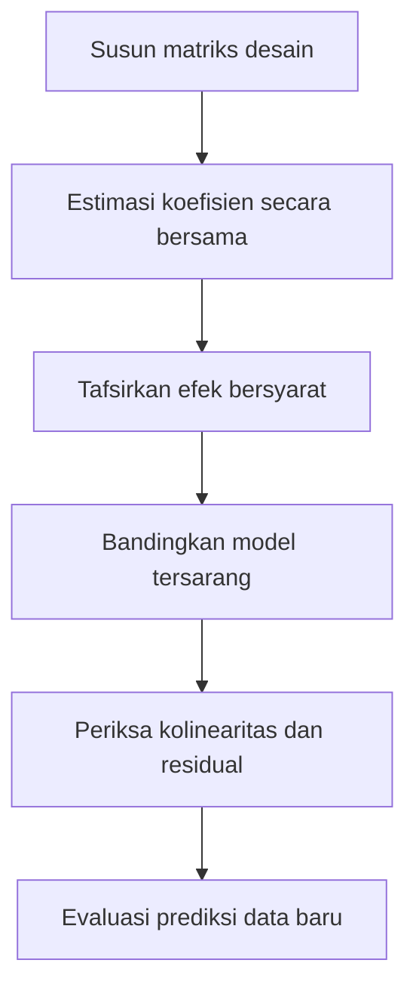
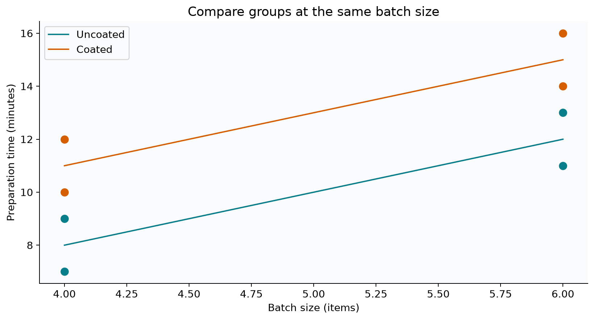
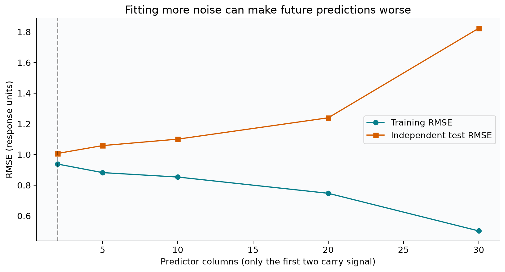

# 07 · Regresi berganda dan perbandingan bersyarat

Regresi berganda mengestimasi respons menggunakan beberapa prediktor secara bersama. Koefisiennya menggambarkan hubungan bersyarat dalam model yang ditentukan. Menambahkan prediktor memperbaiki atau mempertahankan kecocokan pelatihan, tetapi dapat membuat estimasi tidak stabil dan prediksi mendatang lebih buruk.

**Alur pembelajaran:** model → pengodean → pencocokan → uji tersarang → kestabilan → validasi. Prasyarat: [regresi sederhana](../06_Linear_Regression/06_Linear_Regression.md). Notasi matriks diperkenalkan dalam [AA](../AA_Prerequisite/AA_Prerequisite.md).

## 1. Dari garis menuju bidang dan dimensi lebih tinggi

Dengan $p$ kolom prediktor dan intersep,

$$Y_i=\beta_0+\beta_1x_{i1}+\cdots+\beta_px_{ip}+\varepsilon_i.$$

Dua prediktor numerik menentukan bidang untuk rata-rata bersyarat. Lebih banyak prediktor tidak memerlukan prinsip pencocokan baru: minimalkan kuadrat residual. Dalam notasi matriks, $\mathbf y=X\boldsymbol\beta+\boldsymbol\varepsilon$, dengan kolom pertama $X$ berisi satu. Misalkan $K=p+1$ menghitung **seluruh** koefisien, termasuk intersep.

Jika $X$ memiliki rank kolom penuh, solusi OLS secara teoretis adalah $(X^TX)^{-1}X^T\mathbf y$. Dalam perhitungan numerik, gunakan pemecah kuadrat terkecil berbasis QR atau dekomposisi nilai singular, alih-alih menghitung invers secara eksplisit. Rank kolom penuh berarti tidak ada kolom prediktor yang dapat direkonstruksi secara tepat dari kolom lainnya.

Menghitung pengamatan saja tidak cukup. Bahkan dengan 1.000 baris, memasukkan massa dalam kilogram dan massa dalam gram sekaligus menciptakan ketergantungan eksak. Koefisien unik memerlukan rank $K$; estimasi varians residual klasik juga memerlukan $n>K$. Ukuran sampel yang memadai secara praktis biasanya jauh melebihi batas minimum.

## 2. Contoh orisinal dengan prediktor kategoris

Sebuah bengkel mencatat waktu persiapan kelompok barang. Misalkan $x$ adalah ukuran kelompok yang dipusatkan pada lima barang, dan $z$ menunjukkan lapisan pelindung: 0 untuk tanpa lapisan dan 1 untuk berlapis. Gunakan data pembelajaran yang sengaja diseimbangkan berikut:

| Ukuran kelompok | $x$ terpusat | Lapisan $z$ | Waktu, menit |
|---:|---:|---:|---|
| 4 | -1 | 0 | 7, 9 |
| 4 | -1 | 1 | 10, 12 |
| 6 | 1 | 0 | 11, 13 |
| 6 | 1 | 1 | 14, 16 |

Cocokkan $Y=\beta_0+\beta_1x+\beta_2z+\varepsilon$. Persamaan hasil pencocokannya adalah

$$\hat y=10+2x+3z.$$

Untuk kelompok barang berukuran sama, kelompok berlapis memiliki estimasi rata-rata tiga menit lebih tinggi. Dalam masing-masing kategori lapisan, satu barang tambahan berasosiasi dengan tambahan dua menit. Intersepnya sepuluh menit untuk kelompok lima barang tanpa lapisan. Pemusatan menjadikannya acuan bermakna, alih-alih kelompok hipotetis berisi nol barang.

Residualnya $-1,+1$ pada setiap baris tabel, sehingga $RSS_F=8$. Terdapat $n=8$ pengamatan dan $K_F=3$ koefisien, menghasilkan estimasi varians residual $8/(8-3)=1.6$.

<!-- lab: conditional_fit -->

Untuk prediktor tiga kategori, gunakan dua kolom indikator ditambah intersep. Menyertakan ketiga indikator dan intersep menciptakan identitas “intersep = jumlah indikator” dan mengurangi rank. Mengubah kategori acuan mengubah label dan makna koefisien, tetapi tidak mengubah nilai hasil pencocokan model yang sama.

## 3. “Mempertahankan variabel lain tetap” memerlukan model

Dalam model aditif di atas, mengubah $x$ sebesar satu dengan $z$ tetap mengubah estimasi rata-rata sebesar $\beta_1$. Ini adalah asosiasi bersyarat. Hasilnya berbeda dari regresi satu prediktor ketika prediktor yang dihilangkan berasosiasi dengan prediktor yang disertakan sekaligus respons.

Penyesuaian tidak otomatis bersifat kausal. Penyebab bersama yang dihilangkan dapat menyisakan perancuan; mengondisikan pada variabel yang disebabkan oleh perlakuan atau pada mekanisme seleksi dapat menimbulkan bias lain. Pilih variabel berdasarkan pertanyaan dan proses pembangkitan data, bukan sekadar aturan bahwa lebih banyak penyesuaian selalu lebih baik.

**Interaksi** memungkinkan satu hubungan bervariasi menurut prediktor lain:

$$E[Y\mid x,z]=\beta_0+\beta_1x+\beta_2z+\beta_3xz.$$

Sekarang kemiringannya $\beta_1$ untuk $z=0$ dan $\beta_1+\beta_3$ untuk $z=1$. Selisih kelompok pada $x$ tertentu adalah $\beta_2+\beta_3x$. Tidak ada satu efek kelompok yang konstan. Pertahankan suku berorde lebih rendah saat menambahkan interaksi, kecuali model ilmiah secara khusus membenarkan suatu kendala.

Notebook mengevaluasi persamaan contoh $10+2x+3z+xz$ untuk memperlihatkan perubahan selisih kelompok dari 2 menjadi 3 menjadi 4 menit ketika $x$ terpusat berubah dari $-1$ menjadi 0 menjadi 1. Ini adalah ilustrasi yang ditentukan, bukan interaksi yang diinferensikan dari data aditif delapan baris.

<!-- lab: interaction -->

## 4. Bandingkan model tersarang pada pengamatan yang sama

Model tereduksi **tersarang** dalam model lengkap ketika menetapkan koefisien tertentu pada model lengkap menjadi nol menghasilkan model tereduksi. Cocokkan ulang kedua model secara terpisah. Jangan menghapus suku dari persamaan model lengkap hasil pencocokan sambil mempertahankan semua koefisien lainnya; nilai optimal koefisien yang tersisa dapat berubah.

Untuk model OLS tersarang yang dicocokkan pada respons dan baris yang sama, dengan $K_R<K_F$,

$$F=\frac{(RSS_R-RSS_F)/(K_F-K_R)}{RSS_F/(n-K_F)}.$$

Dalam model galat normal klasik yang independen dan homoskedastik, serta hipotesis nol bahwa semua koefisien tambahan nol, statistik ini berdistribusi $F_{K_F-K_R,n-K_F}$. Pembilang mengukur perbaikan per koefisien tambahan. Penyebut mengestimasi varians galat yang tidak terjelaskan dari model lengkap.

Dalam contoh kita, model tereduksi tidak menyertakan lapisan. RSS-nya 26, dibandingkan 8 untuk model lengkap. Karena itu,

$$F=\frac{(26-8)/(3-2)}{8/(8-3)}=11.25,$$

dengan derajat kebebasan $(1,5)$ dan nilai p sekitar 0.020. Ini menguji koefisien lapisan dengan mengondisikan pada ukuran kelompok barang. Dengan satu koefisien tambahan, $F=t^2$ berdasarkan asumsi varians yang sama.

<!-- lab: nested_models -->

Uji F **keseluruhan** menguji apakah seluruh koefisien prediktor nol dengan membandingkan terhadap model yang hanya memiliki intersep. Uji dapat menolak meskipun beberapa koefisien individual tidak presisi. Rumus model yang tidak tersarang, transformasi respons berbeda, atau baris berbeda akibat data hilang tidak memenuhi kondisi perbandingan RSS sederhana ini.

## 5. $R^2$ dan $R^2$ tersesuaikan

Karena model lengkap dapat menetapkan koefisien tambahan menjadi nol, RSS pelatihan yang diminimalkan tidak dapat meningkat. Akibatnya, $R^2$ pelatihan tidak dapat menurun. Prediktor derau acak dapat menyerap ciri kebetulan data pelatihan meskipun tidak memiliki hubungan prediktif nyata.

Untuk model dengan intersep, $R^2$ tersesuaikan adalah

$$\bar R^2=1-\frac{RSS/(n-K)}{TSS/(n-1)}.$$

Ukuran ini membandingkan variasi residual per derajat kebebasan tersisa dengan estimasi model yang hanya menggunakan rata-rata. Dalam contoh kita, $TSS=58$, $R^2=1-8/58\approx0.8621$, dan nilai tersesuaikannya $R^2\approx0.8069$. Nilainya dapat menurun ketika prediktor yang tidak diperlukan ditambahkan dan dapat negatif. Ini merupakan ringkasan pelatihan dengan penalti, bukan pengganti evaluasi data baru atau jaminan pemilihan model yang benar.

<!-- lab: overfitting -->

Simulasi memiliki dua prediktor sebenarnya. Kolom tambahan merupakan derau independen, dan sampel uji dibangkitkan secara terpisah. Kesalahan pelatihan menurun ketika variabel derau ditambahkan, sementara kesalahan pengujian dapat memburuk. Kurva pengujian tertentu dapat berfluktuasi; pelajarannya adalah mengukur generalisasi, bukan menyimpulkannya dari kecocokan pelatihan. Jika pilihan model menggunakan data validasi, pertahankan data uji akhir agar tidak tersentuh atau gunakan rancangan validasi tersarang yang sesuai.

## 6. Kolinearitas dan ketidakpastian koefisien

Jika dua prediktor bergerak hampir bersamaan, data hanya memuat sedikit perbandingan ketika satu berubah sementara yang lain tetap. Kemiringan masing-masing menjadi sulit diidentifikasi meskipun prediksi gabungannya akurat. Koefisien dapat besar, tidak pasti, atau sensitif terhadap perubahan kecil pada data.

**Faktor inflasi varians** untuk prediktor $j$ adalah $VIF_j=1/(1-R_j^2)$, dengan $R_j^2$ berasal dari regresi prediktor tersebut terhadap prediktor lain dengan intersep. Ukuran ini menggambarkan inflasi varians relatif terhadap desain ortogonal dalam model homoskedastik. VIF tinggi merupakan diagnostik, bukan instruksi universal untuk menghapus prediktor.

Notebook membandingkan desain biasa dengan desain yang memuat prediktor hampir duplikat, kemudian memeriksa kekurangan rank eksak akibat duplikat sempurna. Pemusatan dapat membantu interpretasi dan mengurangi beberapa masalah numerik; pemusatan tidak memisahkan pengukuran yang benar-benar redundan. Regresi ridge merupakan salah satu pengembangan prediktif yang mungkin, tetapi mengubah metode estimasi dan berada di luar bab ini.

<!-- lab: collinearity -->

Terus periksa residual, leverage, pengaruh, dan ketergantungan menurut urutan pengumpulan seperti dalam Bab 6. Grafik residual dua dimensi tetap berguna ketika permukaan hasil pencocokan berdimensi tinggi tidak dapat ditampilkan secara langsung.

## 7. Latihan

1. Model tereduksi memiliki RSS 120 dan $K_R=2$. Model lengkap pada 30 baris yang sama memiliki RSS 90 dan $K_F=4$. Hitung statistik F parsial dan derajat kebebasannya.
2. Tafsirkan $\hat y=5+2x-3z+4xz$ pada $z=0$ dan $z=1$.
3. Analis menambahkan sepuluh kolom acak independen dan melihat $R^2$ pelatihan meningkat. Apakah ini membuktikan model lebih baik?
4. Mengapa menyertakan suhu Celsius dan Fahrenheit bersama intersep dapat membuat koefisien tidak unik?
5. Apa yang berubah dalam contoh delapan baris jika kelompok acuan berubah dari tanpa lapisan menjadi berlapis?

## 8. Pembahasan jawaban

1. $F=[(120-90)/2]/[90/26]=13/3\approx4.333$, dengan derajat kebebasan $(2,26)$. Probabilitas ekor atas dihitung dalam notebook.
2. Pada $z=0$, $\hat y=5+2x$. Pada $z=1$, $\hat y=2+6x$. Selisih kelompok adalah $-3+4x$, sehingga “efek $z$ adalah -3” hanya benar pada $x=0$.
3. Tidak. Ini memang diharapkan dari fleksibilitas pencocokan yang lebih besar. Periksa tujuan model, ketidakpastian, asumsi, dan validasi independen.
4. $F=32+1.8C$ adalah kombinasi linier eksak intersep dan kolom Celsius. Matriks desain tidak dapat memiliki rank kolom penuh.
5. Dengan $w=1-z$, persamaan menjadi $\hat y=13+2x-3w$. Prediksi tetap identik; intersep dan kontras kelompok kini menggunakan kelompok barang berlapis sebagai acuan.

<!-- lab: practice -->

## Referensi dan langkah berikutnya

Kaitan bacaan: Starmer (2026), Bab 7, [SQ](../Reference.md#sq-statquest). Pencocokan matriks: [kuadrat terkecil NumPy](https://numpy.org/doc/stable/reference/generated/numpy.linalg.lstsq.html). Perbandingan model: [statsmodels compare_f_test](https://www.statsmodels.org/stable/generated/statsmodels.regression.linear_model.RegressionResults.compare_f_test.html). Interpretasi bersyarat, interaksi, dan eksperimen pada data yang disisihkan memperluas bacaan.

Berikutnya: [08 · Uji t](../08_T-test_for_Testing_the_Differences/08_T-test_for_Testing_the_Differences.md).
