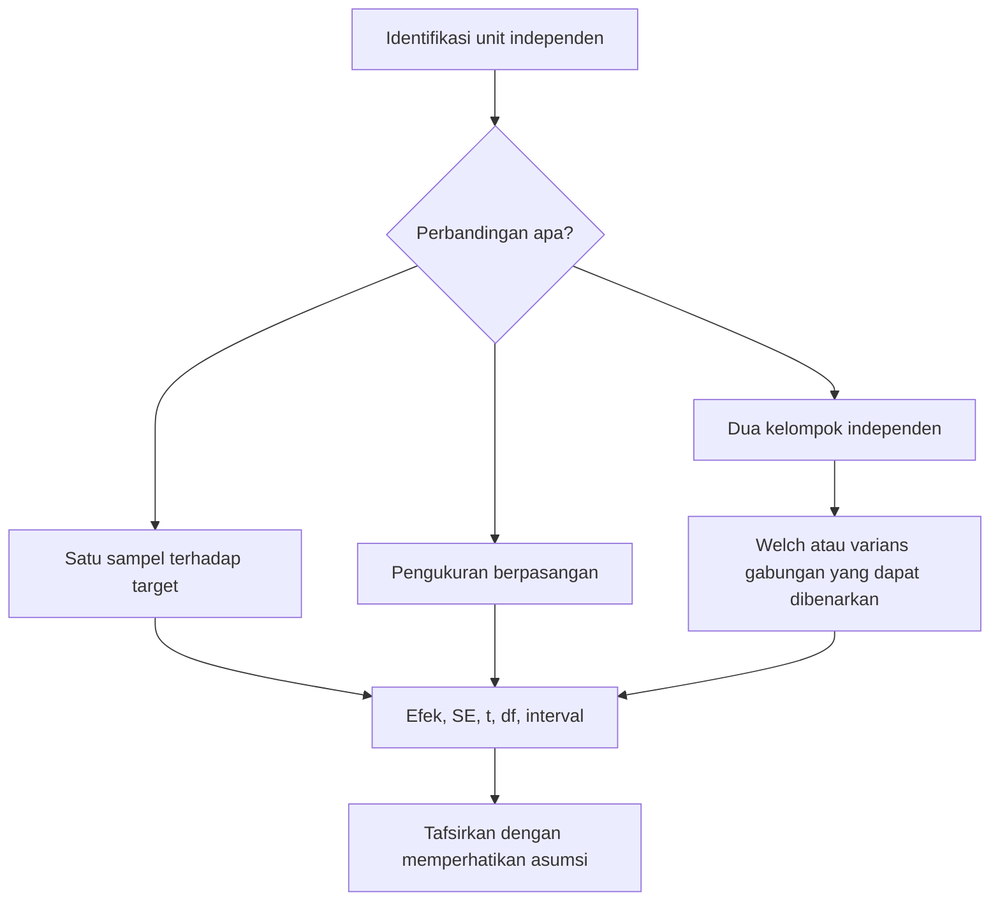
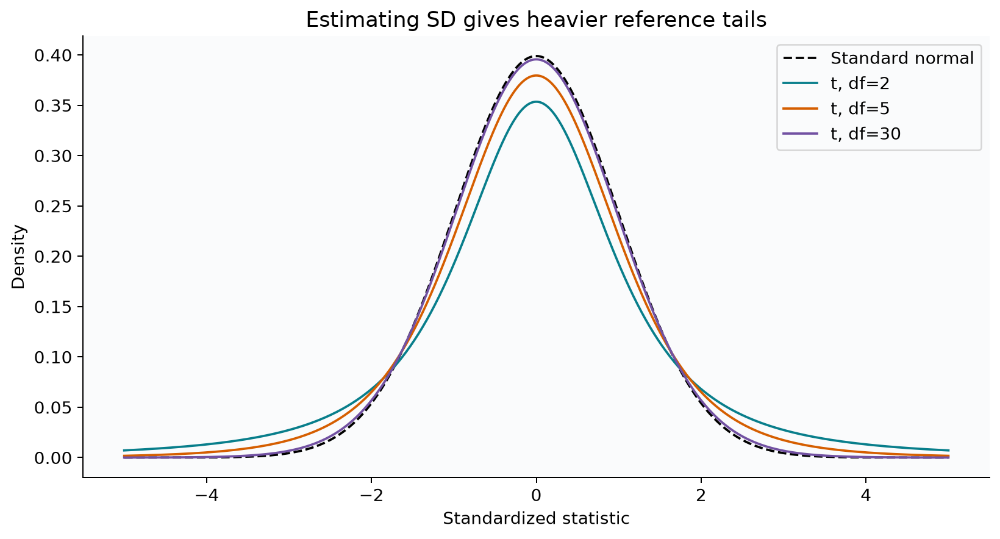
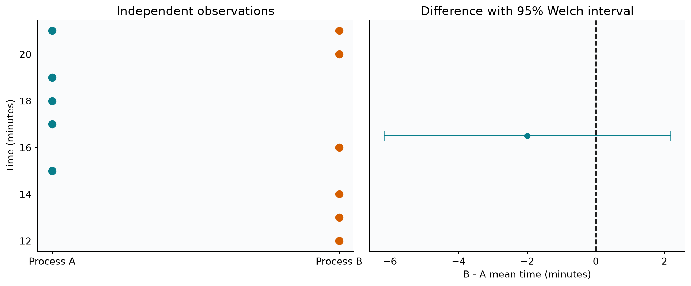
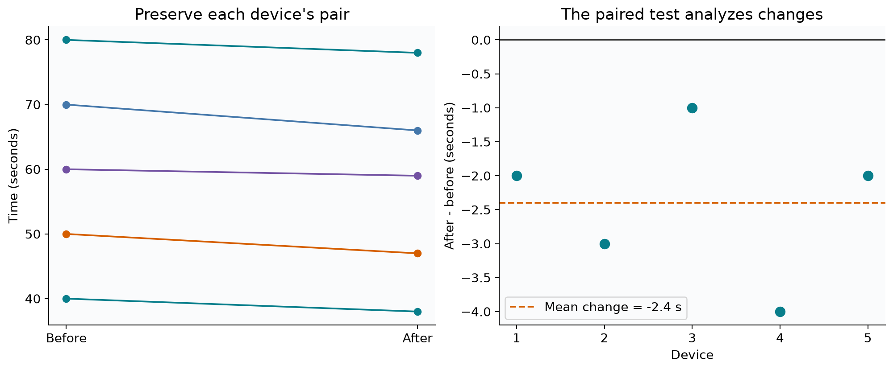

# 08 · Uji t untuk rata-rata dan selisih

Uji t membandingkan estimasi rata-rata atau selisih rata-rata dengan nilai yang dihipotesiskan, diukur dalam satuan estimasi galat baku. Versi yang tepat bergantung pada rancangan: satu sampel, dua sampel independen, atau pengamatan berpasangan.

**Alur pembelajaran:** distribusi t → pilih rancangan → hitung → hubungkan dengan regresi → laporkan. Prasyarat: [nilai p dan interval](../05_P-Values_for_Confidence_Quantification/05_P-Values_for_Confidence_Quantification.md); kaitan dengan regresi menggunakan Bab 6–7.

## 1. Mengapa menggunakan distribusi t?

Untuk pengamatan normal iid, jika $\sigma$ diketahui, $(\bar X-\mu)/(\sigma/\sqrt n)$ akan berdistribusi normal standar. Biasanya $\sigma$ tidak diketahui, sehingga kita menggantinya dengan $S$. Penyebut yang diestimasi ini menimbulkan ketidakpastian tambahan:

$$T=\frac{\bar X-\mu}{S/\sqrt n}\sim t_{n-1}.$$

Distribusi t simetris dengan ekor lebih tebal daripada normal standar. Bentuknya bergantung pada derajat kebebasan. Seiring bertambahnya derajat kebebasan, distribusi ini mendekati normal secara bertahap; tidak ada ukuran sampel ajaib yang membuat keduanya identik. Ekor tebal mencerminkan ketidakpastian dalam menstandarisasi statistik, bukan klaim bahwa setiap kumpulan data mentah berdistribusi t.

<!-- lab: t_distributions -->

## 2. Uji t satu sampel

Untuk menguji $H_0:\mu=\mu_0$, hitung

$$t=\frac{\bar x-\mu_0}{s/\sqrt n},\qquad df=n-1.$$

Untuk alternatif dua sisi, $p=2P(t_{df}\ge|t|)$. Interval terkait adalah $\bar x\pm t_{1-\alpha/2,df}s/\sqrt n$. Uji satu sisi menggunakan ekor yang sesuai dan dipilih sebelumnya.

Untuk volume pengisian rekaan 48, 49, 50, 51, 52 mL, rata-ratanya 50 dan varians sampelnya 2.5. Menguji target 49 mL menghasilkan $t=(50-49)/\sqrt{2.5/5}=\sqrt2$, dengan empat derajat kebebasan. Notebook menghitung nilai p dan intervalnya. Rata-rata berbeda secara deskriptif dari target; seberapa jelas perbedaannya dari target bergantung pada ketidakpastian.

<!-- lab: one_sample -->

## 3. Kelompok independen: uji t Welch

Untuk sampel independen A dan B, definisikan $\Delta=\mu_B-\mu_A$. Dengan varians populasi yang mungkin berbeda, estimasi galat bakunya adalah

$$SE=\sqrt{\frac{s_B^2}{n_B}+\frac{s_A^2}{n_A}},\qquad
t=\frac{(\bar x_B-\bar x_A)-\Delta_0}{SE}.$$

Pendekatan derajat kebebasan Welch adalah

$$\nu=\frac{(s_B^2/n_B+s_A^2/n_A)^2}
{(s_B^2/n_B)^2/(n_B-1)+(s_A^2/n_A)^2/(n_A-1)}.$$

Derajat kebebasan pecahan merupakan hal biasa di sini. Pendekatan Welch–Satterthwaite memperhitungkan ketidakpastian akibat mengestimasi dua varians. Metode Welch tidak mensyaratkan varians sama dan merupakan pilihan awal yang masuk akal untuk dua rata-rata independen ketika asumsi varians sama tidak dapat dibenarkan. Metode ini tetap memerlukan pengambilan sampel independen yang sesuai dan tidak kebal terhadap kemencengan berat atau pengamatan berpengaruh dalam sampel kecil.

### Contoh pembahasan: dua proses persiapan

Gunakan waktu rekaan yang independen, dalam menit:

| Proses | Waktu | $n$ | Rata-rata | Varians sampel |
|---|---|---:|---:|---:|
| A | 15, 17, 18, 19, 21 | 5 | 18 | 5 |
| B | 12, 13, 14, 16, 20, 21 | 6 | 16 | 14 |

Untuk $H_0:\Delta=0$, estimasi efeknya $16-18=-2$ menit. SE-nya $\sqrt{14/6+5/5}=\sqrt{10/3}\approx1.826$, dan $t\approx-1.095$. Derajat kebebasan Welch sekitar 8.299. Nilai p dua sisi sekitar 0.30; interval mencakup nol dan efek yang mungkin bermakna pada kedua arah. Presisi ini tidak cukup untuk menyatakan kesamaan atau perbaikan yang telah terbukti.

<!-- lab: welch -->

Laporkan efek dan interval meskipun nilai p besar. Hanya melaporkan “tidak signifikan” membuang informasi berguna tentang besaran dan presisi.

## 4. Uji Student dengan varians sama dan kaitannya dengan regresi

Jika asumsi varians populasi yang sama dapat dibenarkan, gabungkan informasi dalam kelompok:

$$s_p^2=\frac{(n_A-1)s_A^2+(n_B-1)s_B^2}{n_A+n_B-2},$$

$$t=\frac{(\bar x_B-\bar x_A)-\Delta_0}
{s_p\sqrt{1/n_A+1/n_B}},\qquad df=n_A+n_B-2.$$

Untuk contoh kita, $s_p^2=10$. Ini adalah rata-rata berbobot varians, bukan rata-rata SD tanpa bobot. Ukuran sampel sama tidak membuktikan varians populasi sama. Memilih uji gabungan atau Welch semata-mata berdasarkan uji kesamaan varians terlebih dahulu dapat membuat keseluruhan prosedur lebih sulit ditafsirkan; nyatakan model varians secara langsung.

Regresikan seluruh pengamatan pada intersep dan indikator $z=1$ untuk B, $z=0$ untuk A. Intersep mengestimasi rata-rata A dan koefisien indikator mengestimasi B dikurangi A. Dalam OLS homoskedastik biasa, uji t indikator sama dengan uji t dua sampel **varians gabungan**, dan uji F dengan satu derajat kebebasan sama dengan $t^2$.

Kesetaraan ini umumnya tidak mengubah uji F OLS biasa menjadi uji Welch. Welch menggunakan estimasi varians dan pendekatan derajat kebebasan yang berbeda. Dalam kedua kasus, arah kontras hilang ketika statistik t dikuadratkan; pertahankan tanda efek dalam laporan.

<!-- lab: regression_equivalence -->

## 5. Pengamatan berpasangan: analisis selisih dalam pasangan

Ketika perangkat yang sama diukur sebelum dan sesudah perubahan pengaturan, pengamatannya berpasangan. Misalkan $d_i=\text{after}_i-\text{before}_i$. Uji rata-rata selisih dengan uji t satu sampel:

$$t=\frac{\bar d-\Delta_0}{s_d/\sqrt n},\qquad df=n-1,$$

dengan $n$ adalah jumlah pasangan independen. Asumsi normalitas yang relevan untuk uji eksak sampel kecil berkaitan dengan **selisih**, bukan distribusi sebelum dan sesudah secara terpisah.

Pertimbangkan waktu sebelum $(40,50,60,70,80)$ dan waktu sesudah $(38,47,59,66,78)$ detik untuk lima perangkat. Selisihnya $(-2,-3,-1,-4,-2)$, dengan rata-rata $-2.4$ dan varians sampel 1.3. SE-nya $\sqrt{1.3/5}\approx0.510$, jauh lebih kecil daripada penyebaran waktu mentah perangkat.

<!-- lab: paired -->

Pemasangan bekerja karena $\operatorname{Var}(A-B)=\operatorname{Var}(A)+\operatorname{Var}(B)-2\operatorname{Cov}(A,B)$. Asosiasi positif dalam pasangan dapat mengurangi variasi selisih. Membuat pasangan secara sembarang setelah melihat data bukan cara yang valid untuk memperoleh keuntungan ini. Pemasangan harus berasal dari rancangan, dan hilangnya satu pengukuran dapat mengeluarkan seluruh pasangan dari analisis pasangan lengkap.

## 6. Asumsi, alternatif, dan besar efek

Independensi tidak dapat dibuktikan dengan uji normalitas. Pengamatan berulang, pengamatan yang dipadankan, dan penempatan perlakuan per kelompok memerlukan rancangan masing-masing untuk direpresentasikan dalam analisis. Sampel independen besar dapat membuat inferensi berbasis rata-rata valid secara pendekatan pada kondisi momen yang sesuai, tetapi ekor sangat tebal atau titik berpengaruh tetap dapat berdampak.

Jika asumsi tidak masuk akal, pertimbangkan transformasi yang dapat dibenarkan, estimasi robust, uji pengacakan yang mengikuti rancangan, atau model distribusi yang sesuai. Uji peringkat bukan pengganti otomatis uji selisih rata-rata: hipotesis dan interpretasinya berbeda.

Selisih rata-rata tidak terstandarisasi mempertahankan satuan pengukuran. Cohen's $d$ membagi selisih dengan SD tertentu, sering kali SD gabungan untuk kelompok independen. Untuk rancangan berpasangan, definisi efek terstandarisasi yang berbeda menggunakan penyebut berbeda; sebutkan konvensinya. Koreksi Hedges dapat mengurangi bias sampel kecil pada efek terstandarisasi. Tidak satu pun menggantikan interval atau ambang praktis yang bermakna.

## 7. Latihan

1. Enam pasangan independen memiliki selisih 1, 2, 2, 3, 3, 1. Tentukan rata-rata selisih, SE-nya, t untuk selisih nol, dan derajat kebebasan.
2. Studi tidak berpasangan memiliki $n_A=10,n_B=20,s_A^2=9,s_B^2=16$. Tentukan SE Welch. Dapatkah Anda otomatis menggunakan $df=28$?
3. Mahasiswa memasukkan data sebelum dan sesudah yang berpasangan ke `ttest_ind`. Mengapa hasilnya mungkin tidak efisien atau tidak sesuai?
4. Kapan $F=t^2$ memberikan inferensi dua sisi yang sama untuk selisih kelompok?
5. Mengapa selisih rata-rata dan interval tetap perlu dilaporkan meskipun $p>0.05$?

## 8. Pembahasan jawaban

1. $\bar d=2$, jumlah kuadrat simpangan adalah 4, sehingga $s_d^2=4/5=0.8$, $SE=\sqrt{0.8/6}\approx0.3651$, $t=\sqrt{30}\approx5.477$, dan $df=5$.
2. $SE=\sqrt{9/10+16/20}=\sqrt{1.7}\approx1.3038$. Tidak: Welch menggunakan rumus pendekatan derajat kebebasannya, di sini sekitar 23.37.
3. Rumus sampel independen membuang kovarians pasangan dan tidak merepresentasikan struktur pengambilan sampel sebenarnya. Gunakan selisih atau model berpasangan yang sesuai.
4. Untuk kontras satu derajat kebebasan dan model varians yang sama, seperti uji t dua sampel varians gabungan dan regresi homoskedastik dua kelompok biasa.
5. Keduanya menunjukkan besar efek mana yang masih masuk akal berdasarkan model; label ambang saja tidak menunjukkannya.

<!-- lab: practice -->

## Referensi dan langkah berikutnya

Kaitan bacaan: Starmer (2026), Bab 8, [SQ](../Reference.md#sq-statquest). Pengembangan Welch dan berpasangan: [uji t dua sampel NIST](https://www.itl.nist.gov/div898/handbook/eda/section3/eda353.htm). Pilihan API: [SciPy ttest_ind](https://docs.scipy.org/doc/scipy/reference/generated/scipy.stats.ttest_ind.html) dan [ttest_rel](https://docs.scipy.org/doc/scipy/reference/generated/scipy.stats.ttest_rel.html).

Berikutnya: [09 · Daya uji dan ukuran sampel](../09_Power_and_Power_Analysis/09_Power_and_Power_Analysis.md).
