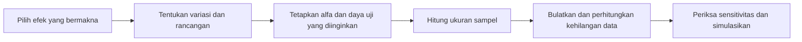
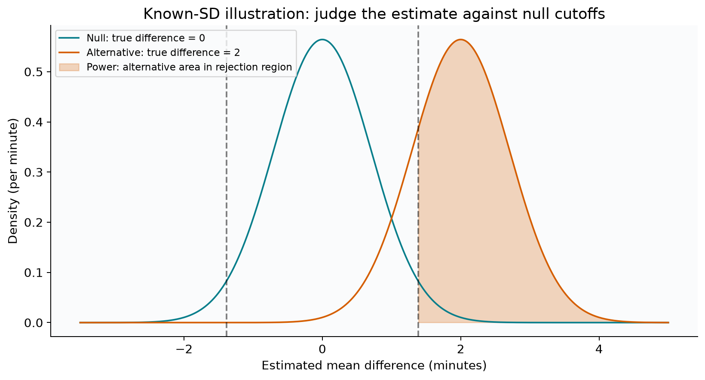
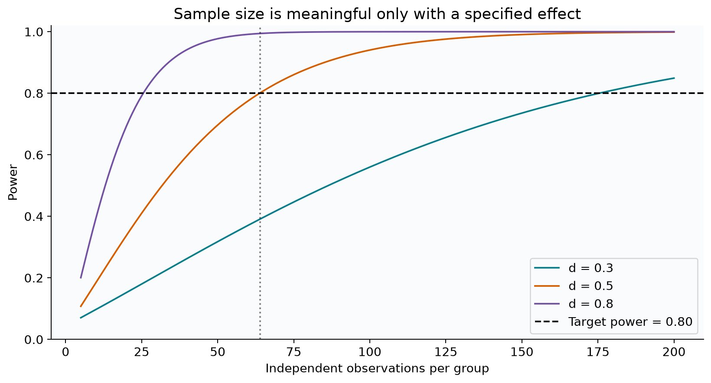

# 09 · Daya uji dan perencanaan ukuran sampel

Daya uji adalah probabilitas bahwa uji tertentu akan mendeteksi efek tertentu dalam rancangan tertentu. Merencanakan ukuran sampel berarti memilih presisi dan kemampuan deteksi yang diperlukan sebelum mengumpulkan data, sambil mengakui ketidakpastian asumsi perencanaan.

**Alur pembelajaran:** tingkat kesalahan → pemisahan distribusi sampling → besar efek → perhitungan daya uji → sensitivitas. Prasyarat: [uji t](../08_T-test_for_Testing_the_Differences/08_T-test_for_Testing_the_Differences.md).

## 1. Daya uji bersifat bersyarat, bukan jaminan

Untuk aturan penolakan $R$ dan efek sebenarnya $\Delta$, definisikan

$$\operatorname{Power}(\Delta)=P_{\Delta}(R),\qquad
\beta(\Delta)=1-\operatorname{Power}(\Delta).$$

Pada alternatif tidak nol, penolakan merupakan deteksi benar, juga disebut positif benar. Pada hipotesis nol, probabilitas penolakan adalah ukuran uji, yang dibatasi oleh tingkat $\alpha$ ketika uji valid. Jadi, kurva daya uji juga dapat didefinisikan pada nol, tetapi titik tersebut mewakili probabilitas positif palsu, bukan deteksi yang berguna.

Rancangan berdaya uji 80% pada efek dua menit berarti bahwa, berdasarkan efek dan asumsi lainnya tersebut, sekitar 80% studi berulang menolak. Ini tidak berarti peluang 80% bahwa perlakuan bekerja, bahwa hasil pengamatan benar, atau bahwa setiap efek tidak nol akan terdeteksi.

## 2. Mengapa lebih banyak pengamatan independen membantu

Untuk kelompok independen dengan SD sama $\sigma$ dan ukuran sama $n$ per kelompok, selisih rata-rata sampel memiliki

$$E[\bar X_B-\bar X_A]=\Delta,\qquad
SE=\sigma\sqrt{2/n}.$$

Distribusi sampling nol berpusat di nol. Pada alternatif positif, pusatnya $\Delta$. Memperbesar $n$ mempersempit kedua distribusi sementara pusatnya tetap. Lebih banyak bagian distribusi alternatif kemudian berada di luar batas model nol yang direncanakan sebelumnya.

Untuk uji normal dengan SD diketahui, misalkan $\lambda=\Delta/[\sigma\sqrt{2/n}]$. Statistik terstandarisasi berdistribusi $N(\lambda,1)$ pada alternatif, sementara daerah penolakan dua sisi adalah $|Z|>z_{1-\alpha/2}$. Daya ujinya adalah

$$\Phi(-z_{1-\alpha/2}-\lambda)
+1-\Phi(z_{1-\alpha/2}-\lambda).$$

<!-- lab: power_geometry -->

Grafik menggunakan **distribusi selisih rata-rata**, bukan tumpang tindih pengamatan individual. Distribusi individual dapat banyak bertumpang tindih sementara studi besar mengestimasi rata-ratanya secara presisi. Lebih banyak pengulangan yang saling bergantung belum tentu memberikan keuntungan yang sama dengan lebih banyak unit independen.

## 3. Pilih efek yang layak dideteksi

Misalkan sebuah bengkel menganggap perubahan proses bermanfaat jika menghemat setidaknya **dua menit** secara rata-rata. Pengetahuan proses sebelumnya menunjukkan SD yang sama sebesar **empat menit**. Untuk kelompok independen dengan varians sama, besar efek terstandarisasinya adalah

$$d=\frac{|\Delta|}{\sigma}=\frac24=0.5.$$

Ini adalah nilai perencanaan, bukan efek yang ditemukan dalam studi saat ini. Gunakan efek terkecil yang penting secara praktis, berdasarkan keputusan dan data sebelumnya yang kredibel. Memilih estimasi studi pendahuluan yang optimistis dapat membuat studi berikutnya sangat kekurangan daya uji. Label umum seperti “kecil” dan “besar” tidak menentukan apa yang penting untuk bengkel tertentu.

Cohen's $d$ bertanda berguna ketika melaporkan arah. Besarnya saja cukup untuk perhitungan daya uji dua sisi. Tentukan konvensi penyebut; perubahan terstandarisasi berpasangan dan efek berdasarkan SD gabungan kelompok independen tidak dapat dipertukarkan.

## 4. Hitung ukuran sampel untuk uji yang direncanakan

Pendekatan rancangan seimbang dua sisi dengan SD diketahui menggunakan

$$n\approx\frac{2(z_{1-\alpha/2}+z_{1-\beta})^2}{d^2}.$$

Pada $\alpha=0.05$, daya uji 0.80, dan $d=0.5$, hasilnya sekitar 62.79 pengamatan **per kelompok**, sebelum pembulatan. Rumus mendekati daya uji dengan menekankan ekor penolakan utama pada efek berarah; rumus berguna untuk intuisi dan perencanaan awal, bukan pengganti perhitungan uji yang sesuai.

Untuk uji t dua sampel varians gabungan, gunakan distribusi t nonsentral. Dengan ukuran kelompok sama,

$$df=2n-2,\qquad \lambda=d\sqrt{n/2},\qquad
c=t_{1-\alpha/2,df},$$

$$\operatorname{Power}=P(t_{df,\lambda}<-c)+P(t_{df,\lambda}>c).$$

Batas berasal dari distribusi t nol **sentral**, sementara probabilitas penolakan pada alternatif berasal dari distribusi **nonsentral**. Notebook menyelesaikannya secara numerik dengan statsmodels dan memeriksa hasil secara independen menggunakan CDF dan fungsi survival t nonsentral SciPy.

Hasilnya sekitar **63.77 per kelompok**. Bulatkan ke atas menjadi **64 per kelompok, total 128**, lalu hitung ulang daya uji yang dicapai, sekitar 0.8015. Pembulatan ke bawah akan meleset dari target. Jika 20% unit yang direkrut diperkirakan tidak dapat digunakan karena alasan yang telah diperhitungkan dalam rancangan, mulailah dengan $\lceil64/(1-0.20)\rceil=80$ per kelompok. Penambahan numerik ini tidak menyelesaikan bias akibat data hilang yang bergantung pada hasil.

<!-- lab: sample_size -->

Perhitungan mengasumsikan pengamatan independen, varians galat normal yang sama, alokasi seimbang, uji gabungan dua sisi, dan satu perbandingan terencana. Rancangan Welch dengan varians tidak sama, rancangan berpasangan, uji dengan pengacakan kelompok, atau prosedur pengujian berganda memerlukan perhitungan daya uji atau simulasi yang sesuai.

## 5. Analisis sensitivitas merupakan bagian dari jawaban

Masukan perencanaan tidak pasti. Hitung beberapa besar efek dan SD yang masuk akal, bukan hanya satu angka yang nyaman. Notebook menampilkan ukuran sampel untuk beberapa nilai $d$ dan membandingkan daya uji yang diinginkan 80% dengan 90%.

<!-- lab: sensitivity -->

Untuk uji dan alokasi yang sama, efek lebih besar dan variasi lebih rendah umumnya meningkatkan daya uji. Ukuran sampel lebih besar meningkatkan presisi. $\alpha$ lebih kecil membuat penolakan lebih sulit dan mengurangi daya uji pada $n$ tetap; mempertahankan daya uji kemudian memerlukan lebih banyak informasi. Ini merupakan kompromi rancangan, bukan alasan untuk melonggarkan ambang signifikansi setelah melihat hasil.

Rumus pendekatan menunjukkan mengapa mendeteksi efek setengahnya memerlukan sekitar empat kali ukuran sampel ketika SD tetap. Memperbaiki keandalan pengukuran atau menggunakan pemasangan/pemblokan yang dapat dibenarkan dapat berharga karena mengurangi derau juga mengurangi kebutuhan informasi. Jika ukuran kelompok adalah $m$ dan korelasi dalam kelompok $\rho$, pendekatan efek desain $1+(m-1)\rho$ menggambarkan mengapa banyak pengukuran dari sedikit kelompok dapat tidak efisien; rancangan berkelompok yang nyata memerlukan perencanaan lebih cermat.

## 6. Verifikasi daya uji dengan menyimulasikan seluruh prosedur

Notebook menyimulasikan 10.000 studi independen berdasarkan $\Delta=2$, $\sigma=4$, dan $n=64$ per kelompok. Simulasi menjalankan uji t gabungan dua sisi yang sama dengan asumsi perhitungan perencanaan. Proporsi penolakan seharusnya mendekati daya uji teoretis, dalam batas galat simulasi.

Untuk $B$ pengulangan dan estimasi daya uji $\hat\pi$, SE Monte Carlo adalah $\sqrt{\hat\pi(1-\hat\pi)/B}$. Pada 0.80 dengan 10.000 pengulangan, nilainya sekitar 0.004. Penyimpangan beberapa perseribu merupakan derau simulasi biasa. Pemeriksaan ini tidak memvalidasi realisme asumsi normal atau varians sama.

<!-- lab: simulated_power -->

Simulasi menjadi sangat berguna ketika analisis nyata mencakup varians tidak sama, pengelompokan, nilai hilang, atau aturan keputusan rumit. Bangkitkan data dari skenario eksplisit yang masuk akal dan jalankan **seluruh analisis yang direncanakan**, termasuk prosedur penghentian atau seleksi apa pun.

## 7. Hindari penalaran daya uji teramati

Setelah studi, memasukkan efek yang diamati ke rumus perencanaan dan menyebut hasilnya “daya uji teramati” hanya menambahkan sedikit informasi di luar nilai p dan dapat menyesatkan. Efek yang diamati mengandung derau, terutama pada studi kecil. Laporkan estimasi dan intervalnya; bahas efek bermakna secara ilmiah mana yang dapat dibatasi oleh data.

Untuk studi baru, tinjau kembali daya uji menggunakan rentang efek dan asumsi variasi yang dapat dipertanggungjawabkan. Hasil sebelumnya yang tidak signifikan bukan bukti efek nol maupun izin menambah pengamatan hingga signifikansi muncul. Rancangan sekuensial yang valid dapat mengizinkan pemeriksaan berulang, tetapi harus mengalibrasi aturan penghentiannya.

## 8. Latihan

1. Perubahan bermakna adalah 3 unit dan SD bersama 6. Efek terstandarisasi apa yang sebaiknya digunakan untuk perencanaan kelompok independen seimbang?
2. Kira-kira bagaimana kebutuhan $n$ berubah jika efek target menjadi setengah sementara SD, daya uji, dan $\alpha$ tetap?
3. Kalkulator menghasilkan 87.2 pengamatan per kelompok. Berapa total minimum setelah pembulatan? Dengan perkiraan kehilangan 15%, berapa yang sebaiknya direkrut pada awalnya per kelompok?
4. Apakah daya uji 90% berarti hasil signifikan memiliki peluang 90% untuk benar?
5. Mengapa studi berpasangan tidak seharusnya langsung menggunakan hasil ukuran sampel kelompok independen?

## 9. Pembahasan jawaban

1. $d=3/6=0.5$. Pertahankan pula makna praktis 3 unit dalam laporan.
2. Sekitar empat kali lebih banyak per kelompok, karena pendekatannya sebanding dengan $1/d^2$.
3. Bulatkan menjadi 88 per kelompok, total 176. Tambahkan menjadi $\lceil88/0.85\rceil=104$ per kelompok, atau 208 pada awalnya, dengan memperhatikan asumsi data hilang.
4. Tidak. Daya uji dihitung dengan syarat alternatif tertentu benar. Daya uji bukan probabilitas posterior bagi hasil yang ditemukan.
5. Informasinya berasal dari selisih dalam pasangan dan SD-nya, termasuk kovarians. Unit independennya adalah pasangan; uji dan derajat kebebasannya berbeda.

<!-- lab: practice -->

## Referensi dan langkah berikutnya

Kaitan bacaan: Starmer (2026), Bab 9, [SQ](../Reference.md#sq-statquest). Implementasi daya uji: [statsmodels TTestIndPower](https://www.statsmodels.org/stable/generated/statsmodels.stats.power.TTestIndPower.html); referensi nonsentral: [SciPy nct](https://docs.scipy.org/doc/scipy/reference/generated/scipy.stats.nct.html). Skenario perencanaan dan analisis sensitivitas merupakan karya orisinal.

Berikutnya: [10 · Kekeliruan nilai p](../10_P-Values_Pitfalls/10_P-Values_Pitfalls.md).
