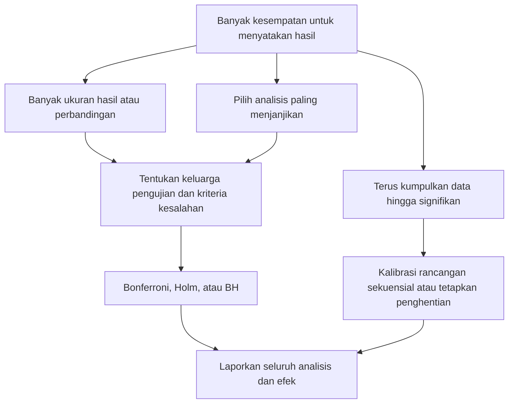
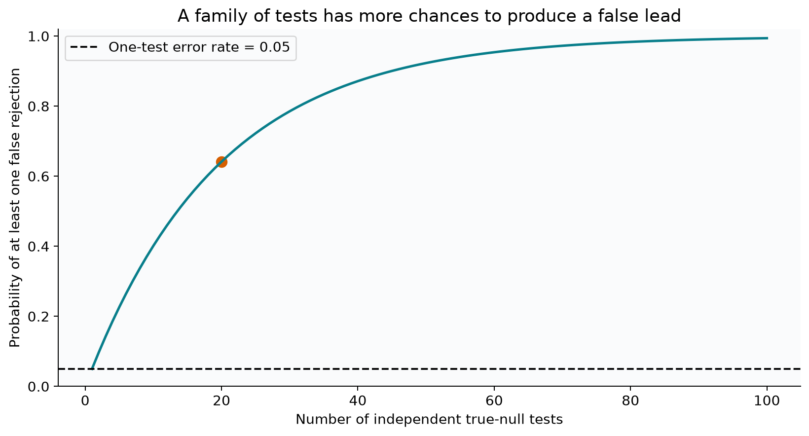
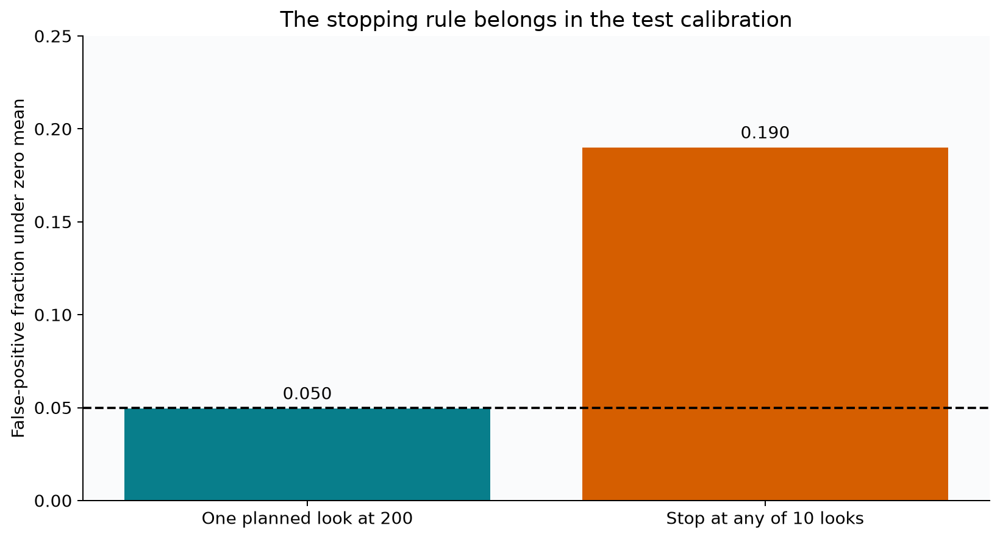

# 10 · Pengujian berganda, seleksi, dan penghentian

Nilai p yang valid untuk satu uji terencana dapat menjadi menyesatkan ketika dipilih dari banyak analisis atau diperiksa berulang kali hingga kecil. Evaluasi keseluruhan prosedur yang menghasilkan klaim, bukan hanya perhitungan akhirnya.

**Alur pembelajaran:** pengujian berganda → FWER dibandingkan FDR → penyesuaian → seleksi → penghentian opsional. Prasyarat: [nilai p](../05_P-Values_for_Confidence_Quantification/05_P-Values_for_Confidence_Quantification.md) dan [daya uji](../09_Power_and_Power_Analysis/09_Power_and_Power_Analysis.md).

## 1. Dua puluh kesempatan menemukan kejutan

Bayangkan menguji dua puluh pengaturan sensor independen, yang semuanya tidak benar-benar mengubah rata-rata akurasi. Setiap uji kontinu yang valid menolak hipotesis nolnya dengan probabilitas $\alpha=0.05$. Peluang **tidak ada** penolakan palsu adalah $(1-0.05)^{20}$. Karena itu,

$$P(\text{at least one false rejection})=1-0.95^{20}\approx0.6415.$$

Ini bukan probabilitas bahwa setiap uji salah. Nilai harapan jumlah penolakan palsu adalah $20(0.05)=1$. Nilai harapan hitungan, probabilitas terjadinya kesalahan apa pun, dan proporsi di antara penemuan yang dilaporkan merupakan besaran berbeda.

Rumus perkalian memerlukan independensi. Uji yang menggunakan kelompok kontrol bersama saling berkorelasi, sehingga rumus eksak tersebut belum tentu berlaku. Linearitas nilai harapan tetap menghasilkan jumlah probabilitas positif palsu individual, tanpa memerlukan independensi. Pelajaran umumnya tetap berlaku: lebih banyak kesempatan dapat meningkatkan peluang setidaknya satu hasil menyesatkan.

<!-- lab: multiple_opportunities -->

## 2. Sebutkan tingkat kesalahan yang ingin dikendalikan

Misalkan $V$ adalah jumlah penolakan palsu dan $R$ jumlah seluruh penolakan dalam keluarga pengujian yang ditentukan sebelumnya.

| Kriteria | Definisi | Interpretasi dalam keluarga pengujian berulang |
|---|---|---|
| Tingkat kesalahan keluarga pengujian, FWER | $P(V\ge1)$ | Probabilitas setidaknya satu penolakan palsu |
| Tingkat penemuan palsu, FDR | $E[V/\max(R,1)]$ | Nilai harapan proporsi penemuan palsu di antara penolakan, dengan nilai nol ketika tidak ada penolakan |

Pengendalian FWER berguna ketika satu klaim palsu pun dalam keluarga pengujian menimbulkan biaya besar. Pengendalian FDR berguna untuk penyaringan eksploratif ketika rata-rata proporsi temuan palsu yang terkendali dapat diterima dan validasi lanjutan direncanakan. FDR 0.05 tidak menjamin bahwa paling banyak 5% penemuan dalam **kumpulan data tertentu ini** palsu, dan tidak memberikan probabilitas 95% bahwa setiap penemuan benar.

Ketika seluruh hipotesis nol benar, setiap himpunan penolakan yang tidak kosong sepenuhnya palsu. Maka $V/\max(R,1)$ bernilai nol atau satu, sehingga FDR sama dengan FWER. Ketika sebagian efek nyata, kedua kriteria dapat berbeda jauh.

Tentukan keluarga pengujian berdasarkan klaim ilmiah dan rencana analisis. Jangan memperkecilnya setelah melihat hasil mana yang tampak menguntungkan. Menghitung hanya nilai p yang dicetak dalam laporan mengabaikan kesempatan seleksi lainnya.

## 3. Bonferroni: batas sederhana

Untuk $m$ uji, bandingkan setiap nilai p mentah dengan $\alpha/m$, atau secara setara bandingkan nilai tersesuaikan

$$p_i^{\mathrm{Bonf}}=\min(1,mp_i)$$

dengan $\alpha$. Keduanya adalah aturan keputusan yang sama, bukan dua cara dengan daya uji berbeda. Batas gabungan memberikan $P(V\ge1)\le\sum_{i\in H_0}P(p_i\le\alpha/m)\le\alpha$. Nilai p individual yang valid sudah cukup; ketergantungan sembarang diperbolehkan.

Bonferroni dapat konservatif, terutama dengan banyak uji berkorelasi, tetapi jaminannya yang jelas dapat sesuai. Metode ini tidak berarti bahwa 5% dari seluruh uji akan menjadi positif palsu setelah penyesuaian; metode ini membatasi probabilitas **penolakan palsu apa pun** dalam keluarga pengujian.

## 4. Holm: prosedur FWER bertahap menurun

Urutkan nilai p mentah sebagai $p_{(1)}\le\cdots\le p_{(m)}$. Bandingkan yang terkecil dengan $\alpha/m$. Jika memenuhi, bandingkan berikutnya dengan $\alpha/(m-1)$, dan lanjutkan hingga pertama kali tidak memenuhi. Kemudian hentikan penolakan.

Nilai tersesuaikannya adalah

$$p_{(i)}^{\mathrm{Holm}}=\min\!\left(1,\max_{j\le i}(m-j+1)p_{(j)}\right).$$

Maksimum kumulatif mempertahankan urutan yang diperlukan aturan bertahap menurun. Kembalikan urutan uji semula sebelum melaporkan. Holm mengendalikan FWER pada ketergantungan sembarang untuk nilai p valid dan tidak pernah memiliki daya uji lebih rendah daripada Bonferroni biasa untuk keluarga pengujian yang sama.

## 5. Benjamini–Hochberg: prosedur FDR bertahap menaik

Untuk tingkat FDR yang diinginkan $q$, cari peringkat **terbesar** $k$ yang memenuhi $p_{(k)}\le kq/m$, lalu tolak seluruh hipotesis hingga peringkat itu. Jika tidak ada yang memenuhi, jangan tolak satu pun. Pengendalian BH standar berlaku pada independensi dan bentuk ketergantungan positif tertentu; ini bukan jaminan universal pada ketergantungan sembarang. Benjamini–Yekutieli merupakan pilihan lebih konservatif untuk ketergantungan umum.

Nilai BH tersesuaikan dapat dihitung dengan minimum kumulatif dari arah terbalik:

$$p_{(i)}^{\mathrm{BH}}=\min\!\left(1,\min_{j\ge i}\frac{m}{j}p_{(j)}\right).$$

Gunakan seluruh keluarga pengujian yang telah ditentukan. BH adalah prosedur yang mengendalikan kriteria kesalahan; FDR adalah kriterianya sendiri, bukan sinonim untuk setiap penyesuaian nilai p.

### Contoh pembahasan

Untuk lima perbandingan terencana dengan nilai p 0.001, 0.012, 0.021, 0.040, dan 0.200:

| p mentah | Bonferroni | Holm | BH |
|---:|---:|---:|---:|
| 0.001 | 0.005 | 0.005 | 0.005 |
| 0.012 | 0.060 | 0.048 | 0.030 |
| 0.021 | 0.105 | 0.063 | 0.035 |
| 0.040 | 0.200 | 0.080 | 0.050 |
| 0.200 | 1.000 | 0.200 | 0.200 |

Dengan aturan p tersesuaikan $\le0.05$, Bonferroni menolak satu, Holm dua, dan BH empat. Penemuan tambahan BH mencerminkan kriteria kesalahan yang berbeda; penemuan itu bukan bukti bahwa BH mengungguli prosedur FWER untuk setiap tujuan.

<!-- lab: corrections -->

Simulasi berikut membuat keluarga pengujian dengan 80 hipotesis nol benar dan 20 efek nyata. Simulasi mengestimasi FWER dan FDR untuk setiap metode, menunjukkan mengapa keduanya tidak boleh disamakan. Kebenaran dalam simulasi diketahui, sehingga $V$ dapat dihitung; dalam data nyata kita tidak mengetahui penolakan mana yang palsu.

Dengan seed tetap notebook dan 3.000 keluarga pengujian, hasilnya kira-kira:

| Metode | Estimasi FWER | Estimasi FDR | Rata-rata penemuan per keluarga pengujian |
|---|---:|---:|---:|
| Bonferroni | 0.041 | 0.0062 | 6.38 |
| Holm | 0.044 | 0.0065 | 6.50 |
| BH | 0.410 | 0.0400 | 12.79 |

BH sering membuat setidaknya satu penemuan palsu di sini, sambil mempertahankan rata-rata proporsi palsu yang kecil di antara himpunan penemuannya yang lebih besar. Ini sesuai dengan target FDR-nya. FWER dan FDR diestimasi dalam pengulangan; tidak ada baris yang menjamin komposisi suatu himpunan penemuan individual. Ubah proporsi hipotesis nol benar atau besar efek untuk melihat mengapa perbedaan ini penting.

<!-- lab: family_simulation -->

## 6. Seleksi mencakup lebih dari sekadar uji eksplisit

Mencoba banyak ukuran hasil, transformasi, subkelompok, himpunan kovariat, pengecualian, atau jendela waktu lalu hanya melaporkan hasil paling menguntungkan akan mengubah prosedur. Memeriksa dua puluh grafik dan hanya menguji perbedaan yang tampak paling jelas tetap menggunakan hasil yang sama untuk memilih kasus yang luar biasa menguntungkan.

Tentukan analisis utama sebelumnya dan catat alternatifnya. Bedakan pola eksploratif dari klaim konfirmatori. Data independen baru dapat menguji hipotesis terpilih tanpa menggunakan kembali derau seleksinya. Penyesuaian sederhana terhadap beberapa nilai p yang tersisa tidak memperhitungkan pencarian jauh lebih besar yang tidak tercatat.

Seleksi juga memperbesar efek yang dilaporkan: di antara banyak estimasi berderau, yang paling ekstrem kemungkinan memuat komponen derau yang menguntungkan. “Kutukan pemenang” ini sangat serius ketika daya uji rendah. Nilai p tersesuaikan menangani kriteria kesalahan pengujian; nilai ini tidak otomatis menghilangkan bias estimasi efek yang dipilih.

## 7. Penghentian opsional mengubah eksperimen

Menambah pengamatan berulang kali dan menerapkan ambang 0.05 untuk sampel tetap menciptakan kesempatan penolakan berulang. Masalahnya bukan sekadar bahwa uji berturut-turut saling bergantung. Bahkan uji independen menimbulkan persoalan pengujian berganda; keseluruhan aturan penghentian harus tercermin dalam kalibrasi.

Notebook menyimulasikan rata-rata sebenarnya nol dengan SD diketahui 1. Simulasi membandingkan satu uji terencana pada $n=200$ dengan sepuluh pemeriksaan pada $n=20,40,\ldots,200$, berhenti setiap kali $p\le0.05$. Aturan kedua menghasilkan lebih banyak positif palsu meskipun setiap uji z dengan $n$ tetap terkalibrasi secara individual.

<!-- lab: optional_stopping -->

Pilih aturan penghentian tetap atau metode sekuensial yang valid, seperti rancangan sekuensial berkelompok yang ditentukan sebelumnya dengan batas terkalibrasi. Analisis sekuensial dapat valid; tidak perlu melarang seluruh pemeriksaan sementara. Perhitungan daya uji sebelumnya saja tidak melindungi tingkat kesalahan jika studi kemudian mengabaikan aturan penghentian yang direncanakan.

## 8. Latihan

1. Berapa peluang setidaknya satu positif palsu dalam sepuluh uji independen dengan hipotesis nol benar pada 0.05? Berapa nilai harapan jumlahnya?
2. Untuk nilai p mentah 0.004, 0.020, 0.030, hitung nilai tersesuaikan Holm dan nyatakan penolakan pada 0.05.
3. Prosedur BH pada $q=0.05$ menghasilkan dua puluh penemuan. Apakah prosedur menjamin paling banyak satu penemuan palsu?
4. Analis memeriksa lima puluh grafik tetapi hanya melaporkan satu nilai p. Apakah proses seleksi yang relevan pasti merupakan satu uji?
5. Apakah mengalikan seluruh nilai p dengan $m$ memberikan keunggulan daya uji dibandingkan membandingkannya dengan $\alpha/m$?

## 9. Pembahasan jawaban

1. $1-0.95^{10}\approx0.4013$; nilai harapan jumlahnya $10(0.05)=0.5$.
2. Kalikan nilai p terurut dengan 3, 2, 1 untuk memperoleh 0.012, 0.040, 0.030. Maksimum kumulatif memberikan **0.012, 0.040, 0.040**. Ketiganya menolak. Melupakan maksimum kumulatif menghasilkan nilai tersesuaikan yang keliru.
3. Tidak. Jaminannya berkaitan dengan nilai harapan proporsi penemuan palsu dalam keluarga pengujian berulang berdasarkan kondisi prosedur, bukan batas deterministik untuk satu keluarga pengujian.
4. Tidak. Seleksi visual dapat menggunakan informasi hasil yang sama seperti banyak uji eksplisit. Proses seleksi harus diperhitungkan.
5. Tidak. Kedua rumusan Bonferroni itu setara secara aljabar.

<!-- lab: practice -->

## Referensi dan langkah berikutnya

Kaitan bacaan: Starmer (2026), Bab 10, [SQ](../Reference.md#sq-statquest). Interpretasi: [pernyataan ASA](https://www.amstat.org/asa/files/pdfs/p-valuestatement.pdf). Algoritme dan kondisi ketergantungan: [metode pengujian berganda statsmodels](https://www.statsmodels.org/stable/generated/statsmodels.stats.multitest.multipletests.html). Makalah asli Holm dan BH tercantum dalam [Referensi](../Reference.md#multiple-testing).

Berikutnya: [11 · ANOVA dan ANCOVA](../11_Anova_and_Ancova/11_Anova_and_Ancova.md).
