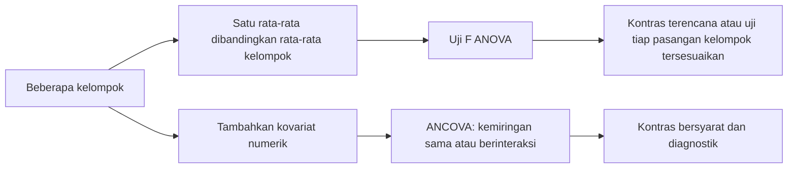
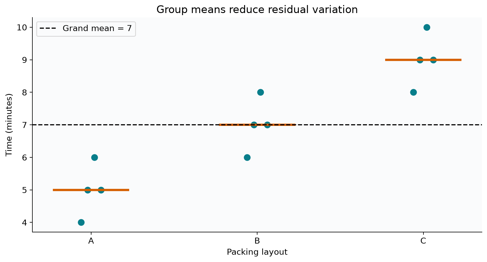
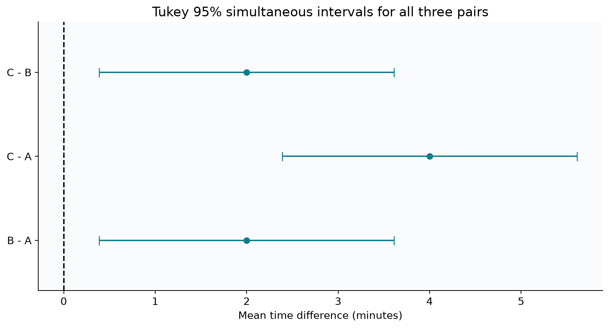
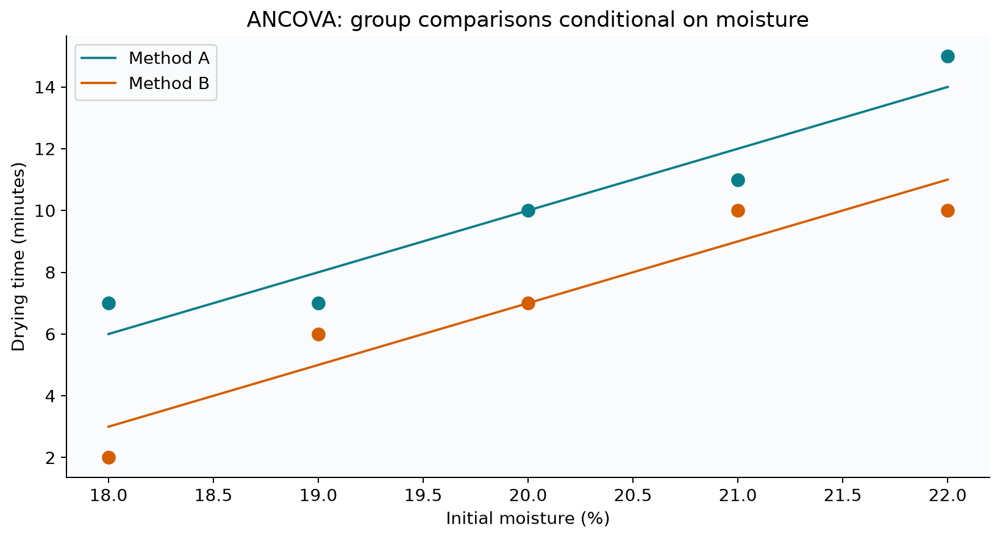

# 11 · ANOVA dan ANCOVA sebagai model linier

ANOVA membandingkan rata-rata kelompok dengan memisahkan variasi antarkelompok dari variasi dalam kelompok. ANCOVA menambahkan kovariat numerik agar kelompok dapat dibandingkan pada nilai kovariat yang sama. Keduanya sesuai secara alami dengan kerangka regresi, dengan asumsi dan kontras yang harus cocok dengan pertanyaan.

**Alur pembelajaran:** dekomposisi varians → uji omnibus → kontras lanjutan → penyesuaian kovariat → interaksi. Prasyarat: Bab [7](../07_Multiple_Regression/07_Multiple_Regression.md), [8](../08_T-test_for_Testing_the_Differences/08_T-test_for_Testing_the_Differences.md), dan [10](../10_P-Values_Pitfalls/10_P-Values_Pitfalls.md).

## 1. ANOVA menguji satu hipotesis bersama

Untuk $g$ kelompok, model satu arah adalah $Y_{ij}=\mu_j+\varepsilon_{ij}$, dengan $i$ mengindeks pengamatan dan $j$ kelompok. Asumsi klasiknya adalah galat normal independen dengan varians sama $\sigma^2$. Hipotesis nolnya adalah

$$H_0:\mu_1=\mu_2=\cdots=\mu_g.$$

Alternatifnya adalah setidaknya satu rata-rata populasi berbeda. Ini tidak menyatakan setiap pasangan berbeda, mengidentifikasi rata-rata terbesar dengan pasti, atau membuktikan penyebab. ANOVA merupakan uji **omnibus**: seluruh perbedaan rata-rata digabungkan menjadi satu pertanyaan.

Dengan intersep dan $g-1$ indikator kelompok, ini adalah regresi biasa. Model tereduksinya memiliki satu rata-rata bersama; model lengkapnya memiliki $g$ rata-rata kelompok. Keduanya dicocokkan pada pengamatan yang sama. Untuk $g=2$, uji F ANOVA klasik sama dengan kuadrat uji t dua sampel varians gabungan.

## 2. Mengapa analisis varians dapat membandingkan rata-rata

Misalkan $n_j$ adalah ukuran kelompok, $N=\sum_jn_j$, $\bar y_j$ rata-rata kelompok, dan $\bar y$ rata-rata keseluruhan yang dibobot menurut ukuran kelompok. Definisikan

$$SS_W=\sum_j\sum_i(y_{ij}-\bar y_j)^2,$$

$$SS_B=\sum_j n_j(\bar y_j-\bar y)^2,\qquad
SS_T=\sum_j\sum_i(y_{ij}-\bar y)^2.$$

Identitas $SS_T=SS_B+SS_W$ diperoleh dengan menguraikan $y_{ij}-\bar y=(y_{ij}-\bar y_j)+(\bar y_j-\bar y)$; suku silang menghilang karena jumlah residual setiap kelompok nol.

Ketika rata-rata populasi sama, $MS_B=SS_B/(g-1)$ dan $MS_W=SS_W/(N-g)$ sama-sama mengestimasi varians derau yang sama. Ketika rata-rata tidak sama, $MS_B$ cenderung membesar karena juga mencerminkan pemisahan rata-rata kelompok. Rasionya adalah

$$F=\frac{MS_B}{MS_W}\sim F_{g-1,N-g}\quad\text{under }H_0.$$

Ini adalah rumus model tersarang dari Bab 7: $SS_W$ merupakan RSS model lengkap dan $SS_B$ merupakan pengurangan dari model yang hanya menggunakan rata-rata.

## 3. Perhitungan ANOVA lengkap secara manual

Tiga tata letak pengemasan fiktif menghasilkan waktu penyelesaian independen berikut:

| Tata letak | Waktu, menit | Rata-rata | Kuadrat simpangan dalam kelompok |
|---|---|---:|---:|
| A | 4, 5, 6, 5 | 5 | 2 |
| B | 6, 7, 8, 7 | 7 | 2 |
| C | 8, 9, 10, 9 | 9 | 2 |

Rata-rata keseluruhannya 7. SS dalam kelompok adalah $2+2+2=6$, dan SS antarkelompok adalah $4(5-7)^2+4(7-7)^2+4(9-7)^2=32$. Jadi SS totalnya 38.

| Sumber | SS | df | Rata-rata kuadrat | F |
|---|---:|---:|---:|---:|
| Antartata letak | 32 | 2 | 16 | 24 |
| Dalam tata letak | 6 | 9 | $2/3$ | |
| Total | 38 | 11 | | |

Nilai p adalah ekor atas $F_{2,9}$ di atas 24, sekitar 0.000247. Kita menolak kesamaan rata-rata populasi berdasarkan model. Hasil menyatakan sebagian rata-rata berbeda; kontras lanjutan menjawab yang mana.

<!-- lab: anova -->

Salah satu ukuran besar efek deskriptif adalah $\eta^2=SS_B/SS_T=32/38\approx0.8421$, yaitu proporsi variasi kuadrat teramati yang dijelaskan oleh keanggotaan kelompok. Nilainya sama dengan $R^2$ pelatihan model. Ini tidak berarti tata letak menyebabkan 84% variasi. Estimator dengan bias yang dikurangi, yang umum dilaporkan dalam ANOVA satu arah, adalah

$$\omega^2=\frac{SS_B-(g-1)MS_W}{SS_T+MS_W},$$

di sini sekitar 0.7931. Dalam data kecil yang berderau, estimasi ini dapat negatif; laporkan konvensi yang digunakan jika membatasinya menjadi nol. Laporkan pula rata-rata kelompok dan selisih dalam menit agar efek tetap mudah ditafsirkan.

## 4. Perbandingan lanjutan memerlukan pengendalian kesalahannya sendiri

Untuk seluruh perbandingan pasangan, terdapat $g(g-1)/2$ uji. Uji omnibus signifikan umumnya tidak membenarkan uji tanpa penyesuaian untuk setiap pasangan. Tentukan keluarga pengujian dan metode seperti prosedur simultan semua pasangan Tukey atau kontras tersesuaikan Holm.

Dalam model varians sama, kontras antara rata-rata kelompok $j$ dan $k$ memiliki

$$SE(\bar y_j-\bar y_k)=\sqrt{MS_W(1/n_j+1/n_k)}$$

dan menggunakan seluruh derajat kebebasan residual $N-g$. Ini menggabungkan varians dari seluruh kelompok, sesuai model ANOVA. Pendekatan ini berbeda dari mengestimasi varians gabungan terpisah untuk setiap pasangan. Notebook menggunakan kontras t dengan varians bersama ini dan koreksi Holm, serta menghasilkan interval simultan Tukey.

<!-- lab: posthoc -->

Kontras terencana dapat menyasar pertanyaan lebih khusus, seperti satu tata letak baru dibandingkan rata-rata dua tata letak yang sudah digunakan. Jumlah koefisien kontras rata-rata kelompok adalah nol. Tidak setiap strategi kontras terencana yang valid memerlukan uji omnibus signifikan terlebih dahulu; pengendalian kesalahannya sebaiknya ditentukan secara langsung, bukan dibuat setelah melihat hasil ANOVA.

## 5. ANCOVA menambahkan kovariat

Misalkan dua metode pengeringan dibandingkan menggunakan kelembapan awal sebagai kovariat **sebelum perlakuan**. Pusatkan kelembapan pada 20 poin persentase: $x=\text{moisture}-20$. Misalkan $z=1$ untuk metode B dan 0 untuk A. ANCOVA aditif adalah

$$Y=\beta_0+\beta_1x+\tau z+\varepsilon.$$

Kedua kelompok memiliki kemiringan $\beta_1$. Parameter $\tau$ adalah selisih rata-rata B dikurangi A pada kelembapan yang sama, diasumsikan konstan di seluruh rentang. Model memiliki tiga koefisien, bukan empat: dua intersep dan satu kemiringan bersama.

Data rekaan kita menggunakan kelembapan 18, 19, 20, 21, 22 dalam **setiap** kelompok, dengan waktu A = $(7,7,10,11,15)$ dan B = $(2,6,7,10,10)$ menit. Model hasil pencocokannya adalah

$$\hat y=10+2x-3z.$$

Selisih bersyarat B dikurangi A adalah $-3$ menit. Karena kelembapan seimbang antarkelompok, selisih tanpa penyesuaian juga $-3$, tetapi mengendalikan kelembapan mengurangi variasi yang tidak terjelaskan secara berarti. Penyesuaian dapat meningkatkan presisi tanpa mengubah estimasi selisih.

<!-- lab: ancova -->

## 6. Uji suku kelompok tambahan, bukan model yang keliru

Untuk menguji $H_0:\tau=0$, bandingkan model tereduksi $Y\sim1+x$ dengan model lengkap $Y\sim1+x+z$. Dalam data pembelajaran, $RSS_R=30.5$, $RSS_F=8$, $K_R=2$, $K_F=3$, dan $N=10$. Maka

$$F=\frac{(30.5-8)/1}{8/7}=19.6875,$$

dengan derajat kebebasan $(1,7)$ dan $p\approx0.00302$. Ini memisahkan efek kelompok **setelah** memperhitungkan kovariat. Perbandingan tanpa penyesuaian memiliki $p\approx0.191$ meskipun estimasi selisihnya sama, yaitu $-3$ menit: penyesuaian terhadap kovariat awal yang prediktif mengurangi SE-nya. Interval 95% tersesuaikan kira-kira $[-4.60,-1.40]$ menit. Data ini sengaja dibentuk untuk menggambarkan presisi, bukan alasan mencari kovariat hingga signifikansi muncul. Sebaliknya, uji F keseluruhan model lengkap terhadap model dengan intersep saja menguji suku kovariat dan kelompok secara bersama.

$R^2$ **parsial** untuk menambahkan kelompok adalah $(RSS_R-RSS_F)/RSS_R=22.5/30.5\approx0.7377$. Ini adalah proporsi variasi residual model tereduksi yang dihilangkan oleh suku tambahan. $R^2$ biasa model lengkap menggunakan variasi total terhadap rata-rata keseluruhan dan menjawab pertanyaan berbeda.

<!-- lab: ancova_comparison -->

## 7. Periksa kesamaan kemiringan, tumpang tindih, dan estimand

Model interaksi menambahkan $\gamma xz$. Model memungkinkan kemiringan kelembapan berbeda: $\beta_1$ untuk A dan $\beta_1+\gamma$ untuk B. Selisih bersyarat kemudian menjadi $\tau+\gamma x$. Evaluasi kontras tersebut pada tingkat kelembapan bermakna dengan tumpang tindih yang memadai. Satu koefisien kelompok tidak lagi merupakan efek tersesuaikan yang universal.

Bandingkan model aditif dan interaksi hanya ketika pertanyaan dan data mendukungnya. Interaksi tidak signifikan pada sampel kecil tidak membuktikan kemiringan sejajar. Notebook memeriksa suku tambahan, lalu menggambarkan persamaan interaksi terpisah yang sengaja ditentukan.

<!-- lab: interaction -->

Dukungan kovariat yang sama sangat penting: jika seluruh pengamatan A memiliki kelembapan rendah dan seluruh pengamatan B kelembapan tinggi, perbandingan pada nilai bersama mungkin terutama bergantung pada ekstrapolasi. Penyesuaian terhadap variabel yang dipengaruhi perlakuan dapat mengubah estimand atau menimbulkan bias. Dalam data observasional, menambahkan kovariat saja tidak membuktikan kausalitas.

ANOVA satu arah mengasumsikan varians sama. Untuk varians yang jelas tidak sama, terutama dengan ukuran sampel berbeda, ANOVA Welch atau model robust yang sesuai mungkin lebih tepat. Data pengukuran berulang dan data berkelompok memerlukan rancangan yang sesuai. Dengan beberapa faktor, model faktorial seperti `time ~ C(layout) * C(material)` juga mencakup interaksi; dalam data tidak seimbang, konvensi jumlah kuadrat ANOVA yang berbeda menguji hipotesis berbeda. Tentukan perbandingan model yang sebenarnya, alih-alih memilih jenis tabel berdasarkan kebiasaan.

## 8. Latihan

1. Empat kelompok masing-masing memuat lima pengamatan. SS dalam kelompok adalah 80 dan SS antarkelompok 60. Hitung F ANOVA dan derajat kebebasan.
2. Apakah uji omnibus signifikan membuktikan bahwa rata-rata sampel terbesar berbeda dari setiap rata-rata lainnya?
3. Dalam $\hat y=12+0.5x-2z+0.3xz$, tentukan kontras B dikurangi A pada $x=0$ dan $x=10$.
4. ANCOVA tereduksi memiliki RSS 50; penambahan dua indikator kelompok menghasilkan RSS 30. Terdapat 24 pengamatan dan empat koefisien model lengkap. Hitung F parsial dan $R^2$ parsial.
5. Mengapa penyesuaian terhadap pengukuran setelah perlakuan berpotensi berbeda dari penyesuaian terhadap kelembapan awal?

## 9. Pembahasan jawaban

1. $N=20$, $g=4$, sehingga $F=(60/3)/(80/16)=4$, dengan df $(3,16)$.
2. Tidak. Hasil memberikan bukti terhadap kesamaan bersama; kontras tertentu dan pengendalian pengujian berganda yang sesuai mengidentifikasi perbedaan khusus.
3. Kontrasnya $-2+0.3x$. Nilainya -2 pada nol dan +1 pada sepuluh; arah estimasi berubah sepanjang rentang kovariat.
4. $F=[(50-30)/2]/[30/(24-4)]=20/3\approx6.667$, dengan df $(2,20)$. Nilai parsialnya $R^2=(50-30)/50=0.4$.
5. Pengukuran setelah perlakuan mungkin berada pada jalur kausal atau mencerminkan seleksi akibat perlakuan. Mengondisikannya dapat mengubah efek sasaran dan menimbulkan bias; penyesuaian awal dan penyesuaian setelah perlakuan tidak dapat dipertukarkan.

<!-- lab: practice -->

## Referensi dan langkah berikutnya

Kaitan bacaan: Starmer (2026), Bab 11, [SQ](../Reference.md#sq-statquest). [ANOVA satu faktor NIST](https://www.itl.nist.gov/div898/handbook/eda/section3/eda354.htm) mendukung dekomposisi dan asumsi. Implementasi: [ANOVA statsmodels](https://www.statsmodels.org/stable/generated/statsmodels.stats.anova.anova_lm.html), [Tukey HSD](https://www.statsmodels.org/stable/generated/statsmodels.stats.multicomp.pairwise_tukeyhsd.html). Contoh $R^2$ parsial dan interaksi memperluas bacaan.

Kembali ke [peta pembelajaran](../README.md), atau tinjau [prasyarat dan penurunan rumus](../AA_Prerequisite/AA_Prerequisite.md).
