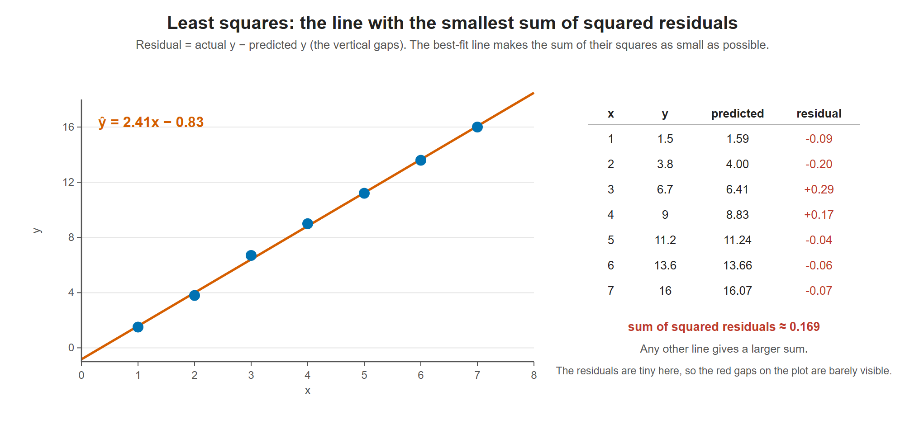

# Lesson 13.1 - The Least Squares Method

> **Video:** [Linear Regression Using Least Squares Method - Line of Best Fit Equation](https://www.youtube.com/watch?v=P8hT5nDai6A) by The Organic Chemistry Tutor
> **Chapter:** [13 - Regression & Correlation](https://www.video-tutor.net/linear-regression.html)

## The big picture: from one variable to two

Until now every chapter looked at **one** variable at a time: one mean, one proportion, one table of counts. This chapter looks at **pairs** of measurements on the same thing, $(x, y)$: hours studied and exam score, advertising spend and sales, temperature and ice-cream sales. Three questions come up:

| Question | Tool | Lesson |
|---|---|---|
| Can I **predict** $y$ from $x$? | the least squares line $\hat y = mx + b$ | 13.1 (this one) |
| Do $x$ and $y$ move **together**, and in which direction? | covariance | 13.2 |
| **How strong** is the straight-line pattern, on a −1 to +1 scale? | correlation coefficient $r$ | 13.3, 13.4 |

**1. Why a straight line?** It is the simplest summary of a trend. The slope $m$ says how much $y$ changes, on average, when $x$ goes up by 1. Here $m \approx 2.41$: each extra unit of $x$ adds about 2.41 to $y$.

**2. Residuals: how far each point misses.** For a point $(x, y)$ the line predicts $\hat y = mx + b$. The miss is the **residual**:

$$\text{residual} = y - \hat y = \text{actual} - \text{predicted}$$

Points above the line have positive residuals and points below have negative ones.

**3. Why "least squares"?** Many lines could be drawn through the points. To pick the best one we need **one number** that says how badly a line fits. Adding up the residuals doesn't work: for the best line they add up to exactly 0, because the positive and negative misses cancel (just like $O - E$ in Lesson 12.1). So we **square** them first and add:

$$\text{SSE} = \sum (y - \hat y)^2 \qquad\text{(sum of squared errors)}$$

The **least squares line** is the line with the **smallest SSE**. The formulas for $m$ and $b$ below are what you get when you use calculus to find that minimum.

Left: a guessed line leaves big misses, and their squares add up to 5.18. Middle: the least squares line leaves tiny misses, SSE = 0.17. No other straight line does better. Right: if you try every slope, the total squared error makes a U-shape, and its lowest point is exactly the least squares slope.

**4. The line goes through the point of means.** The least squares line always passes through $(\bar x, \bar y)$. That's where the intercept formula comes from:

$$b = \frac{\sum y - m\sum x}{n} = \bar y - m\,\bar x$$

Here $\bar x = 4$ and $\bar y = 8.83$, so $b = 8.83 - 2.414(4) \approx -0.83$.

**5. Predict only inside the data.** The line is fitted for $x$ between 1 and 7. Using it far outside that range (**extrapolation**) assumes the straight-line pattern keeps going, which the data can't show.

---

## Goal

Find the straight line that **best fits** a set of points that don't lie exactly on a line. The **least squares method** chooses the line that makes the points as close to it as possible: it minimizes the sum of the squared vertical distances.

## The line

| Algebra | Statistics | Meaning |
|---|---|---|
| $y = mx + b$ | $\hat y = b_0 + b_1x$ | |
| $m$ | $b_1$ | slope |
| $b$ | $b_0$ | y-intercept |

## Formulas

$$m = \frac{n\sum xy - \sum x\sum y}{n\sum x^2 - \left(\sum x\right)^2}, \qquad b = \frac{\sum y - m\sum x}{n}$$

$n$ = number of data points. Keep $m$ unrounded when you calculate $b$.

---

## Example

| $x$ | $y$ | $xy$ | $x^2$ |
|---:|---:|---:|---:|
| 1 | 1.5 | 1.5 | 1 |
| 2 | 3.8 | 7.6 | 4 |
| 3 | 6.7 | 20.1 | 9 |
| 4 | 9.0 | 36.0 | 16 |
| 5 | 11.2 | 56.0 | 25 |
| 6 | 13.6 | 81.6 | 36 |
| 7 | 16.0 | 112.0 | 49 |
| **Sum** | **61.8** | **314.8** | **140** |

$\sum x = 28$, $\;\sum y = 61.8$, $\;\sum xy = 314.8$, $\;\sum x^2 = 140$, $\;n = 7$

**Slope:**
$$m = \frac{n\sum xy - \sum x\sum y}{n\sum x^2 - \left(\sum x\right)^2} = \frac{7(314.8) - 28(61.8)}{7(140) - 28^2} = \frac{2203.6 - 1730.4}{980 - 784} = \frac{473.2}{196} \approx 2.414286$$

**Intercept:**
$$b = \frac{\sum y - m\sum x}{n} = \frac{61.8 - 2.414286(28)}{7} = \frac{61.8 - 67.6}{7} = \frac{-5.8}{7} \approx -0.828571$$

**Line of best fit:**
$$\boxed{y \approx 2.41x - 0.83}$$

### Checking the fit

| $x$ | Predicted $y = 2.41x - 0.83$ | Actual $y$ |
|---:|---:|---:|
| 2 | 3.99 | 3.8 |
| 5 | 11.22 | 11.2 |
| 7 | 16.04 | 16.0 |

The predictions are very close to the data, so the line fits well.

The least squares line passes very close to every point. The residuals (actual minus predicted) are all small, and their squares add up to about 0.17, which is the smallest possible for any straight line.

---

## Doing it in Excel

With the $x$ values in `B2:B8` and the $y$ values in `C2:C8`:

| Want | Formula | Result |
|---|---|---|
| Slope $m$ | `=SLOPE(C2:C8, B2:B8)` (known **y**'s first, then known **x**'s) | 2.414 |
| Intercept $b$ | `=INTERCEPT(C2:C8, B2:B8)` | −0.8286 |

---

## Key takeaways

- The least squares line is the line with the smallest sum of squared residuals, $\sum (y - \hat y)^2$. It always passes through $(\bar x, \bar y)$.
- Build a table with columns $x$, $y$, $xy$, $x^2$ and add up each column.
- $m = \dfrac{n\sum xy - \sum x\sum y}{n\sum x^2 - (\sum x)^2}$ and $b = \dfrac{\sum y - m\sum x}{n}$.
- Don't round $m$ before calculating $b$.
- Excel's `SLOPE` and `INTERCEPT` give the same results in seconds.
