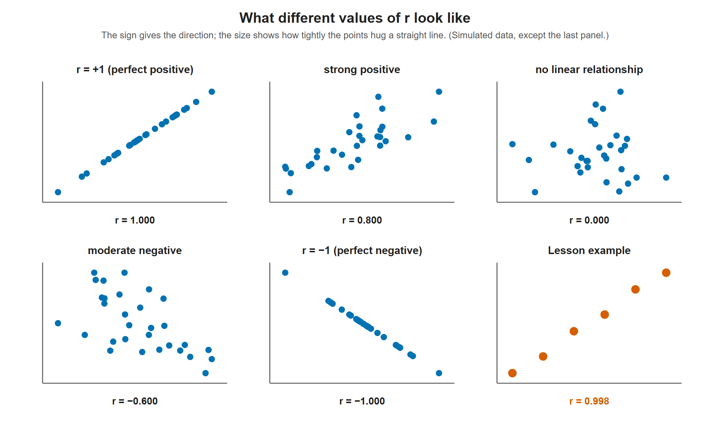

# Lesson 13.3 - Correlation Coefficient

> **Video:** [Correlation Coefficient](https://www.youtube.com/watch?v=11c9cs6WpJU) by The Organic Chemistry Tutor
> **Chapter:** [13 - Regression & Correlation](https://www.video-tutor.net/linear-regression.html)

## The big picture: how well does a line describe the data?

Lesson 13.1 found the best straight line through a set of points. But a "best" line exists for **any** set of points, even a random cloud. We also need to know **how well** that line describes the data. Lesson 13.2's covariance shows the direction, but its size depends on the units, so it can't tell us that either. That is the job of the **correlation coefficient** $r$.

**1. One number for direction and strength.** $r$ is always between −1 and +1.

- The **sign** gives the direction. It is the same as the sign of the slope: $+$ for an upward trend, $-$ for a downward one.
- The **size** gives the strength: how tightly the points hug the line. $|r| = 1$ means every point is exactly on the line, and $r \approx 0$ means no straight-line pattern.

**2. $r$ has no units.** Hours and points, or dollars and kilograms: $r$ comes out the same whatever units you measure in. That makes it easy to compare relationships across different studies.

**3. Where the formula comes from.** $r$ is the covariance (Lesson 13.2) divided by both standard deviations (Lesson 13.4):

$$r = \frac{\text{cov}(x, y)}{s_x\,s_y}$$

Write out the covariance and both SDs in terms of sums and the $n - 1$ factors cancel. What's left is the computational formula in this lesson, which needs only the column sums.

**4. $r^2$: how much the line explains.** Squaring $r$ gives the **coefficient of determination**: the share of the variation in $y$ that the line accounts for. In this lesson's example $r = 0.998$, so $r^2 \approx 0.996$. The line explains about 99.6% of the ups and downs in $y$, and only 0.4% is left over as scatter.

**5. Three ways to misread $r$.**

1. **Steep ≠ strong.** $r$ measures how tightly the points hug the line, not how steep the line is. A flat, tight pattern can have a bigger $r$ than a steep, scattered one.
2. **$r \approx 0$ doesn't mean "no relationship".** It only means no **straight-line** relationship. Points on a perfect curve can have $r = 0$.
3. **Outliers matter.** One unusual point can change $r$ a lot. Always look at the scatter plot, not only the number.

And always: **correlation is not causation.** A strong $r$ says the variables move together. It doesn't say that one causes the other.

---

## What $r$ tells you

The **correlation coefficient** $r$ (sometimes written $\rho$) measures the **strength and direction of the linear relationship** between two variables. $-1 \le r \le 1$.

| $r$ | Picture | Relationship |
|---|---|---|
| $+1$ | All points exactly on a line going **up** | Perfect positive (direct): $y$ rises as $x$ rises |
| $-1$ | All points exactly on a line going **down** | Perfect negative (inverse): $y$ falls as $x$ rises |
| close to $\pm 1$ (e.g. 0.8) | Points close to a line | Strong linear relationship |
| smaller (e.g. 0.6-0.7) | Points more scattered around the line | Weaker linear relationship |
| ≈ 0 | Random cloud of points | No linear relationship |

The **sign** of $r$ matches the sign of the slope. The **size** of $r$ shows how tightly the points hug the line.

The closer r is to ±1, the more tightly the points line up. The sign follows the direction of the trend. The lesson's data (orange) is almost a perfect line, r = 0.998.

## Formula

$$r = \frac{n\sum xy - \sum x\sum y}{\sqrt{\left[n\sum x^2 - \left(\sum x\right)^2\right]\left[n\sum y^2 - \left(\sum y\right)^2\right]}}$$

$n$ = number of $(x, y)$ pairs.

---

## Example

| $x$ | $y$ | $xy$ | $x^2$ | $y^2$ |
|---:|---:|---:|---:|---:|
| 1 | 2 | 2 | 1 | 4 |
| 2 | 4 | 8 | 4 | 16 |
| 3 | 7 | 21 | 9 | 49 |
| 4 | 9 | 36 | 16 | 81 |
| 5 | 12 | 60 | 25 | 144 |
| 6 | 14 | 84 | 36 | 196 |
| **Sum** | **48** | **211** | **91** | **490** |

$\sum x = 21$, $\;\sum y = 48$, $\;\sum xy = 211$, $\;\sum x^2 = 91$, $\;\sum y^2 = 490$, $\;n = 6$

**Numerator:** $n\sum xy - \sum x\sum y = 6(211) - 21(48) = 1266 - 1008 = 258$

**Denominator:**

- $n\sum x^2 - \left(\sum x\right)^2 = 6(91) - 21^2 = 546 - 441 = 105$
- $n\sum y^2 - \left(\sum y\right)^2 = 6(490) - 48^2 = 2940 - 2304 = 636$
- $\sqrt{105 \times 636} = \sqrt{66{,}780} \approx 258.42$

$$r = \frac{n\sum xy - \sum x\sum y}{\sqrt{\left[n\sum x^2 - \left(\sum x\right)^2\right]\left[n\sum y^2 - \left(\sum y\right)^2\right]}} = \frac{258}{258.42} \approx 0.998$$

A **very strong positive** linear relationship: as $x$ increases, $y$ increases almost exactly along a straight line.

---

## Key takeaways

- $r$ ranges from −1 to +1. The sign gives the direction and the size gives the strength of the **linear** relationship.
- Build a table of $x$, $y$, $xy$, $x^2$, $y^2$, add each column, then use the formula.
- $r \approx 0$ means no *linear* relationship. There could still be a curved one.
- $r^2$ is the share of the variation in $y$ explained by the line. $r$ measures tightness, not steepness.
- Correlation is not causation.
