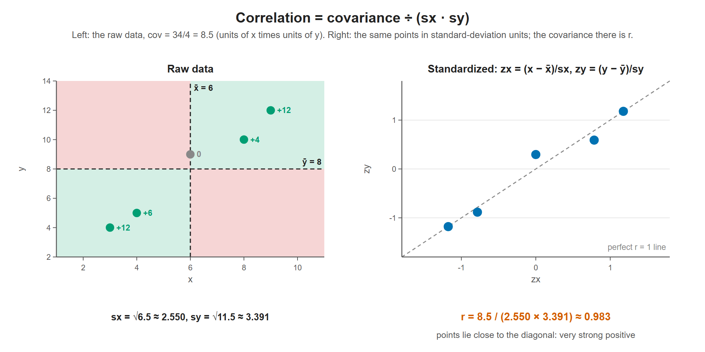

# Lesson 13.4 - Calculating the Correlation Coefficient Using the Covariance Formula

> **Video:** [How To Calculate The Correlation Coefficient Using The Covariance Formula](https://www.youtube.com/watch?v=5wIiOFnXSYs) by The Organic Chemistry Tutor
> **Chapter:** [13 - Regression & Correlation](https://www.video-tutor.net/linear-regression.html)

## The big picture: making covariance unit-free

Lesson 13.2 ended with a problem: the covariance's **sign** shows the direction, but its **size** depends on the units. This lesson fixes that, and the result is the correlation coefficient $r$ from Lesson 13.3.

**1. The fix: divide by both standard deviations.**

$$r = \frac{\text{cov}(x, y)}{s_x\,s_y}$$

The covariance has units of (units of $x$) × (units of $y$), and so does $s_x s_y$. The units cancel, so $r$ is a pure number.

**2. Same thing as averaging z-scores.** Recall the z-score from Lesson 8.1, $z = (x - \bar x)/s$: "how many SDs from the mean". Put $s_x$ and $s_y$ inside the sum:

$$r = \frac{1}{n - 1}\sum \frac{x - \bar x}{s_x}\cdot\frac{y - \bar y}{s_y} = \frac{\sum z_x z_y}{n - 1}$$

So **$r$ is the covariance of the z-scores**. Standardizing puts both variables on the same scale, so changing units can't affect it.

Multiplying $y$ by 10 multiplies the covariance by 10, from 8.5 to 85. But $s_y$ also grows by 10, so $r$ stays 0.983. In z-scores (right), the covariance **is** $r$.

**3. Why $r$ is always between −1 and +1.** The z-scores of each variable have SD 1, so $\sum z_x^2 = \sum z_y^2 = n - 1$. A sum of squares can't be negative:

$$0 \le \sum (z_x - z_y)^2 = (n - 1) + (n - 1) - 2(n - 1)\,r = 2(n - 1)(1 - r) \;\Rightarrow\; r \le 1$$

Using $\sum (z_x + z_y)^2 \ge 0$ the same way gives $r \ge -1$. $r = 1$ exactly when every $z_y = z_x$, which means all the points lie on an upward line.

**4. The link back to the line (Lesson 13.1).** The least squares slope is $r$ rescaled into the units of the data:

$$m = r\,\frac{s_y}{s_x}$$

For this lesson's data, $m = 0.9831 \times \dfrac{3.391}{2.550} \approx 1.31$. So the correlation, the covariance and the slope all come from the same building blocks.

---

## Two equivalent formulas

**Method 1 - from the covariance:**

$$r = \frac{\text{cov}(x, y)}{s_x\,s_y}, \qquad \text{cov}(x, y) = \frac{\sum (x - \bar x)(y - \bar y)}{n - 1}, \qquad s_x = \sqrt{\frac{\sum (x - \bar x)^2}{n - 1}}$$

Dividing the covariance by both standard deviations removes the units and puts $r$ on the −1 to +1 scale.

**Method 2 - the computational formula** (Lesson 13.3):

$$r = \frac{n\sum xy - \sum x\sum y}{\sqrt{\left[n\sum x^2 - (\sum x)^2\right]\left[n\sum y^2 - (\sum y)^2\right]}}$$

---

## Data

$x$: 3, 4, 6, 8, 9 $\qquad$ $y$: 4, 5, 9, 10, 12 $\qquad n = 5$

---

## Method 1 - covariance and standard deviations

$\bar x = \sum x / n = 30/5 = 6$, $\;\bar y = \sum y / n = 40/5 = 8$

| $x$ | $y$ | $x - \bar x$ | $y - \bar y$ | product | $(x - \bar x)^2$ | $(y - \bar y)^2$ |
|---:|---:|---:|---:|---:|---:|---:|
| 3 | 4 | −3 | −4 | 12 | 9 | 16 |
| 4 | 5 | −2 | −3 | 6 | 4 | 9 |
| 6 | 9 | 0 | 1 | 0 | 0 | 1 |
| 8 | 10 | 2 | 2 | 4 | 4 | 4 |
| 9 | 12 | 3 | 4 | 12 | 9 | 16 |
| **Sum** | | 0 | 0 | **34** | **26** | **46** |

(The video says "pos 2" for the first product at one point. $(-3)(-4) = 12$, and the column total of 34 is correct.)

$$\text{cov}(x, y) = \frac{\sum (x - \bar x)(y - \bar y)}{n - 1} = \frac{34}{4} = 8.5$$
$$s_x = \sqrt{\frac{\sum (x - \bar x)^2}{n - 1}} = \sqrt{\frac{26}{4}} = \sqrt{6.5} \approx 2.54951, \qquad s_y = \sqrt{\frac{\sum (y - \bar y)^2}{n - 1}} = \sqrt{\frac{46}{4}} = \sqrt{11.5} \approx 3.39116$$
$$r = \frac{\text{cov}(x, y)}{s_x\,s_y} = \frac{8.5}{2.54951 \times 3.39116} \approx 0.9831$$

**Mental-math tip:** $34/4 = 32/4 + 2/4 = 8 + 0.5 = 8.5$.

Dividing the covariance by sx and sy is the same as measuring both variables in standard-deviation units. In those units the points sit close to the diagonal line zy = zx, which is why r ≈ 0.983 is close to 1.

---

## Method 2 - computational formula (check)

| $x$ | $y$ | $xy$ | $x^2$ | $y^2$ |
|---:|---:|---:|---:|---:|
| 3 | 4 | 12 | 9 | 16 |
| 4 | 5 | 20 | 16 | 25 |
| 6 | 9 | 54 | 36 | 81 |
| 8 | 10 | 80 | 64 | 100 |
| 9 | 12 | 108 | 81 | 144 |
| **30** | **40** | **274** | **206** | **366** |

- Numerator: $n\sum xy - \sum x\sum y = 5(274) - 30(40) = 1370 - 1200 = 170$
- $n\sum x^2 - (\sum x)^2 = 5(206) - 30^2 = 1030 - 900 = 130$
- $n\sum y^2 - (\sum y)^2 = 5(366) - 40^2 = 1830 - 1600 = 230$

$$r = \frac{n\sum xy - \sum x\sum y}{\sqrt{\left[n\sum x^2 - (\sum x)^2\right]\left[n\sum y^2 - (\sum y)^2\right]}} = \frac{170}{\sqrt{130 \times 230}} = \frac{170}{\sqrt{29{,}900}} \approx 0.9831 \;✓$$

(The product is 29,900; the video says "293,900" at one point.)

Both methods agree: $r \approx 0.983$, a **very strong positive** linear relationship.

---

## Key takeaways

- $r = \dfrac{\text{cov}(x, y)}{s_x s_y}$. Correlation is covariance rescaled to −1 … +1.
- Equivalently, $r = \sum z_x z_y/(n - 1)$, the covariance of the z-scores. Changing units never changes $r$.
- The slope of the least squares line is $m = r\,s_y/s_x$.
- Use $n - 1$ consistently in the covariance and in both standard deviations, or $N$ in all three for a population. The factors cancel either way.
- The computational formula gives the same $r$ without computing deviations.
