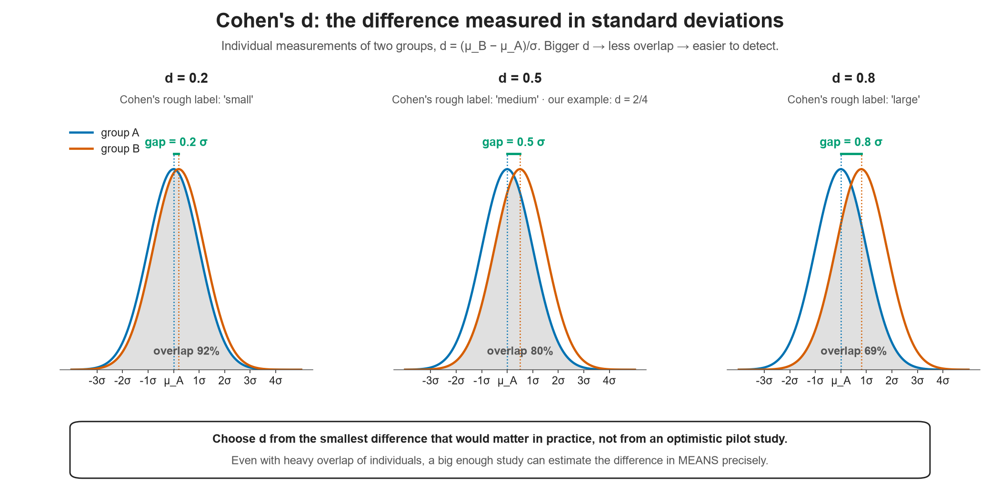

# Lesson 15.2 - Effect Size for Planning

> **Reading:** *The StatQuest Illustrated Guide to Statistics*, Chapter 9 (Starmer, 2026) · [references](../Reference.md#sq-statquest)
> **Chapter:** 15 - Power and Power Analysis

## The big picture: how big an effect are we looking for?

**1. Power needs a target.** "What is the power?" has no answer until you say **which** effect you want to detect. A study can have 99% power for a huge effect and 10% power for a tiny one. So the first planning step is to choose the effect size.

**2. Cohen's $d$ puts the effect on a standard scale.** Lesson 11.2 used Cohen's $d$ to describe an observed difference. For planning we use the same idea with the **assumed** values:

$$d = \frac{|\Delta|}{\sigma} = \frac{\text{difference in means}}{\text{standard deviation}}$$

$d = 0.5$ means the two group means are half a standard deviation apart. Because it has no units, the same power tables work for minutes, kilograms or test scores.

**3. Picture the overlap.** The figure shows **individual** measurements in two groups. With $d = 0.2$ the curves overlap by 92%. With $d = 0.8$ the overlap is still 69%. Even "large" effects leave many individuals in group A scoring higher than individuals in group B.

As $d$ grows, the curves separate and the shaded overlap shrinks. Our workshop example has $d = 2/4 = 0.5$.

**4. Where should $d$ come from?** Good choices, from best to worst:

- **The smallest difference that would matter in practice**: "we would only switch processes if it saves at least 2 minutes".
- Previous careful studies of similar situations.
- Cohen's rough labels (0.2 small, 0.5 medium, 0.8 large), only as a last resort. They know nothing about your workshop.

Using an exciting result from a small pilot study is risky. Small studies that "worked" tend to have overestimated effects, so the main study ends up **underpowered**.

**5. Individuals vs means.** The overlap of **individuals** doesn't decide the test. The test compares **means**, and a mean from a big sample is very precise (SE shrinks like $1/\sqrt n$). Even heavily overlapping groups can be told apart with enough data. That is what Lesson 15.3 shows.

---

## Goal

Choose and compute a planning effect size, and understand what it says about the overlap of two groups.

## Formulas

$$d = \frac{|\Delta|}{\sigma}, \qquad \text{overlap of two normal curves} = 2\,\Phi\!\left(-\frac{d}{2}\right)$$

$\Phi$ = standard normal CDF (the z-table, Lesson 8.1).

---

## Example

The workshop would adopt the new process only if it saves **at least 2 minutes** on average. Past records show the SD of preparation times is about **4 minutes**.

**Step 1: planning effect size.**
$$d = \frac{2}{4} = 0.5$$

**Step 2: overlap.**
$$2\,\Phi(-0.25) = 2(0.4013) = 0.80$$

So 80% of the two distributions overlap. Many individual new-process batches will still be slower than many old-process ones, even when the average saving is 2 minutes.

**Step 3: what to report.** Report **both** scales: "We plan to detect a 2-minute difference (SD 4 minutes, $d = 0.5$)." The minutes are what people care about. $d$ is what goes into the power calculation.

| $d$ | Label | Overlap $2\Phi(-d/2)$ |
|---:|---|---:|
| 0.2 | small | 92% |
| 0.5 | medium | 80% |
| 0.8 | large | 69% |

---

## Doing it in Excel

`=2*NORM.S.DIST(-0.5/2, TRUE)` → 0.80

---

## Your turn

A meaningful change in a blood test is 3 units, and the SD between people is 6 units. What $d$ should the planner use? What is the overlap?

**Answer:** $d = 3/6 = 0.5$ and the overlap is $2\Phi(-0.25) = 80\%$. Report the 3-unit difference too, so readers know the practical size.

---

## Key takeaways

- Power is always "power to detect a difference of size ___".
- Cohen's $d = |\Delta|/\sigma$ measures the difference in standard deviations.
- Base $d$ on the smallest difference that matters in practice, not on an optimistic pilot result.
- Even a "large" $d = 0.8$ leaves 69% overlap between individuals. Tests compare means, which become precise with large $n$.
