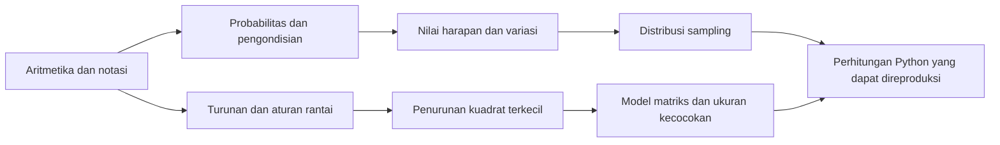
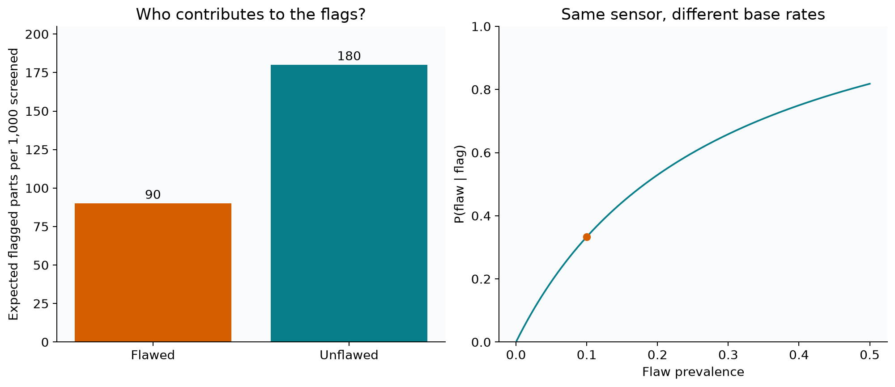
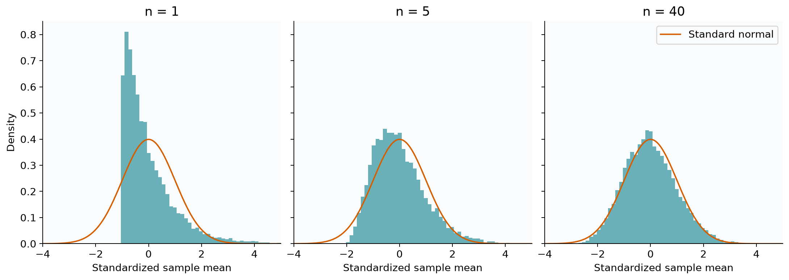
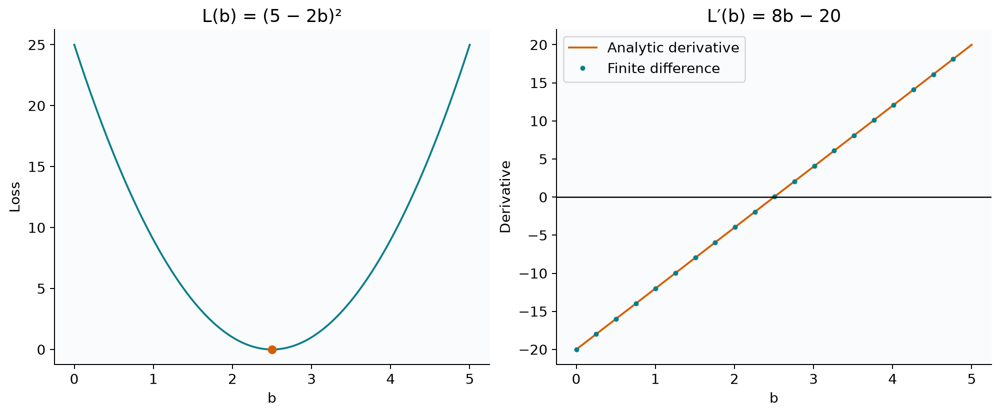
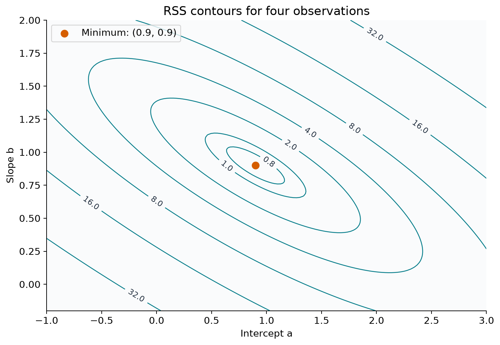

# AA · Prasyarat matematika dan Python

Statistika menjadi lebih mudah ketika notasinya merujuk pada operasi yang sudah dikenal. Referensi ini mengembangkan probabilitas, aljabar, kalkulus, dan operasi array yang digunakan dalam materi. Baca Bagian 1–4 sebelum bab inferensi pertama, dan kembali ke Bagian 5–8 saat mempelajari regresi. Kalkulus berguna untuk memahami penurunan rumus, tetapi tidak diperlukan untuk menjalankan notebook awal.

**Alur pembelajaran:** terjemahkan notasi → bedakan pertanyaan probabilitas → turunkan fungsi kerugian → selesaikan regresi → verifikasi hasil dalam Python. Ini adalah bab referensi, sehingga setiap bagian menunjukkan penggunaannya dalam materi utama.

## 1. Penjumlahan, perkalian, pangkat, dan logaritma

Untuk pengamatan $x_1,\ldots,x_n$, subskrip mengidentifikasi suatu pengamatan. Notasi $\sum_{i=1}^n x_i$ berarti menjumlahkan pengamatan; $\prod_{i=1}^n x_i$ berarti mengalikannya. Tanda kurung mengubah apa yang dikuadratkan:

$$\sum_i x_i^2\ne\left(\sum_i x_i\right)^2\quad\text{in general}.$$

Untuk $x=(1,2,4)$, hasilnya 21 dan 49. Demikian pula, $\sum_i(x_i-\bar x)^2$ adalah jumlah kuadrat simpangan; $[\sum_i(x_i-\bar x)]^2$ bernilai nol karena jumlah simpangan nol. Menguadratkan setelah menjumlahkan akan menghilangkan seluruh informasi penyebaran.

Untuk bilangan bulat tidak negatif, $n!=n(n-1)\cdots1$ dan $0!=1$. Koefisien binomial $\binom nk=n!/[k!(n-k)!]$ menghitung himpunan bagian tanpa urutan berukuran $k$. Memilih dua dari lima benda menghasilkan sepuluh himpunan bagian. Menghitung susunan berurutan akan menghitung setiap pasangan dua kali.

Logaritma natural $\log$ adalah invers fungsi eksponensial $e^x$. Untuk $a,b$ positif, $\log(ab)=\log a+\log b$ dan $\log(a/b)=\log a-\log b$. Tidak ada aturan sepadan $\log(a+b)=\log a+\log b$.

Aturan ini menjelaskan log-likelihood: perkalian kontribusi likelihood positif menjadi penjumlahan kontribusi log. Karena log monoton naik, pemaksimumnya tetap sama. Menjumlahkan kepadatan mentah alih-alih mengalikannya umumnya mengubah persoalan estimasi. `logpdf` dan `logpmf` perangkat lunak juga menghindari pengambilan log setelah probabilitas sangat kecil telanjur dibulatkan menjadi nol.

<!-- lab: arithmetic -->

Dalam Python, perpangkatan menggunakan `**`; `^` bukan perpangkatan. Array mendukung operasi per elemen: `x**2` menguadratkan setiap elemen, sedangkan `x.sum()**2` menguadratkan jumlahnya.

## 2. Aturan probabilitas dan pengondisian

**Kejadian** adalah himpunan hasil yang mungkin. Probabilitas tidak negatif, probabilitas total adalah satu, dan probabilitas kejadian saling lepas dijumlahkan. Untuk kejadian umum,

$$P(A\cup B)=P(A)+P(B)-P(A\cap B).$$

Irisan muncul dua kali dalam dua probabilitas terpisah, sehingga dikurangi sekali. Aturan komplemen adalah $P(A^c)=1-P(A)$. Untuk $P(B)>0$, probabilitas bersyarat adalah

$$P(A\mid B)=\frac{P(A\cap B)}{P(B)}.$$

Pengondisian mengubah himpunan acuan menjadi kasus ketika $B$ terjadi. Pengondisian umumnya tidak simetris: $P(A\mid B)$ dan $P(B\mid A)$ dapat sangat berbeda.

Kejadian **independen** ketika $P(A\cap B)=P(A)P(B)$. Jika keduanya memiliki probabilitas positif, ini setara dengan mengetahui satu kejadian tidak mengubah probabilitas kejadian lain. Sebaliknya, kejadian saling lepas dengan probabilitas positif tidak dapat terjadi bersama sehingga saling bergantung. Independensi adalah sifat yang perlu dibenarkan berdasarkan model atau rancangan, bukan aturan perkalian otomatis untuk sembarang kejadian.

### Contoh sensor orisinal: membalik probabilitas bersyarat

Misalkan 10% komponen yang diproduksi memiliki cacat permukaan. Sensor penyaringan menandai 90% komponen cacat dan 20% komponen tanpa cacat. Berapa proporsi komponen bertanda yang cacat?

Bayangkan 1.000 komponen: sekitar 100 cacat dan 900 tanpa cacat. Jumlah yang ditandai adalah $100(0.9)=90$ dan $900(0.2)=180$. Karena itu, hanya $90/(90+180)=1/3$ komponen bertanda yang cacat. Probabilitas deteksi sensor 90% bukan jawaban untuk pertanyaan terbalik.

Secara formal, dengan $D$ untuk cacat dan $F$ untuk ditandai, hukum probabilitas total memberikan

$$P(F)=P(F\mid D)P(D)+P(F\mid D^c)P(D^c)=0.27.$$

Aturan Bayes kemudian memberikan

$$P(D\mid F)=\frac{P(F\mid D)P(D)}{P(F)}=\frac{0.09}{0.27}=\frac13.$$

<!-- lab: conditional_probability -->

Contoh ini membalik probabilitas bersyarat karena seluruh probabilitas yang diperlukan ditentukan. Nilai p saja tidak menyediakan bahan untuk $P(H_0\mid\text{data})$; inferensi tersebut memerlukan model berbeda dengan probabilitas prior dan likelihood yang sesuai.

## 3. Nilai harapan, varians, dan kovarians

Untuk variabel acak diskret, $E[X]=\sum_x xP(X=x)$ ketika penjumlahannya terdefinisi dengan baik. Untuk variabel kontinu dengan kepadatan $f$, ganti penjumlahan dengan $\int x f(x)\,dx$. Nilai harapan adalah rata-rata berbobot probabilitas atas hasil yang mungkin, belum tentu nilai yang dapat terjadi dalam satu pengamatan.

Dengan momen kedua berhingga,

$$\operatorname{Var}(X)=E[(X-E[X])^2]=E[X^2]-E[X]^2,$$

$$\operatorname{Cov}(X,Y)=E[(X-E[X])(Y-E[Y])].$$

Nilai harapan bersifat linier, terlepas dari apakah variabel independen:

$$E[aX+bY+c]=aE[X]+bE[Y]+c.$$

Varians berbeda:

$$\operatorname{Var}(aX+bY)=a^2\operatorname{Var}(X)+b^2\operatorname{Var}(Y)+2ab\operatorname{Cov}(X,Y).$$

Independensi menyiratkan kovarians nol ketika momennya ada; kovarians nol umumnya tidak menyiratkan independensi. Misalnya, jika $X$ seragam pada $[-1,1]$ dan $Y=X^2$, kovariansnya nol karena simetri tetapi $Y$ sepenuhnya ditentukan oleh $X$.

Untuk pengamatan independen dan berdistribusi identik dengan varians $\sigma^2$,

$$\operatorname{Var}(\bar X)=\frac{1}{n^2}\sum_i\operatorname{Var}(X_i)=\frac{\sigma^2}{n}.$$

Mengambil akar kuadrat menghasilkan $SE(\bar X)=\sigma/\sqrt n$. Pengamatan berkorelasi menambahkan suku kovarians, sehingga menganggap seluruh baris independen dapat sangat meremehkan ketidakpastian. Inilah alasan pemasangan dan pengelompokan memengaruhi inferensi.

## 4. Hukum bilangan besar dan teorema limit pusat

**Hukum bilangan besar** menyatakan bahwa, dengan asumsi yang sesuai seperti pengamatan independen dan berdistribusi identik dengan nilai harapan dari nilai absolut yang berhingga, rata-rata sampel konvergen dalam probabilitas menuju rata-rata populasi. Hukum ini menggambarkan nilai yang dituju rata-rata ketika ukuran sampel bertambah.

**Teorema limit pusat** klasik mengasumsikan pengamatan independen dan berdistribusi identik dengan varians berhingga yang tidak nol, serta menggambarkan *bentuk dan skala* galat rata-rata tersebut:

$$\frac{\sqrt n(\bar X-\mu)}{\sigma}\xrightarrow{d}N(0,1).$$

Keduanya merupakan pernyataan berbeda. Tidak satu pun menyatakan bahwa pengamatan mentah menjadi normal. Tidak ada ukuran sampel 30 yang memadai secara universal: konvergensi bergantung pada karakteristik seperti kemencengan, ekor, ketergantungan, dan probabilitas mana yang sedang didekati.

Notebook berulang kali mengambil sampel waktu tunggu eksponensial dengan rata-rata dan SD sama-sama 2. Setiap sampel mentah tetap menceng, sementara rata-rata terstandarisasi semakin mendekati normal ketika $n$ meningkat. Simulasi menggunakan **SD populasi yang diketahui** untuk menunjukkan teorema; menggantinya dengan estimasi sampel menambahkan langkah statistik lain.

<!-- lab: clt -->

## 5. Turunan: mengukur laju perubahan lokal

Turunan $f$ pada $x$ adalah limit

$$f'(x)=\lim_{h\to0}\frac{f(x+h)-f(x)}{h},$$

jika ada. Turunan menggambarkan kemiringan garis singgung, bukan rata-rata kemiringan pada interval besar sembarang. Aturan pangkat memberikan $d(x^r)/dx=rx^{r-1}$ ketika ekspresi dan turunannya terdefinisi. Turunan konstanta adalah nol dan turunan bersifat distributif terhadap penjumlahan.

Untuk fungsi komposit, **aturan rantai** memberikan

$$\frac{d}{dx}f(g(x))=f'(g(x))g'(x).$$

Misalnya, menurunkan $L(b)=(5-2b)^2$ memerlukan fungsi kuadrat di luar dan fungsi linier di dalam:

$$L'(b)=2(5-2b)(-2)=8b-20.$$

Titik stasionernya $b=2.5$. Turunan keduanya 8, sehingga fungsi kuadrat ini cembung ketat dan titik tersebut merupakan minimum unik. Turunan nol saja belum tentu mengidentifikasi minimum untuk fungsi sembarang; titik tersebut juga dapat berupa maksimum atau titik belok stasioner.

<!-- lab: derivatives -->

Selisih berhingga mendekati turunan secara numerik. Langkah sangat besar menimbulkan galat pendekatan; langkah sangat kecil dapat kehilangan presisi akibat pengurangan nilai yang hampir sama. Ini berguna untuk memeriksa penurunan rumus, tetapi bukan definisi jawaban eksak yang dihasilkan komputer.

## 6. Menurunkan garis kuadrat terkecil

Untuk garis dengan intersep $a$ dan kemiringan $b$, definisikan

$$RSS(a,b)=\sum_{i=1}^n(y_i-a-bx_i)^2.$$

**Turunan parsial** memvariasikan satu koefisien sambil mempertahankan yang lain tetap. Dengan aturan rantai,

$$\frac{\partial RSS}{\partial a}=-2\sum_i(y_i-a-bx_i),\qquad
\frac{\partial RSS}{\partial b}=-2\sum_i x_i(y_i-a-bx_i).$$

Tetapkan keduanya sama dengan nol. Persamaan pertama menghasilkan $\hat a=\bar y-\hat b\bar x$. Substitusikan ke persamaan kedua dan pusatkan prediktor:

$$\sum_i(x_i-\bar x)(y_i-\bar y)-\hat b\sum_i(x_i-\bar x)^2=0.$$

Jadi, ketika $S_{xx}=\sum_i(x_i-\bar x)^2>0$,

$$\hat b=\frac{S_{xy}}{S_{xx}},\qquad \hat a=\bar y-\hat b\bar x.$$

Jika setiap $x_i$ sama, $S_{xx}=0$: data tidak dapat mengidentifikasi efek intersep dan kemiringan secara terpisah. Jika tidak demikian, fungsi kerugian kuadrat memiliki minimum koefisien yang unik. Persamaan residual juga menunjukkan bahwa jumlah residual nol dan residual ortogonal terhadap prediktor pada data pelatihan. Sifat tersebut berasal dari pencocokan dengan intersep; sifat itu bukan bukti bahwa asumsi statistik terpenuhi.

Untuk $x=(0,1,2,3)$ dan $y=(1,2,2,4)$, $\bar x=1.5$, $\bar y=2.25$, $S_{xx}=5$, dan $S_{xy}=4.5$. Garis hasil pencocokan adalah $\hat y=0.9+0.9x$, dengan residual $(0.1,0.2,-0.7,0.4)$ dan RSS 0.7.

<!-- lab: least_squares -->

## 7. Notasi matriks dan keteridentifikasian

Susun data sebagai $\mathbf y=X\boldsymbol\beta+\boldsymbol\varepsilon$. Untuk satu prediktor, setiap baris $X$ adalah $(1,x_i)$ dan $\boldsymbol\beta=(a,b)^\top$. Untuk beberapa prediktor, tambahkan kolom. Jika $X$ memiliki $K$ kolom dan rank kolom penuh,

$$\hat{\boldsymbol\beta}=(X^\top X)^{-1}X^\top\mathbf y.$$

Rumus ini berguna untuk memahami persamaan normal $X^\top(\mathbf y-X\hat{\boldsymbol\beta})=0$. Untuk komputasi, gunakan pemecah kuadrat terkecil seperti `np.linalg.lstsq` alih-alih membentuk invers secara eksplisit. Pemecah tersebut menangani pengondisian numerik dengan lebih cermat. Matriks dengan rank kurang tidak mengidentifikasi vektor koefisien yang unik, meskipun pemecah mengembalikan satu solusi perwakilan.

Intersep ditambah satu indikator untuk **setiap** kategori bersifat redundan karena jumlah indikator sama dengan intersep. Gunakan kategori acuan atau pengodean lain dengan rank penuh. Untuk estimasi varians residual biasa, juga diperlukan $n>K$: rank penuh saja tidak menyisakan derajat kebebasan residual positif.

## 8. RSS, MSE, dan jebakan penyebut

Misalkan $TSS=\sum_i(y_i-\bar y)^2>0$. Untuk model OLS yang memuat intersep,

$$R^2=1-\frac{RSS}{TSS}.$$

Jika kedua kerugian model dibagi dengan $n$ yang sama, maka

$$1-\frac{RSS/n}{TSS/n}=R^2.$$

Namun, $RSS/(n-K)$ mengestimasi varians galat, dan $TSS/(n-1)$ mengestimasi varians hasil. Menggunakan penyebut berbeda ini menghasilkan $R^2$ **tersesuaikan**:

$$\bar R^2=1-\frac{RSS/(n-K)}{TSS/(n-1)}.$$

Dalam contoh empat titik, $TSS=4.75$. Nilai biasa adalah $R^2=1-0.7/4.75\approx0.8526$, sementara nilai tersesuaikan adalah $R^2=1-(0.7/2)/(4.75/3)\approx0.7789$. Besaran yang disebut “MSE” harus dibaca bersama penyebut dan tujuannya. Pada data baru, MSE prediksi mengestimasi kinerja prediksi dan bukan estimasi tak bias varians galat pelatihan.

## 9. Bekerja dengan cermat menggunakan array dan eksperimen yang dapat direproduksi

Notebook dimulai dengan sel penyiapan bersama dan menggunakan generator lokal ber-seed seperti `np.random.default_rng(123)`. Seed membuat perhitungan dapat diulang; seed tidak memvalidasi model. Seed eksplisit dan versi paket yang ditetapkan memudahkan perbandingan, meskipun keluaran identik hingga setiap bit tidak dijamin di semua pustaka numerik dan platform.

Untuk array berbentuk `(experiments, observations)`, `mean(axis=1)` menghitung satu rata-rata per eksperimen. Menghilangkan `axis` merata-ratakan semuanya menjadi satu angka dan dapat mengubah pertanyaan tanpa disadari. `var` dan `std` NumPy secara bawaan menggunakan `ddof=0`; gunakan `ddof=1` untuk varians dan SD sampel yang lazim. Ringkasan kolom pandas mungkin memiliki pengaturan bawaan berbeda, jadi pilih secara sadar.

Periksa dimensi, satuan, data hilang, dan nilai berhingga sebelum pencocokan. `NaN` bukan nol, dan menghapus baris tanpa memperhatikan akibatnya dapat membuat model tersarang menggunakan sampel berbeda. Setiap notebook di sini menggunakan data sintetis lengkap untuk memusatkan pembelajaran. Untuk data nyata, berikan alasan penanganan data hilang dan verifikasi bahwa perbandingan model menggunakan pengamatan yang persis sama.

Mulai ulang kernel dan jalankan seluruh sel secara berurutan. Variabel sisa eksperimen sebelumnya dapat membuat notebook yang dijalankan tidak berurutan tampak bekerja. Skrip validasi repositori menjalankan setiap notebook dalam kernel baru dan memeriksa identitas numerik serta tautan dan berkas keluaran.

## 10. Latihan

1. Untuk $x=(2,3,5)$, hitung $\sum x_i^2$, $(\sum x_i)^2$, dan $\sum(x_i-\bar x)$.
2. Ubah prevalensi cacat pada contoh sensor menjadi 1%, dengan tingkat deteksi dan penandaan palsu tetap. Tentukan $P(D\mid F)$.
3. Turunkan $(7-3b)^2$ dan tentukan minimumnya.
4. Untuk $x=(0,1,2)$ dan $y=(2,3,5)$, hitung intersep dan kemiringan kuadrat terkecil, RSS, dan $R^2$.
5. Apa yang dikembalikan `samples.mean(axis=1)` jika `samples.shape == (1000, 20)`? Mengapa SD-nya berbeda dari SD seluruh 20.000 nilai?
6. Jika dua variabel memiliki varians 4 dan 9 serta kovarians 3, tentukan varians selisihnya. Apa yang akan berubah jika diasumsikan independen?

## 11. Pembahasan jawaban

1. $4+9+25=38$; $(2+3+5)^2=100$; dan nol, dengan kemungkinan pembulatan titik mengambang dalam kode.
2. $P(D\mid F)=0.9(0.01)/[0.9(0.01)+0.2(0.99)]=0.009/0.207\approx0.04348$. Sensor yang sama memiliki proporsi cacat nyata yang jauh lebih kecil di antara penandaannya ketika cacat jarang.
3. $-6(7-3b)=18b-42$. Tetapkan sama dengan nol: $b=7/3$. Turunan keduanya 18, sehingga titik stasioner merupakan minimum unik.
4. $\bar x=1$, $\bar y=10/3$, $S_{xx}=2$, dan $S_{xy}=3$. Maka $\hat b=1.5$, $\hat a=11/6$, RSS $=1/6$, $TSS=14/3$, dan $R^2=27/28\approx0.9643$.
5. Hasilnya 1.000 rata-rata, masing-masing dihitung dari 20 pengamatan. Dalam pengambilan sampel independen dan berdistribusi identik, SD populasinya adalah SD semula dibagi $\sqrt{20}$; ini mengukur variasi rata-rata, bukan pengamatan individual.
6. $4+9-2(3)=7$. Asumsi independensi akan secara keliru menghilangkan suku kovarians dan menghasilkan 13. Gunakan struktur ketergantungan yang sebenarnya.

<!-- lab: practice -->

## Referensi dan langkah berikutnya

Kaitan bacaan: Starmer (2026), Lampiran A–F, [SQ](../Reference.md#sq-statquest). Penurunan probabilitas dan kuadrat terkecil merupakan hasil standar yang disampaikan di sini dengan contoh orisinal. Referensi komputasi: [kuadrat terkecil NumPy](https://numpy.org/doc/stable/reference/generated/numpy.linalg.lstsq.html); latar belakang statistik: [kuadrat terkecil NIST](https://www.itl.nist.gov/div898/handbook/pmd/section1/pmd141.htm). Materi matriks, kovarians, dan limit pusat memperluas lampiran sumber.

Kembali ke [00 · Pendahuluan](../00_Intro/00_Intro.md) atau [peta pembelajaran](../README.md).
