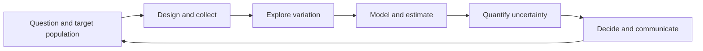
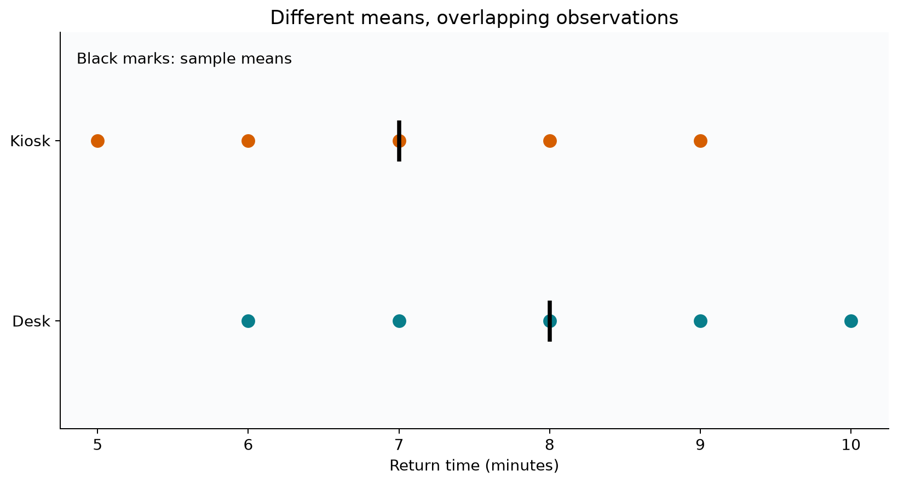
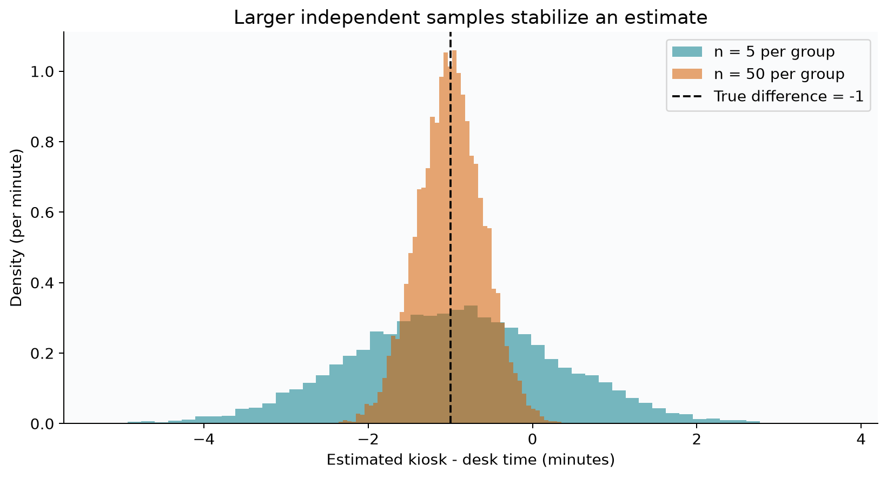

# 00 · Learning to reason with data

Statistics connects a question about the world to a conclusion that acknowledges uncertainty. A calculation becomes useful only after we know what was measured, how the observations were obtained, and which claim we want to assess.

**Learning route:** question → design → description → inference → decision. Read [the prerequisites](../../18_prerequisites/18-1-sums_products_and_logarithms.md) whenever notation or Python gets in the way. This chapter needs only arithmetic.

## 1. Start with a question you can measure

Suppose a library is considering two ways to return borrowed equipment. Is a staffed desk or a self-service kiosk faster? “Better” is not yet a statistical question. Better might mean shorter average time, fewer very long waits, fewer errors, or lower cost. Each requires a different outcome.

We choose **elapsed return time in minutes** and ask about eligible weekday returns at this library during the next term. A row represents one return, with a method, date, and elapsed time. Define the timer's start and stop before collecting data. Counting time only after a user reaches the desk would answer a different question from counting time since joining the queue.

A **population** is the set of units or outcomes our question concerns. A **sample** is the observed subset. A **parameter** is a numerical feature of the population or probability model. A **statistic** is a function of the observed sample. Our target, or **estimand**, is

$$\Delta=\mu_{\mathrm{kiosk}}-\mu_{\mathrm{desk}}.$$

Negative values mean a faster kiosk on average. Writing this sign convention now prevents reversing the conclusion later. It also distinguishes a population comparison from the observed difference between two sample means.

## 2. Four tasks that sound similar but are different

| Task | Example question | What it needs |
|---|---|---|
| Description | What were the observed return times? | Clear summaries and graphs |
| Estimation | What is the average difference in the target population? | A suitable design and uncertainty estimate |
| Prediction | How long will the next return take? | A model that works for future returns |
| Causal inference | What would change if we assigned the same eligible users to the other method? | A design or justified assumptions identifying that intervention |

A fitted line can predict well without identifying a cause. Users who choose a kiosk may already be comfortable with the equipment. A comparison of volunteers would mix a method difference with a user difference. Random assignment helps make treatment groups comparable in expectation. Random sampling serves a different purpose: supporting generalization to the target population. Neither guarantees perfect balance or perfect measurements in a particular study.

## 3. A first complete example

Consider these **invented** return times. They are small enough to calculate by hand and are not evidence about an actual library.

| Method | Times, in minutes | Mean |
|---|---|---:|
| Desk | 6, 8, 7, 9, 10 | 8 |
| Kiosk | 5, 7, 6, 8, 9 | 7 |

The estimated difference is $7-8=-1$ minute. This is a descriptive fact about these ten observations. It does not tell us whether another sample would show the same difference, nor whether the sampling process represents next term's users.

The dots show the data that the means conceal: the groups overlap substantially. Overlap alone is not a hypothesis test. Equally, distinct sample averages alone are not proof of a population difference. Later chapters compare the estimated difference to its sampling uncertainty.

**Notebook experiment:** calculate the two means, then replace just the last kiosk time by 20. Predict how the mean changes before running the cell. Which observation causes the change, and would the median react as much?

<!-- lab: first_comparison -->

## 4. Why repeated samples disagree

Imagine that we could repeatedly sample five desk returns and five kiosk returns from stable processes. Each repetition produces different observations and therefore a different estimated difference. The distribution of those estimates is a **sampling distribution**.

The next simulation assumes two normal populations with means 8 and 7 minutes and a common standard deviation of 2 minutes. These are known inputs to a teaching simulation, not estimates justified by the ten numbers above. Samples are independent. The simulated estimand is exactly $-1$ minute, yet some estimated differences are positive.

Compare five observations per group with fifty. Larger independent samples make the estimate more stable around the truth. They do not remove the variability of individual returns. They also cannot repair systematically selecting only fast kiosk users. That is **bias**, a different problem from sampling variability.

**Read the plot:** the dashed line marks the known population difference. The horizontal axis is an estimated difference, not an individual return time. The density axis is scaled so each histogram's area is one. Increasing sample size concentrates the estimates near the dashed line.

<!-- lab: repeated_samples -->

## 5. A useful statistical workflow

1. **Specify the claim.** Name the outcome, units, population, comparison, and time period. State which effect size would matter in practice.
2. **Design the study.** Identify the independent observational unit. Plan sampling, assignment, missing-data handling, and sample size.
3. **Look at the observations.** Check units, duplicates, missing values, unusual points, and plots before fitting models.
4. **Estimate and quantify uncertainty.** Report an effect in meaningful units and an interval, with assumptions made explicit.
5. **Check the analysis.** Ask whether clustering, nonlinear patterns, unusual observations, or multiple analyses change the interpretation.
6. **Communicate the scope.** State what the evidence supports, what remains uncertain, and what additional data would help.

An analysis is reproducible when someone else can obtain the same computational results from the recorded inputs and steps. Reproducibility does not establish that the design answers the scientific question. The notebooks make calculations reproducible; the explanatory notes teach how to evaluate their relevance.

## 6. How to use this repository

Read a section, predict what its graph or calculation should show, then run the corresponding notebook cells. Change one input at a time. Explain the changed result in a sentence before moving on. For simulations, compare a numerical result with its theoretical benchmark; a fixed random seed makes an experiment repeatable but does not make its assumptions true.

Every chapter has `<folder_name>.md`, `<folder_name>.ipynb`, and a `figure/` directory. Notebooks repeat the notes and interleave executable experiments. The figures are original and generated by the notebook code. Mermaid diagrams summarize the route through a chapter; the prose also gives that route because not every notebook viewer renders Mermaid.

The chapter sequence follows broad topics in Josh Starmer's book. Explanations, datasets, exercises, and graphics are independently written. Formal definitions and additional safeguards are included where intuition alone can mislead. The private book files are not needed to run the course. See [References](../../Reference.md) for attribution and [publication guidance](../../PUBLICATION.md) for source handling.

## 7. Practice

Try these before reading the answers.

1. An archive records the time needed for **every one of today's 40 returns**. Is its mean a population mean or a sample mean?
2. A second library observes locker-return times of 3, 4, 5, 8 minutes and desk times of 5, 6, 7, 10 minutes. Calculate locker minus desk. Can you conclude that lockers cause faster returns?
3. An analyst collects 50,000 records from users who volunteered to try a kiosk. What does the large sample solve, and what does it leave unresolved?
4. Why is predicting the next return generally harder than estimating a mean return time?

## 8. Worked answers

1. For today's 40 returns, it is a population mean. For next month's returns or a continuing return process, it is a sample-based estimate. The target determines the label.

   **Label** means the statistical name we give the calculated average: a **population mean** or a **sample mean used to estimate a population mean**. **Target** means the set of returns whose average we want to know, also called the **target population**.

   If the question is **“What was the average return time for today's 40 returns?”**, the target is exactly those 40 returns. Because the archive includes every one of them, we have the entire target population, so their average is a population mean.

   If the question is **“What will the average return time be next month?”**, the target is next month's returns. Today's 40 observations are historical data used to estimate that future average; they are not the entire target population or a literal sample drawn from next month. Using them this way requires an assumption that today's conditions are informative about next month's. Likewise, for an ongoing return process, today's returns cover only part of the process we want to understand.

   **The calculated number stays the same, but its statistical role changes with the question.** Having all of today's data does not mean having all the data for every possible target.

2. The means are $20/4=5$ and $28/4=7$, so the observed difference is $-2$ minutes. Without information about assignment and comparability, this is an association, not an established causal effect.

   **Assignment** means how users end up in each group: who uses a locker and who uses the staffed desk. Are users assigned at random, do they choose for themselves, or does a staff member direct them? If users choose for themselves, those returning just one item might be more likely to choose a locker.

   **Comparability** means whether the two groups are sufficiently similar in other factors that affect return time to allow a fair comparison. For example, are they returning similar numbers of items, arriving at similarly busy times, and handling similarly complicated returns? If desk users return more items or need to resolve a fine, the comparison may not be fair.

   The data support this statement: **“In these observations, locker users finished 2 minutes faster on average than desk users.”** They do not yet establish this causal claim: **“Using a locker causes return time to be 2 minutes shorter on average.”**

   The difference could come from the return method, differences in users' circumstances, or both. **Random assignment helps make the groups comparable**, so we can better assess the effect of the return method itself. It does not guarantee perfectly balanced groups in a particular study, especially with only four observations per group, and the estimated effect still has uncertainty.

3. More independent records can reduce sampling variability within the sampled process. They do not guarantee that volunteers represent nonvolunteers, fix measurement errors, or remove confounding.

   **Sampling variability** means that an estimate changes from sample to sample just by chance. Suppose we repeatedly collect return times from users who volunteer to try the kiosk under similar conditions. One sample might contain more unusually fast returns, while another contains more unusually slow returns. With 50,000 independent observations rather than 50, these chance differences usually have less influence on the average, so averages from repeated samples tend to be closer together. This makes the estimate more precise; it does not make every individual return time less variable.

   **Independent records** means that the observations do not depend on one another. For example, repeated returns by the same person may be related because that person brings the same habits and level of experience to each visit. Consequently, 50,000 records from a small number of frequent users may provide less information than 50,000 independent returns. The number of rows alone does not tell us how much independent information we have.

   **“Within the sampled process”** limits what the larger sample improves. Here, the data come from people volunteering to use the kiosk under the study's conditions. Collecting more observations through that same process can make the estimated average for those volunteers more stable. It does not automatically extend the conclusion to all library users or to different conditions.

   **Volunteers may not represent nonvolunteers.** People comfortable with technology might be more willing to try the kiosk and need less time to use it. People who avoid the kiosk might need more help. Even 50,000 volunteers can leave the second group poorly represented. This is a possible selection bias: a systematic difference between the people observed and the population we want to understand. Addressing it requires a suitable sampling design or justified adjustments, beyond simply recruiting more volunteers.

   **Measurement error** means that a recorded value differs from the value we intended to measure. Errors can be random, such as small accidental differences in when a stopwatch is stopped, or systematic, such as consistently excluding waiting time. Suppose the intended outcome includes waiting time, but the timer always starts after a two-minute wait. A return that actually takes seven minutes is recorded as five minutes. Every recorded duration is then two minutes too short. A larger sample can estimate that incorrectly measured average more precisely, but the missing two minutes remain. We need to fix when timing begins: **more records do not correct systematic measurement errors**.

   **Confounding** occurs when another factor influences both the method people use and their return time, mixing its influence with the method's effect. For example, prior kiosk experience might make users more likely to volunteer for the kiosk and help them finish faster. If we compare these volunteers with desk users, a shorter kiosk average could partly reflect experience. This problem can remain even when every return time is measured correctly. More observations alone cannot separate these effects. Random assignment can help; an observational comparison needs an appropriate design or adjustment and justified assumptions.

   **A larger sample can make an estimate more precise without making it accurate for the intended target or establishing causation.** Sample size, who is observed, how time is measured, and how groups are formed answer different parts of the problem.

4. A future individual has its own variability in addition to uncertainty about the average. Averaging many observations can reduce uncertainty about a mean, but it cannot make every individual identical.

<!-- lab: practice -->

## References and next step

Reading connection: Starmer, *The StatQuest Illustrated Guide to Statistics* (2026), front matter and Chapter 1. See [SQ in the reference list](../../Reference.md#sq-statquest). The example and workflow here are original teaching material.

Next: [01 · Fundamental concepts](../01_Fundamental_Concepts_in_Statistics/01_Fundamental_Concepts_in_Statistics.md).
