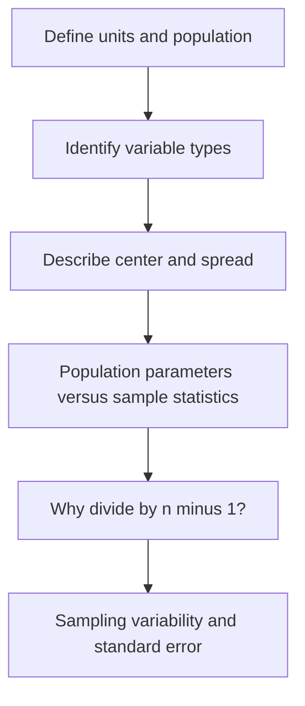
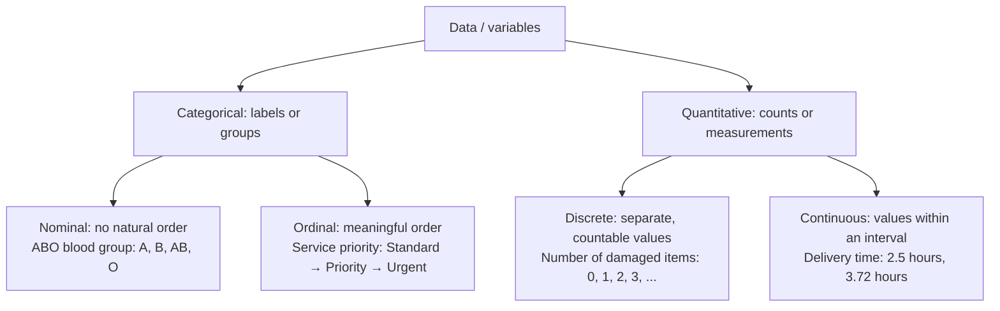
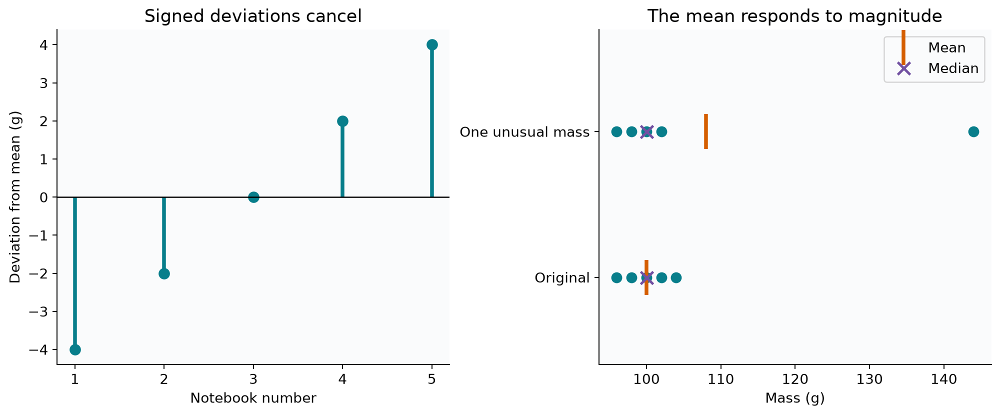
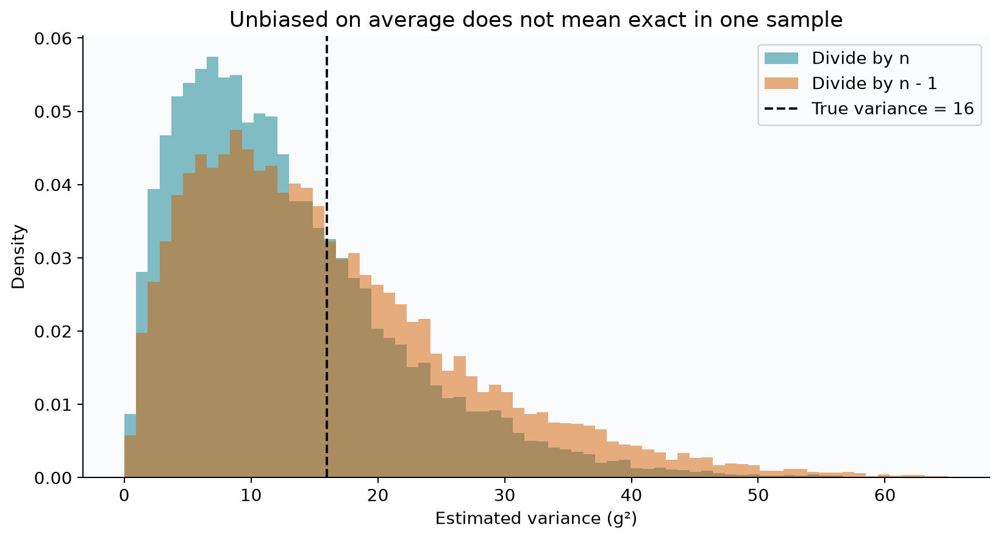
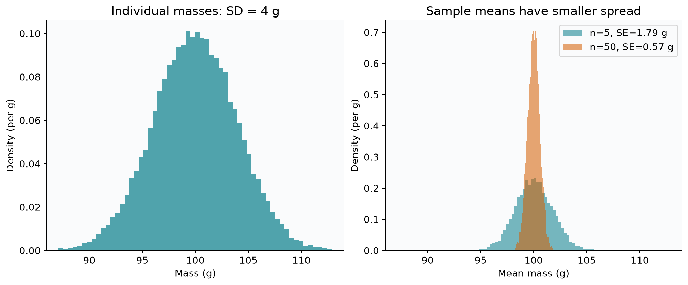

# 01 · Populations, samples, and variation

A mean tells us where observations balance; a standard deviation tells us how widely they vary. When we observe only a sample, both are estimates. Understanding the difference between the spread of observations and the uncertainty of an estimate is the foundation of inference.

**Learning route:** data types → descriptive summaries → estimation → uncertainty. Prerequisites: sums, squares, and square roots; see [AA](../../18_prerequisites/18-1-sums_products_and_logarithms.md).

## 1. What is one observation?

Suppose we measure the mass of notebooks packed by a small stationery workshop. The observational unit is one notebook, the numerical variable is mass in grams, and the target population might be all notebooks made by the workshop this week. “All notebooks everywhere” is a different population and is not represented merely by collecting more measurements at one workshop.

### Data and variables: a classification tree

A **variable** is a characteristic recorded for each observational unit, such as a notebook's cover color or mass. **Data** are the observed values of those variables: for example, “blue” for cover color and “96 grams” for mass. In a typical data table, each row represents one unit and each column represents one variable.

Variables fall into two broad groups: **categorical** variables describe labels or groups, while **quantitative (numeric)** variables describe counts or measurements. Categorical variables include **nominal** and **ordinal** variables; quantitative variables include **discrete** and **continuous** variables.

| Variable type | Meaning | Example | What the values let us say |
|---|---|---|---|
| **Nominal (categorical)** | Categories with no natural ranking or numerical distance | ABO blood group: A, B, AB, O; notebook cover color: blue, red, green | We can compare category membership and count frequencies. Blood group A is not “higher” than B, and subtracting their labels has no meaning. |
| **Ordinal (categorical)** | Categories with a meaningful order, but no implied equal spacing | Service levels defined in increasing urgency: Standard → Priority → Urgent | Urgent ranks above Priority, but the step from Standard to Priority need not equal the step from Priority to Urgent. |
| **Discrete (quantitative)** | Numerical values from a finite or countable set | Number of damaged items in a package: 0, 1, 2, 3, ... | A package can contain 2 or 3 damaged items, but not 2.5 damaged items. Differences in counts are meaningful. |
| **Continuous (quantitative)** | A measurement modeled as able to take any value within an interval | Delivery time: 2.5 or 3.72 hours; notebook mass in grams | Intermediate values such as 2.51 hours are possible. Numerical differences describe amounts of time or mass. |

**Order does not imply equal spacing.** Coding Standard, Priority, and Urgent as 1, 2, and 3 preserves their order, but does not establish that Urgent is three times as urgent as Standard or that the two steps are equally large. Likewise, numerical product codes remain nominal labels; their average does not describe a meaningful product characteristic.

**Recorded precision does not determine the underlying variable type.** A delivery duration remains a continuous measurement even when rounded to whole minutes. Its recorded precision depends on the measuring instrument, the recording procedure, and rounding. By contrast, a count of damaged items is discrete because only separate count values are possible. A sample's average count can still be fractional: packages with 2 and 3 damaged items have an average of 2.5 damaged items per package.

**The same setting can contain several variable types.** For one delivery, the delivery company's name is nominal, its priority category is ordinal, its number of damaged items is discrete, and its elapsed delivery time is continuous. Classify the particular characteristic being recorded.

Dependence matters too. Measuring the same notebook ten times gives information about instrument repeatability, but not ten independent notebooks' worth of information about production variability. Always count the units relevant to the question.

## 2. Center: mean and median answer different questions

For observations $x_1,\ldots,x_n$, the arithmetic mean is

$$\bar x=\frac{1}{n}\sum_{i=1}^{n}x_i.$$

The **median** splits ordered data into two halves; for even $n$, the usual sample median averages the middle two values. The mean uses the magnitude of every observation. The median depends primarily on order and is less sensitive to an extreme observation.

Use these invented masses: **96, 98, 100, 102, 104 grams**. Their sum is 500, mean is 100, and median is 100. Replacing 104 by 144 increases the mean to 108 but leaves the median at 100. The arithmetic is correct in both cases. The question is which summary communicates the feature you care about. If total material consumption matters, the mean is directly useful; if a typical notebook matters, the median may be more representative under skewness.

The mean minimizes $\sum_i(x_i-a)^2$ over choices of center $a$. A median minimizes $\sum_i|x_i-a|$. Different loss functions explain their different responses to extreme observations.

## 3. Spread: calculate variance step by step

For the five original masses, deviations from the mean are $-4,-2,0,2,4$. Their sum is zero, so averaging signed deviations cannot measure spread. Squaring makes all deviations nonnegative and emphasizes larger deviations.

| Mass $x_i$ | Deviation $x_i-100$ | Squared deviation |
|---:|---:|---:|
| 96 | -4 | 16 |
| 98 | -2 | 4 |
| 100 | 0 | 0 |
| 102 | 2 | 4 |
| 104 | 4 | 16 |
| **Total** | **0** | **40** |

If these five notebooks are the **entire finite population of interest**, its variance is $40/5=8\text{ g}^2$, and its standard deviation is $\sqrt8\approx2.828$ grams. More generally,

$$\mu=\frac{1}{N}\sum_{i=1}^N x_i,\qquad
\sigma_{\mathrm{finite}}^2=\frac{1}{N}\sum_{i=1}^N(x_i-\mu)^2.$$

If instead the five observations are an independent sample from an ongoing process with variance $\sigma^2$, the usual unbiased variance estimator is

$$s^2=\frac{\sum_i(x_i-\bar x)^2}{n-1}=\frac{40}{4}=10\text{ g}^2,
\qquad s=\sqrt{10}\approx3.162\text{ g}.$$

Variance has squared units; standard deviation returns to the original units. Neither is the average absolute deviation. In NumPy, `np.var(x, ddof=0)` divides by $n$ and `np.var(x, ddof=1)` divides by $n-1$. Specify the denominator deliberately.

### Population parameters versus sample statistics: reference table

A **parameter** summarizes the population we want to understand. A **statistic** is calculated from a sample; when used to estimate a population parameter, its calculation rule is an **estimator**, and its observed numerical value is an **estimate**.

For this table, write the finite population values as $y_1,\ldots,y_N$ and the sample values as $x_1,\ldots,x_n$. The different letters distinguish the two sets; earlier formulas used $x_i$ for either set depending on the context. Let $K$ be the number of population units meeting a specified condition, and $k$ the corresponding count in the sample. For example, the condition could be “the notebook has at least one torn page.” Write $\mathbf y=(y_1,\ldots,y_N)$ and $\mathbf x=(x_1,\ldots,x_n)$. The notation $Q(\mathbf z,\tau)$ means the quantile of values $\mathbf z$ at probability level $0<\tau<1$, using a stated quantile convention.

| Aspect | Population parameter / quantity | Sample statistic / estimate |
|---|---|---|
| Describes | The entire defined population | The observed sample; may be used to estimate a population feature |
| Availability | Often unknown unless the entire population is observed | Calculated from observed sample data |
| Variation | Fixed for a defined population | Can change from sample to sample |
| Size | $N$: number of population units | $n$: number of sampled units |
| Mean | $\mu=\frac{\sum_{j=1}^{N}y_j}{N}$ | $\bar x=\frac{\sum_{i=1}^{n}x_i}{n}$ estimates $\mu$ |
| Variance | $\sigma_{\mathrm{finite}}^2=\frac{\sum_{j=1}^{N}(y_j-\mu)^2}{N}$ | $s^2=\frac{\sum_{i=1}^{n}(x_i-\bar x)^2}{n-1}$ for $n>1$; see the variance conventions below |
| Standard deviation | $\sigma_{\mathrm{finite}}=\sqrt{\frac{\sum_{j=1}^{N}(y_j-\mu)^2}{N}}$ | $s=\sqrt{\frac{\sum_{i=1}^{n}(x_i-\bar x)^2}{n-1}}$ for $n>1$; usual sample estimate of population SD |
| Proportion | $p=\frac{K}{N}$ | $\hat p=\frac{k}{n}$ estimates $p$ |
| Minimum | $y_{\min}=\min(y_1,\ldots,y_N)$ | $x_{\min}=\min(x_1,\ldots,x_n)$; may miss the population minimum |
| Maximum | $y_{\max}=\max(y_1,\ldots,y_N)$ | $x_{\max}=\max(x_1,\ldots,x_n)$; may miss the population maximum |
| Quantile at level $\tau$ | $q_\tau=Q(\mathbf y,\tau)$ | $\hat q_\tau=Q(\mathbf x,\tau)$ estimates $q_\tau$ |
| First quartile (25%) | $Q_{1,\mathrm{pop}}=Q(\mathbf y,0.25)$ | $Q_{1,\mathrm{sample}}=Q(\mathbf x,0.25)$ estimates $Q_{1,\mathrm{pop}}$ |
| Median (50%) | $Q_{2,\mathrm{pop}}=Q(\mathbf y,0.50)$ | $Q_{2,\mathrm{sample}}=Q(\mathbf x,0.50)$ estimates $Q_{2,\mathrm{pop}}$ |
| Third quartile (75%) | $Q_{3,\mathrm{pop}}=Q(\mathbf y,0.75)$ | $Q_{3,\mathrm{sample}}=Q(\mathbf x,0.75)$ estimates $Q_{3,\mathrm{pop}}$ |

**Variance conventions matter.** The population column describes a finite list using denominator $N$. For iid observations from an ongoing process, $s^2$ is unbiased for that process's variance $\sigma^2$, as derived next. For simple random sampling without replacement from the finite list, $s^2$ is instead unbiased for $S^2=\sum_{j=1}^{N}(y_j-\mu)^2/(N-1)$; consequently, $\frac{N-1}{N}s^2$ is unbiased for $\sigma_{\mathrm{finite}}^2$. The standard deviation $s$ is generally not unbiased for the population SD, even when $s^2$ is unbiased for the corresponding variance.

**An estimate is not a guarantee.** For a sample drawn from this finite population, $x_{\min}\ge y_{\min}$ and $x_{\max}\le y_{\max}$: unobserved units can extend the range. Sample extremes are generally biased estimators of population extremes. Means, proportions, and quantiles also need an appropriate sampling design to support inference about the target population. For quantiles, state the interpolation convention; use one that gives the usual average of the two middle values for the median when the number of observations is even.

<!-- lab: summaries -->

## 4. Why $n-1$? A derivation, not a rule to memorize

Assume $X_1,\ldots,X_n$ are independent and identically distributed, with mean $\mu$ and finite variance $\sigma^2$. The sample mean is fitted to these same observations, making their squared distances from it systematically smaller than their squared distances from the unknown population mean. Algebra gives

$$\sum_i(X_i-\bar X)^2
=\sum_i(X_i-\mu)^2-n(\bar X-\mu)^2.$$

To see why the cross-term disappears, expand $X_i-\mu=(X_i-\bar X)+(\bar X-\mu)$ and use $\sum_i(X_i-\bar X)=0$.

Taking expectations, the first sum has expectation $n\sigma^2$. Independence implies $\operatorname{Var}(\bar X)=\sigma^2/n$, so the final term has expectation $n(\sigma^2/n)=\sigma^2$. Consequently,

$$E\!\left[\sum_i(X_i-\bar X)^2\right]=(n-1)\sigma^2.$$

Dividing by $n-1$ therefore gives $E[s^2]=\sigma^2$. Dividing by $n$ has expectation $(n-1)\sigma^2/n$. With $n=5$, it averages only 80% of the true variance.

Another view is **degrees of freedom**: after fixing the mean, the deviations must sum to zero, so the last deviation is determined by the others. This explains the one fitted constraint; the expectation calculation establishes unbiasedness. Unbiased means correct **on average over repeated samples**, not correct in every sample. Also, $\sqrt{s^2}$ is generally not an unbiased estimator of $\sigma$ because taking a square root is nonlinear.

**Notebook experiment:** sample five observations repeatedly from a normal process with standard deviation 4 grams. Compare the average of the two variance estimators with $\sigma^2=16$. Change $n$ to 20. The bias of division by $n$ shrinks, while both estimators become more stable.

<!-- lab: variance_bias -->

## 5. Standard deviation is not standard error

The **standard error** of a statistic is the standard deviation of its sampling distribution. For the mean of iid observations,

$$\operatorname{SE}(\bar X)=\frac{\sigma}{\sqrt n},\qquad
\widehat{\operatorname{SE}}(\bar X)=\frac{s}{\sqrt n}.$$

SD answers “How variable are individual notebook masses?” SE answers “How variable would the sample mean be across repeated samples?” For our five masses, the estimated SE is $\sqrt{10}/\sqrt5=\sqrt2\approx1.414$ grams. This is not the spread of the five individual masses.

If $n$ increases fourfold under the same iid process, the SE halves. Individual variability $\sigma$ stays the same. To improve the variability of the products themselves, we need to change the production process, not simply measure more products.

<!-- lab: sampling_means -->

Sampling without replacement from a small finite population needs extra care. If $S^2=\sum(x_i-\mu)^2/(N-1)$ denotes the finite-population variance with denominator $N-1$, simple random sampling gives $\operatorname{Var}(\bar X)=(1-n/N)S^2/n$. The factor accounts for learning more as a sample approaches a census. The iid formulas in this course concern a continuing process or a negligible sampling fraction unless stated otherwise.

## 6. What summaries leave out

Two datasets can have the same mean and SD but different shapes, clusters, or outliers. Plot the individual data when $n$ is small and a histogram when it is large. For strongly skewed data, report the median and interquartile range, $IQR=Q_3-Q_1$, alongside a graph. Software packages use different interpolation conventions for sample quantiles, so record the method if exact reproduction matters.

The familiar statement “about 95% of observations lie within two SDs of the mean” is an approximate **normal-distribution** statement. It is not a universal consequence of computing an SD. A census removes sampling uncertainty about its own measured values; it does not remove measurement error or uncertainty about future production.

## 7. Practice

1. A sample of cable lengths is 8, 10, 10, 12 cm. Calculate mean, median, sample variance, sample SD, and estimated SE of the mean.
2. Every cable length is multiplied by 10 to convert to millimeters. What happens to variance and SD?
3. Explain why $n=1$ cannot estimate an unknown population variance using $s^2$.
4. You measure five devices 100 times each. Can you use $n=500$ in the iid SE formula to describe variation among devices?
5. A normal process has variance 25. What is the expected value of the variance estimator that divides by $n$ for $n=10$?

## 8. Worked answers

1. Mean and median are 10 cm. Squared deviations sum to 8, so $s^2=8/3\approx2.667\text{ cm}^2$, $s\approx1.633$ cm, and estimated SE is $1.633/2\approx0.816$ cm.
2. Variance is multiplied by $10^2=100$; SD is multiplied by 10. Adding a constant instead would change the mean but leave variance and SD unchanged.

   These are **two different operations**. Multiplying every value by 10 makes its variance 100 times as large and its SD 10 times as large. Adding 10 to every value shifts the mean by 10 but leaves the variance and SD unchanged. Here, $10^2$ means “10 squared,” or $10\times10=100$, not the number 102.

   For a simple example, use the values 1, 2, and 3 and calculate **sample variance with denominator $n-1$**:

   | Operation | Data | Mean | Sample variance | Sample SD |
   |---|---|---:|---:|---:|
   | Original | 1, 2, 3 | 2 | 1 | 1 |
   | Add 10 to each value | 11, 12, 13 | 12 | 1 | 1 |
   | Multiply each value by 10 | 10, 20, 30 | 20 | 100 | 10 |

   **Why does adding leave the spread unchanged?** Variance and SD measure distances from the mean. Adding 10 moves both the observations and their mean by 10. The original deviations are $1-2,\;2-2,\;3-2$, giving $-1,0,1$. After adding 10, the deviations are $11-12,\;12-12,\;13-12$, still giving $-1,0,1$. Their squared deviations, variance, and SD therefore stay the same.

   **Multiplying stretches the distances.** After multiplying by 10, the mean is 20 and the deviations become $-10,0,10$. Each deviation is 10 times as large, so each squared deviation is $10^2=100$ times as large. The sample variance becomes $(100+0+100)/(3-1)=100$, and the SD becomes $\sqrt{100}=10$.

   For the cable example, converting centimeters to millimeters multiplies the numerical lengths and SD by 10, and the numerical variance by 100. This reflects the change of units; the cables' physical lengths and physical variation have not changed.

3. The single observation equals its sample mean. There is no remaining deviation with which to estimate variability, and the denominator is zero.
4. No. Repeated measurements within a device are dependent for that question. A design or model must distinguish between-device variation from within-device measurement noise.
5. $(9/10)25=22.5$. This is an expectation over repetitions, not a claim that every estimated variance is 22.5.

   **What is being estimated?** The process has a true variance of $\sigma^2=25$. Assume we draw $n=10$ independent observations from that same normal process. The question asks about the estimator that calculates squared deviations from the **sample mean** and divides their sum by **$n$**:

   $$v_n=\frac{1}{n}\sum_{i=1}^{n}(X_i-\bar X)^2.$$

   Each new sample has its own mean $\bar X$ and its own variance estimate $v_n$. The process variance stays at 25, but the estimate changes with the observations drawn.

   **Where does $9/10$ come from?** Section 4 shows that the expected sum of squared deviations from the sample mean is $(n-1)\sigma^2$. The sample mean is fitted to the same data, which makes these squared deviations smaller on average than deviations from the true process mean. Dividing by $n$ gives

   $$E[v_n]=\frac{n-1}{n}\sigma^2
   =\frac{10-1}{10}\times25
   =\frac{9}{10}\times25
   =22.5.$$

   Here, $E[v_n]$ means the **expected value**, or the average of the estimator over its sampling distribution. Numerically, the expected sum of squared deviations is $9\times25=225$, and dividing by 10 gives $225/10=22.5$. We can calculate this expectation without knowing the values in any particular sample.

   **Imagine repeating the study.** Draw 10 observations, calculate their sample mean, and calculate one variance estimate using denominator 10. Then draw a fresh group of 10 and repeat the calculation. If we do this independently many times, the average of the resulting variance estimates tends toward 22.5. A finite run of repetitions will generally not average to exactly 22.5, and individual estimates can be below or above 22.5, or even above the true variance of 25.

   **The estimator is biased downward on average.** Its bias is $E[v_n]-\sigma^2=22.5-25=-2.5$, so its expected value is 10% below the true variance. This does not mean that every sample's estimate is exactly 10% too low. Repeating the study more often reveals the average behavior; it does not remove the bias while each sample still has only 10 observations.

   If we instead divide the same squared-deviation sum by $n-1=9$, we obtain the usual sample variance $s^2$. Its expected value is $225/9=25$, so it is unbiased under these assumptions. Individual values of $s^2$ still vary from sample to sample; unbiasedness does not make every estimate equal to 25.

<!-- lab: practice -->

## References and next step

Reading connection: Starmer (2026), Chapter 1, [SQ](../../Reference.md#sq-statquest). Formal variance and uncertainty definitions are supported by [NIST's measures of scale](https://www.itl.nist.gov/div898/handbook/eda/section3/eda356.htm) and [confidence limits](https://www.itl.nist.gov/div898/handbook/eda/section3/eda352.htm). The derivation and simulations here are original.

Next: [02 · Histograms](../02_Histogram/02_Histogram.md).
